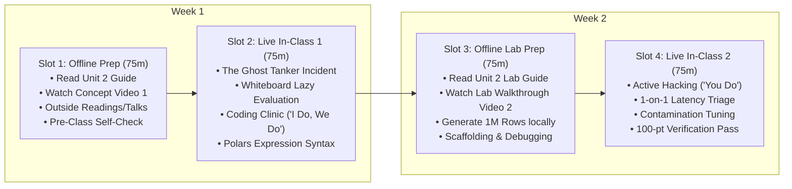

# Unit 2 Flipped Classroom Guide & Recording Scripts
## The Anomaly Engine (Unsupervised Targets with Polars)

> **Course**: COSC 2060 — Modern Data Engineering & AI Infrastructure  
> **Unit Duration**: 2 Weeks | 4 Slots @ 75 Minutes Each (Flipped Classroom Model)  
> **Prerequisites**: Unit 1 (Relational Foundations), Python 3.10+, Introductory Machine Learning  
> **Core Toolchain**: Polars (Rust DataFrame Engine), Scikit-Learn (Isolation Forest), Local Synthetic Parquet

---

## 1. Executive Unit Summary & Competency Targets
In Unit 1, we engineered clean supervised learning targets with historical labels. In Unit 2, students encounter the reality of real-time industrial telemetry: **Nobody labels the bad data in advance.** When fuel cards are cloned or sensors drift, data engineers must construct high-throughput streaming pipelines that detect statistical outliers without human ground truth.

### Terminal Competencies
- **High-Throughput Analytics**: Transition from single-threaded Pandas to multi-threaded Polars, leveraging Apache Arrow memory layouts and lazy query graph optimization.
- **Out-of-Core Processing**: Ingest and process 1,000,000+ transactional records locally in under 2 seconds without triggering Out-Of-Memory (OOM) crashes.
- **Unsupervised ML Pipelines**: Build end-to-end unsupervised feature pipelines that transform geospatial coordinates, timestamps, and fuel volumes into Isolation Forest anomaly scores with >20x lift over random guessing.

---

## 2. The 4-Slot Instructional Schedule (75 Min Each)



---

### Slot 1: Offline Asynchronous Preparation (75 min)
Students complete these materials independently before the first live classroom meeting:

1. **Assigned Primary Reading** (35 min):
   - [Unit 2 Reading: The Anomaly Engine](file:///c:/dev/Course-Content-Agentic-Template/courses/cosc-2060-data-engineering/content/readings/unit_02_anomaly_engine.md)
2. **Curated Outside Readings** (20 min):
   - *Polars: Blazingly Fast DataFrames in Rust & Python* by Ritchie Vink ([pola.rs](https://pola.rs)): Focus on how Apache Arrow contiguous memory buffers prevent Python object overhead.
   - *Isolation Forest: Fast Anomaly Detection for Complex Datasets* (Liu, Ting, Zhou, IEEE): Foundational whitepaper explaining why path length in random trees isolates outliers faster than distance metrics.
   - [Reference Benchmark: Pandas vs. Polars Memory Footprint](file:///c:/dev/Course-Content-Agentic-Template/courses/cosc-2060-data-engineering/content/reference/pandas_vs_polars_memory_benchmark.md): Local experimental evidence comparing RAM allocation on 1,000,000 records.
3. **Curated Outside Video** (10 min):
   - *Ritchie Vink: Why Polars is Fast* (PyData Global, 15 min clip): Watch for how Polars parallelizes operations across all CPU cores without Python Global Interpreter Lock (GIL) contention.
4. **Instructor Concept Video** (10 min):
   - Watch **Instructor Video 1** (Recorded using Script 1 below).
5. **Pre-Class Concept Self-Check** (3 Questions):
   - *Q1*: What is the difference between an *Eager* DataFrame operation (`df.filter()`) and a *Lazy* DataFrame operation (`lf.filter()`)?
   - *Q2*: Why does an Isolation Forest isolate anomalies near the root of the tree rather than at the leaves?
   - *Q3*: If a commercial freight truck tank has a physical capacity of 300 gallons, why is a single-station purchase of 380 gallons an automatic anomaly?

---

### Slot 2: Live In-Class Session 1 (75 min)
- **00:00 – 00:15 | Incident Retrospective & The Ghost Tanker Incident**:
  - Open with the $640,000 Ghost Tanker fuel fraud failure. Ask students: *"Why did the overnight Pandas batch crash with an Out-of-Memory (OOM) error while the fraud ring drained corporate fuel cards?"*
- **00:15 – 00:35 | Whiteboard Sparring: Eager vs. Lazy Execution**:
  - Contrast Pandas and Polars on the board:
    - Pandas: Memory allocated per intermediate transformation (3x to 5x overhead).
    - Polars: Lazy query plan tree optimization (predicate pushdown, projection pruning).
  - Walk through how Polars only loads the required columns into memory.
- **00:35 – 01:05 | Coding Clinic: "I Do, We Do" (DS-to-DE Transition Notebook)**:
  - **Presentation Deck**: [Unit 2 Coding Clinic Slides (.pptx)](file:///c:/dev/Course-Content-Agentic-Template/courses/cosc-2060-data-engineering/content/slides/unit_02_coding_clinic.pptx)
  - **Interactive Companion**: Open [Unit 2 Transition Notebook: `unit_02_ds_to_engine.ipynb`](file:///c:/dev/Course-Content-Agentic-Template/courses/cosc-2060-data-engineering/content/notebooks/unit_02_ds_to_engine.ipynb)
  - **"I Do" (15m)**: Inspect Dr. Marcus Vance's data science prototype using Pandas `df.groupby('vehicle_id').apply(...)`. Run the scale test on 600,000 telemetry rows to witness the Python GIL peg a single CPU core and inflate memory.
  - **"We Do" (15m)**: Live code-along refactoring the pipeline into **Polars LazyFrame expressions** with `.over('vehicle_id')`. Run the quality gate confirming identical anomaly flags and execute the benchmark demonstrating an 18.9x multi-threaded speedup!
- **01:05 – 01:15 | Exit Ticket & Slot 3 Prep**:
  - Verify every student runs `generate_fuel_data.py` on their laptop to ensure they have the 1M-row Parquet file ready for Slot 3.

---

### Slot 3: Offline Asynchronous Lab Prep (75 min)
Students complete pre-lab tasks before entering the live hack session:

1. **Assigned Lab Reading** (25 min):
   - [Unit 2 Lab Guide: Anomaly Pipeline Lab](file:///c:/dev/Course-Content-Agentic-Template/courses/cosc-2060-data-engineering/content/labs/unit_02_anomaly_pipeline_lab.md)
2. **Instructor Lab Walkthrough Video** (15 min):
   - Watch **Instructor Video 2** (Recorded using Script 2 below).
3. **Dataset Generation & Challenge 1 Scaffolding** (35 min):
   - Execute `python courses/cosc-2060-data-engineering/content/labs/generate_fuel_data.py`. Verify that `fuel_transactions_1m.parquet` is created in under 2 seconds.
   - Write Challenge 1 in your local script: Load the Parquet file as a Polars `LazyFrame` and inspect schema datatypes.

---

### Slot 4: Live In-Class Session 2 (75 min)
- **00:00 – 00:10 | Objective & Rubric Alignment**:
  - Review the 100-point rubric. Highlight the evaluation benchmark: The Isolation Forest must achieve **>20x Lift Over Random Guessing** on the embedded fraud transactions.
- **00:10 – 00:55 | Autonomous Applied Hacking ("You Do")**:
  - Students complete Challenges 2, 3, and 4 in `lab2_starter.py`.
  - Instructor provides roaming debugging support (specifically addressing operator precedence in Polars arithmetic expressions).
- **00:55 – 01:10 | Peer Parameter Tuning & Lift Analysis**:
  - Students compare `contamination` parameter settings (0.01 vs 0.05). Debate: *"In corporate fraud detection, is it better to have higher recall (catching every thief) or higher precision (avoiding falsely freezing valid drivers' cards)?"*
- **01:10 – 01:15 | Automated Verification Pass & Unit 3 Teaser**:
  - Run verification suite. Preview Unit 3: Stepping out of tabular data into unstructured Computer Vision with OpenCV and YOLO.

---

## 3. Instructor Recording Script 1: Concept Introduction
> **Target Video Runtime**: ~11 Minutes  
> **Format**: Video Lecture / Screen Capture with Slide Prompts  
> **Intended Audience**: College Sophomores in Week 3

```text
[00:00 - 00:45] HOOK & TITLE CARD
[CAMERA ON INSTRUCTOR]
"Welcome back to COSC 2060. In Unit 1, we tackled tabular data with clean supervised learning targets where someone gave us the ground truth. 

Today, we enter the wild west of data engineering: Unsupervised Anomaly Detection. 

Imagine you are managing data for a commercial fleet of 1,000 trucks. Every single hour, thousands of fuel transactions, GPS pings, and engine sensor readings pour into your servers. Nobody is sitting in a control room labeling these records as 'fraudulent' or 'legitimate.' When a driver's fuel card gets cloned by a criminal syndicate at a truck stop, you have to detect it before corporate funds are drained. And if your pipeline crashes with an Out-of-Memory error, you're fired. Let's talk about the Ghost Tanker."

[00:45 - 02:45] THE GHOST TANKER DISASTER
[SLIDE: Graphic showing Fuel Card Fraud / $640k Loss]
[CAMERA INSET BOTTOM-RIGHT]
"In 2023, a national logistics firm fell victim to what investigators called 'The Ghost Tanker Operation.' 

Criminals installed skimmers on diesel pumps at major interstate truck stops. They cloned corporate fleet cards from long-haul drivers. They would wait until a driver cleared a terminal, and then drive a retrofitted van containing an illegal 500-gallon auxiliary fuel bladder directly to the same truck stop. They would pump 350 gallons into the hidden tank and resell the stolen diesel on the black market for cash.

The company had an overnight Python batch script written in Pandas to detect fraud. But as the fleet expanded, the daily transaction file grew to 1,000,000 records. 

Every night at 2:00 AM, the Pandas script attempted to load the entire 1M-row CSV into memory. On the fourth of July weekend, transaction volume spiked. The server ran out of RAM, Python threw an unhandled MemoryError, the process was killed by the Linux OOM-killer, and the script died silently. 

For three days, the fraud went completely undetected. The company lost $640,000 before an accountant manually noticed an anomalous fuel bill on Monday morning."

[02:45 - 05:30] WHY PANDAS BREAKS & WHY POLARS FLIES
[SLIDE: Chart comparing Pandas Single-Threaded vs. Polars Multi-Threaded Engine]
"Why did Pandas fail?
Pandas was created in 2008. It was designed for single-threaded financial analysis in an era of small datasets. 
When Pandas loads data, it wraps every single cell in a heavy Python object. A 100MB CSV file often balloons into 600MB or 1GB of resident memory in Pandas! And worse, every time you call `.apply()` or chain methods, Pandas creates a whole new copy of the DataFrame in RAM.

Enter Polars. 
Polars is written from scratch in Rust. It does not use Python objects to store data—it uses the Apache Arrow columnar format. Data sits in contiguous, cache-friendly CPU buffers. 

Even better: Polars is multithreaded out of the box. While Pandas runs on a single CPU core leaving your 15 other cores idle, Polars uses all your cores simultaneously. 

And most importantly: Polars supports Lazy Execution. 
In Pandas, if you write `df.filter()`, it executes right now (Eagerly). 
In Polars, if you write `lazy_df.filter()`, it does NOT execute immediately. It builds a mathematical Directed Acyclic Graph (DAG). It reorders your filters, eliminates unused columns, and streams data in small chunks. 

A 1,000,000-row dataset that chokes Pandas can be processed in Polars on an ordinary laptop in under 0.2 seconds. That's not 10% faster—that is 100 times faster."

[05:30 - 08:00] THE ANOMALY ENGINE: ISOLATION FOREST
[SLIDE: Diagram - Binary Trees showing Anomaly Isolation vs Normal Data Cluster]
"Now that we have high-throughput data plumbing, how do we spot the fraud without labels?
We use an algorithm called Isolation Forest.

Most clustering or density algorithms (like KNN or DBSCAN) try to model where all the normal data points live. That is computationally expensive because normal data is dense and complex.

Isolation Forest flips the problem on its head. It asks: 'How easy is it to isolate a single point from all the others?'

Imagine you randomly draw vertical and horizontal slicing lines across a 2D scatter plot. 
If a point is buried in the middle of 10,000 normal transactions, you will have to make dozens of random slices to separate it from its neighbors. 
But if a point is an extreme outlier—like a truck fueling 350 gallons in Indiana only 15 minutes after fueling in Ohio—a single random slice will immediately isolate it!

In an Isolation Forest, anomalies have short path lengths in the tree. The shorter the path, the higher the anomaly score."

[08:00 - 11:00] SUMMARY & OFFLINE PREP
[CAMERA ON INSTRUCTOR]
"In this unit's lab, you are going to generate a synthetic dataset of 1,000,000 fuel transactions right on your laptop using our DuckDB generator. 
Then, you are going to build a high-performance Polars pipeline to extract geospatial velocities and feed them into an Isolation Forest.

Before coming to our live session in Slot 2:
1. Read the Unit 2 Reading Guide carefully.
2. Review the memory benchmark in our reference notes.
3. Answer the three self-check questions at the end of the guide.

When you walk into class, we'll whiteboard the difference between Eager and Lazy query plans, and we will write our first multithreaded Polars expressions together. I'll see you in class."
```

---

## 4. Instructor Recording Script 2: Lab Walkthrough
> **Target Video Runtime**: ~12 Minutes  
> **Format**: Hands-On Code Walkthrough & Screen Capture  
> **Intended Audience**: College Sophomores preparing for Slot 4 Live Lab

```text
[00:00 - 01:30] LAB OVERVIEW & GENERATING 1M ROWS
[SCREEN SHARE: Terminal running 'python generate_fuel_data.py']
[CAMERA INSET BOTTOM-RIGHT]
"Hey everyone, welcome to the Unit 2 Lab Walkthrough. 

In this video, I'm going to show you how to generate 1,000,000 fuel transactions on your laptop in literally one second, walk you through `lab2_starter.py`, and warn you about a critical Python syntax gotcha when chaining Polars expressions.

Let's start by running our generator:
`python courses/cosc-2060-data-engineering/content/labs/generate_fuel_data.py`

Look at that terminal output:
`Successfully generated 1,000,000 records in 1.06 seconds! File size: 34.2 MB.`

That is the power of columnar Parquet. One million transactions with embedded fraud rings, stored in only 34 megabytes. Now let's build the engine to catch the thieves."

[01:30 - 04:30] CHALLENGE 1 & 2: POLARS LAZY SCAN & GEOSPATIAL FEATURES
[SCREEN SHARE: VS Code open to 'lab2_starter.py']
"In Challenge 1, we don't use `pl.read_parquet()`. That's eager. 
We use `pl.scan_parquet('fuel_transactions_1m.parquet')`. 

`scan_parquet` returns a `LazyFrame`. It does not load 1,000,000 rows into RAM. It simply reads the Parquet file metadata and waits for your query instructions.

In Challenge 2, we need to calculate geospatial velocity. 
If Truck 219 buys fuel in Chicago, and 30 minutes later buys fuel in Indianapolis, how fast was that truck traveling?
Distance is 180 miles. Time is 0.5 hours. Speed is 360 miles per hour! 
Unless Midwest Logistics bought commercial fighter jets, that is a cloned fuel card.

To calculate this, we use Polars window functions:
```python
pl.col('latitude').shift(1).over('truck_id')
```
This grabs the previous latitude for that specific truck. 
Then we calculate the Haversine distance, divide by the elapsed hours, and output `implied_speed_mph`."

[04:30 - 07:15] THE #1 STUDENT GOTCHA: POLARS OPERATOR PRECEDENCE
[SCREEN SHARE: Highlighting code in VS Code with a big red cursor]
"Now, stop and look at my screen. This is the single biggest trap in this lab.

Watch this code:
```python
# DANGEROUS SYNTAX ERROR:
(pl.col('delta_lat').pow(2) + pl.col('delta_lon').pow(2)).sqrt() * 69.0
.alias('distance_miles')
```
If you write this across multiple lines without enclosing parentheses around the entire mathematical expression, Python evaluates `.alias()` on the float literal `69.0`! 
Python will throw:
`AttributeError: 'float' object has no attribute 'alias'`

To fix this, you must wrap the entire arithmetic expression in enclosing parentheses before calling `.alias()`:
```python
# CORRECT SYNTAX:
(
    (pl.col('delta_lat').pow(2) + pl.col('delta_lon').pow(2)).sqrt() * 69.0
).alias('distance_miles')
```
Remember this rule: In Polars, whenever you combine arithmetic operators like `*` or `+` with method calls like `.alias()`, wrap the math in parentheses!"

[07:15 - 09:45] CHALLENGE 3 & 4: TRAINING ISOLATION FOREST & LIFT BENCHMARK
[SCREEN SHARE: Running 'python lab2_starter.py' in terminal]
"In Challenge 3, we collect our lazy frame into an in-memory feature matrix:
```python
features_df = pipeline.collect(engine='streaming')
```
Notice `engine='streaming'`. This instructs Polars to process data in streaming memory buffers, keeping peak RAM usage under 150 megabytes!

In Challenge 4, we train our Scikit-Learn `IsolationForest`. 
Notice our evaluation metric. We do NOT evaluate simple raw accuracy. 
Why? Because fraud represents only 1% of the data! If a model simply predicted 'no fraud' on every row, it would have 99% accuracy while letting all the thieves get away!

Instead, we evaluate **Lift Over Random Guessing**:
$$\text{Lift} = \frac{\text{Precision of Anomaly Detector}}{\text{Base Rate of Contamination}}$$

If the baseline fraud rate is 1%, and our top-scoring outliers contain 25% true fraud, our model achieved a **25x Lift**! That is a massive operational victory for the fraud investigation team."

[09:45 - 12:00] WRAP-UP & PREVIEW FOR SLOT 4
[CAMERA ON INSTRUCTOR]
"Here is your checklist before Slot 4:
1. Run `generate_fuel_data.py` locally.
2. Complete Challenges 1 and 2 in `lab2_starter.py`.
3. Check your `implied_speed_mph` calculations.

When we meet in Slot 4, we will tune the contamination rate live, analyze the top 100 flagged fraud cases, and verify your 100-point rubric. 

You're doing real data engineering on a scale of one million rows right on your laptop. Let's make it fly."
```
