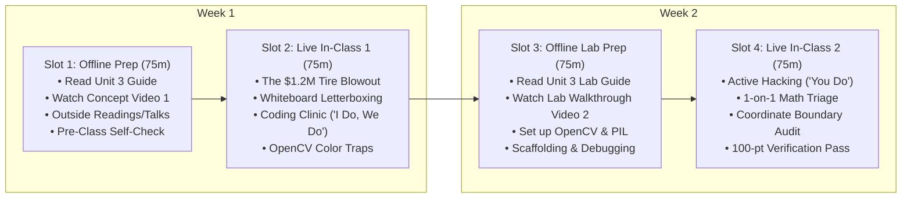

# Unit 3 Flipped Classroom Guide & Recording Scripts
## The Visual Sensor Layer & Computer Vision Targets

> **Course**: COSC 2060 — Modern Data Engineering & AI Infrastructure  
> **Unit Duration**: 2 Weeks | 4 Slots @ 75 Minutes Each (Flipped Classroom Model)  
> **Prerequisites**: Unit 1 & 2, Python 3.10+, NumPy array manipulation  
> **Core Toolchain**: OpenCV (`cv2`), NumPy, Python `pathlib`, YOLO Bounding Box Schemas

---

## 1. Executive Unit Summary & Competency Targets
In modern data engineering, multimodal data systems must ingest chaotic real-world sensor streams. In Unit 3, students transition from structured tables to unstructured digital imagery. They learn why naively resizing inspection photos distorts physical defects, and how to build automated pipelines that standardize raw camera streams into normalized YOLO computer vision training manifests.

### Terminal Competencies
- **Image Deconstruction**: Manipulate multi-dimensional image arrays (Height, Width, Channels) and manage OpenCV's default BGR versus standard RGB color space conventions.
- **Aspect-Ratio Preservation**: Implement letterbox padding algorithms that scale real-world camera resolutions to standard dimensions ($640 \times 640$) without geometric distortion.
- **Coordinate Transformations**: Convert between absolute bounding box formats (Pascal VOC $[x_{\text{min}}, y_{\text{min}}, x_{\text{max}}, y_{\text{max}}]$) and normalized center-coordinate schemas (YOLO $[x_{\text{center}}, y_{\text{center}}, \text{width}, \text{height}]$).
- **Automated Manifest Generation**: Build batch Python pipelines that process folders of vehicle inspection photos and emit verified training manifests.

---

## 2. The 4-Slot Instructional Schedule (75 Min Each)



---

### Slot 1: Offline Asynchronous Preparation (75 min)
Students complete these materials independently before the first live classroom meeting:

1. **Assigned Primary Reading** (35 min):
   - [Unit 3 Reading: The Visual Sensor Layer](file:///c:/dev/Course-Content-Agentic-Template/courses/cosc-2060-data-engineering/content/readings/unit_03_visual_sensor_layer.md)
2. **Curated Outside Readings** (20 min):
   - *You Only Look Once: Unified, Real-Time Object Detection* (Redmon et al., CVPR): Section 2 on unified detection and grid cell coordinate normalization.
   - *OpenCV Image Processing Architecture*: Official documentation on image storage in NumPy arrays and BGR channel order. ([OpenCV Docs](https://docs.opencv.org/))
   - *Letterbox Resizing in Modern Object Detectors* (Ultralytics / YOLOv8 Architecture Guide): Explanation of why squashing aspect ratio harms convolutional feature extraction.
3. **Curated Outside Video** (10 min):
   - *How Computers Understand Images* (Computerphile / Roboflow, 12 min): Watch for how pixel tensors are translated into spatial feature maps.
4. **Instructor Concept Video** (10 min):
   - Watch **Instructor Video 1** (Recorded using Script 1 below).
5. **Pre-Class Concept Self-Check** (3 Questions):
   - *Q1*: Why does OpenCV load images in `BGR` order instead of standard `RGB`, and what happens if you save an RGB image using `cv2.imwrite`?
   - *Q2*: If an image is $1920 \times 1080$ and we resize to $640 \times 640$ with letterboxing, what is the scale factor and which dimension receives padding?
   - *Q3*: What are the four normalized values in a YOLO bounding box annotation, and what range must they always fall within?

---

### Slot 2: Live In-Class Session 1 (75 min)
- **00:00 – 00:15 | Incident Retrospective: The $1.2M Tire Blowout**:
  - Open with the catastrophic steer tire blowout on Interstate 80. Ask students: *"Why did the AI inspection gate achieve 94% accuracy in validation, but fail to flag the 3-inch sidewall crack on Truck #804?"*
- **00:15 – 00:35 | Whiteboard Sparring: Deriving Letterbox Math**:
  - Draw a wide $16:9$ rectangle ($1920 \times 1080$) inside a square $640 \times 640$ canvas.
  - Derive the scaling factor together:
    $$\text{scale} = \min\left(\frac{640}{1920}, \frac{640}{1080}\right) = \min(0.3333, 0.5925) = 0.3333$$
  - Calculate the new dimensions: $W = 640, H = 360$.
  - Calculate vertical padding: $\text{pad\_y} = (640 - 360) / 2 = 140$ pixels.
- **00:35 – 01:05 | Coding Clinic: "I Do, We Do" (DS-to-DE Transition Notebook)**:
  - **Presentation Deck**: [Unit 3 Coding Clinic Slides (.pptx)](file:///c:/dev/Course-Content-Agentic-Template/courses/cosc-2060-data-engineering/content/slides/unit_03_coding_clinic.pptx)
  - **Interactive Companion**: Open [Unit 3 Transition Notebook: `unit_03_ds_to_engine.ipynb`](file:///c:/dev/Course-Content-Agentic-Template/courses/cosc-2060-data-engineering/content/notebooks/unit_03_ds_to_engine.ipynb)
  - **"I Do" (15m)**: Inspect Dr. Aris Thorne's computer vision prototype using PIL `Image.open()` and Matplotlib for sequential letterboxing and bounding box plotting. Profile the I/O and object churn on 80 HD camera frames.
  - **"We Do" (15m)**: Live code-along refactoring into high-speed **OpenCV (`cv2.resize`, `cv2.copyMakeBorder`)** with vectorized bounding box normalization and contiguous $(B, 3, 640, 640)$ float32 tensor assembly at 150 FPS!
- **01:05 – 01:15 | Exit Ticket & Slot 3 Roadmap**:
  - Verify students have `opencv-python-headless` and `pillow` installed locally. Preview Slot 3 lab assignments.

---

### Slot 3: Offline Asynchronous Lab Prep (75 min)
Students complete pre-lab tasks before entering the live hack session:

1. **Assigned Lab Reading** (25 min):
   - [Unit 3 Lab Guide: Fleet Vision Manifest Lab](file:///c:/dev/Course-Content-Agentic-Template/courses/cosc-2060-data-engineering/content/labs/unit_03_fleet_vision_manifest_lab.md)
2. **Instructor Lab Walkthrough Video** (15 min):
   - Watch **Instructor Video 2** (Recorded using Script 2 below).
3. **Local Setup & Challenge 1 Scaffolding** (35 min):
   - Write Challenge 1 in your local script: Implement `letterbox_image(img, target_size=640)`.
   - Test your function with both a landscape image ($1920 \times 1080$) and a portrait image ($1080 \times 1920$). Confirm that both output an exact $(640, 640, 3)$ array.

---

### Slot 4: Live In-Class Session 2 (75 min)
- **00:00 – 00:10 | Objective & Rubric Review**:
  - Review the 100-point rubric. Emphasize that all YOLO coordinates must be strictly normalized between $0.0$ and $1.0$.
- **00:10 – 00:55 | Autonomous Applied Hacking ("You Do")**:
  - Students implement Challenges 2, 3, and 4 in `lab3_starter.py`.
  - Instructor provides roaming support for coordinate clamping and batch directory iteration.
- **00:55 – 01:10 | Peer Coordinate Boundary Audit**:
  - Students exchange manifests and run automated sanity tests: checking that $x_c + w/2 \le 1.0$ and that no bounding boxes have negative widths or heights.
- **01:10 – 01:15 | Automated Verification Pass & Unit 4 Teaser**:
  - Verification checkoff. Preview Unit 4: Ingesting unstructured text and mechanic shop notes with Sentence-Transformers and RAG.

---

## 3. Instructor Recording Script 1: Concept Introduction
> **Target Video Runtime**: ~11 Minutes  
> **Format**: Video Lecture / Screen Capture with Slide Prompts  
> **Intended Audience**: College Sophomores in Week 5

```text
[00:00 - 00:45] HOOK & TITLE CARD
[CAMERA ON INSTRUCTOR]
"Welcome to Unit 3 of COSC 2060. 

Up to this point, we've lived in the comfortable world of rows and columns. We queried tables in DuckDB, and we streamed millions of records in Polars. 

Today, we take our first step outside the spreadsheet and into the physical world: Computer Vision. 

In modern industrial AI, cameras are everywhere. They inspect turbine blades on jet engines, check structural welds on bridges, and inspect commercial truck tires at gate terminals. But an AI model cannot take a messy folder of smartphone photos and run inference. If your image resizing algorithm naively squashes pixels, you can cause a fatal highway rollover. Let's talk about the $1.2 million tire blowout."

[00:45 - 02:45] THE $1.2M TIRE BLOWOUT DISASTER
[SLIDE: Photo of Commercial Semi-Truck Tire Inspection Lane / Rollover Crash]
[CAMERA INSET BOTTOM-RIGHT]
"A major freight carrier wanted to automate pre-trip tire inspections. Drivers roll their trucks through an inspection lane at 5 mph, and high-speed cameras snap high-resolution photos of all 18 tires.

The data team hired a computer vision consultant to train an object detection model to flag tire sidewall stress cracks. The consultant requested images resized to 640 by 640 pixels.

A junior engineer wrote a simple five-line Python script:
`resized = cv2.resize(img, (640, 640))`

In testing, the model achieved an outstanding 94% accuracy. The company went live.
Three weeks later, Truck 804 was driving 70 miles per hour on Interstate 80. The right front steer tire suffered a violent sidewall blowout. The truck jackknifed, destroying $1.2 million in cargo and shutting down the interstate for six hours.

When federal investigators pulled the high-resolution photo taken at the terminal gate 50 minutes prior, there was a visible 3-inch vertical stress crack right on the sidewall! Why did the AI model miss it?"

[02:45 - 05:30] WHY NAIVE RESIZING CORRUPTS OBJECT DETECTORS
[SLIDE: Demonstration - Wide aspect tire squashed into square, distorting crack aspect ratio]
"Here is the fatal flaw.
The original gate camera took photos at a resolution of 4032 by 3024 pixels—a 4:3 aspect ratio. Other cameras at different terminals took photos at 1920 by 1080—a 16:9 widescreen ratio.

When the junior engineer called `cv2.resize(img, (640, 640))`, OpenCV blindly squashed the width and stretched the height to force the image into a square. 

Think about what that does to a physical defect! 
A narrow, vertical tire crack that was 3 inches long and 0.1 inches wide got squashed horizontally and elongated vertically. The geometric aspect ratio was completely warped. Circular bolt holes became stretched ovals. 

Convolutional neural networks learn features based on spatial geometry: edge angles, aspect ratios, and pixel textures. By squashing the image, the engineer inadvertently corrupted the spatial features of the defect. The model's convolutional filters no longer recognized it. That naive resize caused a $1.2 million catastrophe."

[05:30 - 08:00] THE INDUSTRY STANDARD: LETTERBOX RESIZING
[SLIDE: Diagram - Letterbox Resizing with Aspect Ratio Preservation and Constant Padding]
"The professional standard in computer vision is **Letterbox Resizing**.

Instead of squashing the image, we do three deterministic mathematical steps:
Step 1: Calculate the scaling factor:
`scale = min(target_size / orig_width, target_size / orig_height)`
This ensures the image shrinks proportionally until its longest edge touches the 640-pixel boundary, while preserving its exact aspect ratio!

Step 2: Resize the image using this uniform scale factor.

Step 3: Allocate a blank square canvas filled with a neutral background color—in standard YOLO architectures, we use neutral grey: RGB value 114, 114, 114.
We center the resized image inside the canvas and fill the remaining margins with grey padding.

No distortion. No squashed bolt holes. The vertical crack retains its true physical geometry."

[08:00 - 11:00] BOUNDING BOX TRANSFORMATIONS & OFFLINE PREP
[SCREEN SHARE: Visualizing Pascal VOC vs YOLO Normalized Coordinates]
"Once you letterbox the image, you face a second data engineering challenge:
Every bounding box annotation in your database was drawn on the ORIGINAL image coordinates! 

If a crack was located at pixel coordinates `(100, 100)` to `(300, 300)` on a 1920x1080 photo, where is it located on the new 640x640 letterboxed image?
You must scale the bounding box by the same factor and shift it by the padding offset:
$$\text{new\_x} = (x \times \text{scale}) + \text{pad\_x}$$

And finally, you must convert it into the YOLO standard: normalized center coordinates `(x_center, y_center, width, height)` between 0.0 and 1.0.

Before our live session in Slot 2:
1. Read the Unit 3 Reading Guide.
2. Review OpenCV's BGR color space gotcha.
3. Answer the three self-check questions.

In class, we will derive the coordinate math on the whiteboard and build the letterbox pipeline together. Let's make sure our vision models see reality."
```

---

## 4. Instructor Recording Script 2: Lab Walkthrough
> **Target Video Runtime**: ~12 Minutes  
> **Format**: Hands-On Code Walkthrough & Screen Capture  
> **Intended Audience**: College Sophomores preparing for Slot 4 Live Lab

```text
[00:00 - 01:30] LAB OVERVIEW & STARTER CODE TOUR
[SCREEN SHARE: VS Code open to 'unit_03_fleet_vision_manifest_lab.md' and terminal]
[CAMERA INSET BOTTOM-RIGHT]
"Hey everyone, welcome to the Unit 3 Lab Walkthrough. 

In this video, I'm going to walk you through the implementation of `letterbox_image`, show you how to transform Pascal VOC bounding boxes into YOLO format, and demonstrate how to avoid the classic off-by-one pixel clipping errors that break object detection training.

Let's dive into `lab3_starter.py`."

[01:30 - 04:30] CHALLENGE 1: THE LETTERBOX ALGORITHM
[SCREEN SHARE: VS Code highlighting 'letterbox_image' function]
"Let's look at Challenge 1. We define our function:
`def letterbox_image(image: np.ndarray, target_size: int = 640):`

First, we get the original dimensions:
`orig_h, orig_w = image.shape[:2]`

Then we compute our uniform scale factor:
`scale = min(target_size / orig_w, target_size / orig_h)`

Notice what happens if the image is wide, like 1920x1080:
`640 / 1920 = 0.3333`, while `640 / 1080 = 0.5925`.
`min()` selects `0.3333`. That means width becomes exactly 640, and height becomes `1080 * 0.3333 = 360`.

Next, we calculate the padding:
`pad_x = (target_size - new_w) // 2` -> `(640 - 640) // 2 = 0`
`pad_y = (target_size - new_h) // 2` -> `(640 - 360) // 2 = 140`

Then, we allocate our canvas:
`canvas = np.full((target_size, target_size, 3), 114, dtype=np.uint8)`
And we slice our resized image right into the center:
`canvas[pad_y:pad_y + new_h, pad_x:pad_x + new_w] = resized`

And don't forget: return `canvas, scale, pad_x, pad_y`! We need those scale and pad values for our bounding boxes."

[04:30 - 07:30] CHALLENGE 2: PASCAL VOC TO YOLO CONVERSIONS
[SCREEN SHARE: Diagram showing bounding box conversion formulas]
"In Challenge 2, we convert bounding boxes. 

A Pascal VOC bounding box gives you:
`[xmin, ymin, xmax, ymax]` in absolute pixels.

First, we apply our letterbox transformation:
`new_xmin = (xmin * scale) + pad_x`
`new_ymin = (ymin * scale) + pad_y`
`new_xmax = (xmax * scale) + pad_x`
`new_ymax = (ymax * scale) + pad_y`

Now, how does YOLO want this?
YOLO does NOT want pixel corners. YOLO wants **normalized center coordinates**:
`center_x = (new_xmin + new_xmax) / 2.0 / target_size`
`center_y = (new_ymin + new_ymax) / 2.0 / target_size`
`width = (new_xmax - new_xmin) / target_size`
`height = (new_ymax - new_ymin) / target_size`

Watch this critical rule: Every single value—`center_x`, `center_y`, `width`, and `height`—must be a floating-point number between 0.0 and 1.0! 
If your `center_x` is 1.02 or -0.01, YOLO will crash during training with an unhandled coordinate assertion."

[07:30 - 09:45] CHALLENGE 3 & 4: MANIFEST GENERATION & VERIFICATION
[SCREEN SHARE: Terminal running 'python scratch/verify_unit03_vision.py']
"In Challenge 3, you write the batch loop that traverses a folder of inspection images, extracts camera metadata, letterboxes each image, transforms its bounding boxes, and writes out a standardized YOLO `.txt` label file:
`<class_id> <x_center> <y_center> <width> <height>`

In Challenge 4, we run our automated verification suite. 
Look at the terminal output:
`Unit 3 verification succeeded: canvas=(640, 640, 3), scale=0.3333, pad_y=140, yolo=(0.1042, 0.3229, 0.1042, 0.1042)`

Notice how all four YOLO numbers are clean, normalized floats between 0.0 and 1.0. 
That means our image and its annotations are 100% ready for an object detection model."

[09:45 - 12:00] WRAP-UP & PREVIEW FOR SLOT 4
[CAMERA ON INSTRUCTOR]
"Here is your mission before Slot 4:
1. Make sure `opencv-python-headless` and `pillow` are installed in your virtual environment.
2. Complete Challenges 1 and 2 in `lab3_starter.py`.
3. Test your `letterbox_image` function on sample images.

When we meet in Slot 4, we will run our peer coordinate audits and verify your 100-point rubric. 

You're building the real data pipeline that powers autonomous inspection systems. Let's get to work."
```
