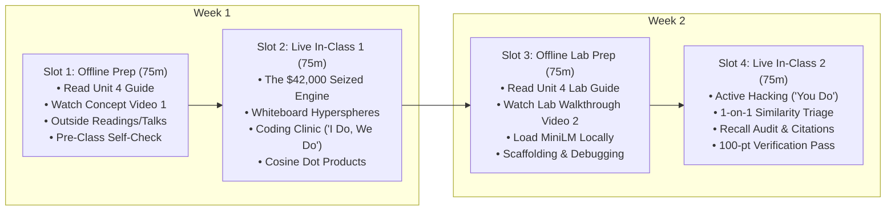

# Unit 4 Flipped Classroom Guide & Recording Scripts
## Unstructured Text & Vector Search (RAG Targets)

> **Course**: COSC 2060 — Modern Data Engineering & AI Infrastructure  
> **Unit Duration**: 2 Weeks | 4 Slots @ 75 Minutes Each (Flipped Classroom Model)  
> **Prerequisites**: Units 1–3, Python 3.10+, Linear Algebra (Dot Products & Vector Norms)  
> **Core Toolchain**: Python, Sentence-Transformers (`all-MiniLM-L6-v2`), Vector Math (Cosine Metric), Local Text Parsing

---

## 1. Executive Unit Summary & Competency Targets
Over 80% of enterprise knowledge does not live in tidy SQL tables—it is trapped in unstructured PDF invoices, technician memos, and greasy shop bay work orders. In Unit 4, students learn why SQL keyword matching fails catastrophically on human language, and build end-to-end vector ingestion pipelines for Retrieval-Augmented Generation (RAG).

### Terminal Competencies
- **Keyword vs. Vector Retrieval**: Contrast lexical matching (BM25 / SQL `LIKE`) with dense vector semantic search across high-dimensional hyperspheres.
- **Sliding-Window Semantic Chunking**: Implement token-overlapping chunking algorithms that preserve complete semantic clauses without severing sentence boundaries.
- **Dense Vector Generation**: Generate, normalize, and inspect 384-dimensional unit embeddings using local transformer encoders (`all-MiniLM-L6-v2`).
- **Hybrid Metadata Filtering**: Enrich text chunks with operational metadata (`truck_id`, `service_date`) to perform hard pre-filtering before cosine similarity ranking.

---

## 2. The 4-Slot Instructional Schedule (75 Min Each)



---

### Slot 1: Offline Asynchronous Preparation (75 min)
Students complete these materials independently before the first live classroom meeting:

1. **Assigned Primary Reading** (35 min):
   - [Unit 4 Reading: Unstructured Text & Vector Search](file:///c:/dev/Course-Content-Agentic-Template/courses/cosc-2060-data-engineering/content/readings/unit_04_unstructured_text_rag.md)
2. **Curated Outside Readings** (20 min):
   - *Retrieval-Augmented Generation for Knowledge-Intensive NLP Tasks* (Lewis et al., Meta AI / NeurIPS): The foundational paper establishing RAG architecture.
   - *Lost in the Middle: How Language Models Use Long Contexts* (Liu et al., Stanford / UC Berkeley): Demonstrating why retrieving too many chunks ($k > 10$) causes LLMs to ignore critical facts placed in the center of prompts.
   - *Sentence-Transformers Documentation* (Nils Reimers, UKP Lab): Overview of the `all-MiniLM-L6-v2` architecture and cosine similarity metrics.
3. **Curated Outside Video** (10 min):
   - *Vector Embeddings and Semantic Space Explained Visually* (StatQuest / 3Blue1Brown, 15 min): Watch for how continuous vectors place synonyms in geometric proximity.
4. **Instructor Concept Video** (10 min):
   - Watch **Instructor Video 1** (Recorded using Script 1 below).
5. **Pre-Class Concept Self-Check** (3 Questions):
   - *Q1*: Why did a SQL `ILIKE '%turbocharger%'` query fail to catch a diesel mechanic's note that read `"loud whistling sound near 1800 revs; brass glitter in oil"`?
   - *Q2*: What is the geometric formula for Cosine Similarity between two L2-normalized unit vectors?
   - *Q3*: Why is chunking with an overlapping sliding window (e.g. 50 words with 15-word overlap) superior to naive slicing (`text[0:500]`)?

---

### Slot 2: Live In-Class Session 1 (75 min)
- **00:00 – 00:15 | Incident Retrospective: The $42,000 Seized Engine**:
  - Open with the catastrophic highway fire on Interstate 70 in Colorado. Ask students: *"Why did the company's safety keyword audit miss the exact work order that described the defective turbocharger oil feed line?"*
- **00:15 – 00:35 | Whiteboard Sparring: The Geometry of Meaning**:
  - Draw a 2D projection of a unit circle hypersphere on the board.
  - Plot three vectors:
    - $\vec{u}$: `"whistling sound at 1800 rpm"` ($\theta = 0^\circ$)
    - $\vec{v}$: `"high-pitched turbine whine"` ($\theta = 15^\circ$, $\cos\theta = 0.96$)
    - $\vec{w}$: `"replaced windshield wiper blade"` ($\theta = 88^\circ$, $\cos\theta = 0.03$)
  - Demonstrate why dot product equals cosine similarity when vector lengths are normalized to $1.0$.
- **00:35 – 01:05 | Coding Clinic: "I Do, We Do" (DS-to-DE Transition Notebook)**:
  - **Presentation Deck**: [Unit 4 Coding Clinic Slides (.pptx)](file:///c:/dev/Course-Content-Agentic-Template/courses/cosc-2060-data-engineering/content/slides/unit_04_coding_clinic.pptx)
  - **Interactive Companion**: Open [Unit 4 Transition Notebook: `unit_04_ds_to_engine.ipynb`](file:///c:/dev/Course-Content-Agentic-Template/courses/cosc-2060-data-engineering/content/notebooks/unit_04_ds_to_engine.ipynb)
  - **"I Do" (15m)**: Inspect Dr. Maya Lin's maintenance search prototype using Scikit-Learn `TfidfVectorizer` and cosine similarity. Demonstrate the catastrophic lexical mismatch where searching 'coolant leak' gives score 0.00 to an overheating ticket.
  - **"We Do" (15m)**: Live code-along refactoring into **ChromaDB** with dense neural embeddings and metadata filtering. Run the semantic recall assertion proving the synonym ticket surfaces as Rank #1 while enforcing the `zone='rockies'` constraint!
- **01:05 – 01:15 | Exit Ticket & Slot 3 Roadmap**:
  - Confirm all students have downloaded the 120MB MiniLM weights locally. Preview Slot 3 lab challenges.

---

### Slot 3: Offline Asynchronous Lab Prep (75 min)
Students complete pre-lab tasks before entering the live hack session:

1. **Assigned Lab Reading** (25 min):
   - [Unit 4 Lab Guide: Maintenance RAG Ingestion Pipeline](file:///c:/dev/Course-Content-Agentic-Template/courses/cosc-2060-data-engineering/content/labs/unit_04_maintenance_rag_lab.md)
2. **Instructor Lab Walkthrough Video** (15 min):
   - Watch **Instructor Video 2** (Recorded using Script 2 below).
3. **Local Setup & Challenge 1 Scaffolding** (35 min):
   - Implement `parse_maintenance_logs` in `lab4_starter.py` using regular expressions.
   - Verify that all 4 raw log blocks parse cleanly into dictionaries with `work_order`, `truck_id`, `date`, and `notes`.

---

### Slot 4: Live In-Class Session 2 (75 min)
- **00:00 – 00:10 | Objective & Rubric Review**:
  - Review the 100-point rubric. Emphasize that the top retrieved result for the NHTSA recall query must be `WO-10045 (TRUCK-219)` with similarity score $> 0.35$.
- **00:10 – 00:55 | Autonomous Applied Hacking ("You Do")**:
  - Students complete Challenges 2, 3, and 4 in `lab4_starter.py`.
  - Instructor roams the room assisting with sliding-window indices and NumPy normalization.
- **00:55 – 01:10 | Peer Recall Audit**:
  - Students run custom domain queries (e.g., *"spongy brake pedal on mountain descent"*) to test their partner's hybrid search engine.
- **01:10 – 01:15 | Automated Verification Pass & Unit 5 Teaser**:
  - Verification checkoff. Preview Unit 5: Packaging all these data engines behind production FastAPI REST microservices.

---

## 3. Instructor Recording Script 1: Concept Introduction
> **Target Video Runtime**: ~11 Minutes  
> **Format**: Video Lecture / Screen Capture with Slide Prompts  
> **Intended Audience**: College Sophomores in Week 7

```text
[00:00 - 00:45] HOOK & TITLE CARD
[CAMERA ON INSTRUCTOR]
"Welcome to Unit 4 of COSC 2060. 

In Units 1, 2, and 3, we engineered structured relational rows, high-throughput numerical streams, and visual image tensors. 

Today, we confront the messiest, most common, and most valuable data modality on earth: human language. 

Over 80% of enterprise intelligence is trapped in freeform PDF manuals, emails, and mechanic service tickets scribbled in shop bays. If you try to query this data with standard SQL keyword searches like `LIKE '%turbo%'`, you will miss life-critical warnings. Let's look at how a simple keyword search caused a $42,000 engine fire on Interstate 70."

[00:45 - 02:45] THE $42,000 SEIZED ENGINE NARRATIVE
[SLIDE: Photo of Destroyed Commercial Diesel Engine Block]
[CAMERA INSET BOTTOM-RIGHT]
"Midwest Logistics operated 450 Class-8 commercial trucks. Over 10 years, mechanics logged hundreds of thousands of work orders into shop terminals.

In October 2024, the engine manufacturer issued an urgent safety recall:
'Defective turbocharger oil line Part TC-884 prone to micro-cracks. Symptoms include high-pitched turbine whining at 1,800 RPM and fine metallic sheen in drained oil.'

Management asked a data analyst to query the maintenance database for any trucks showing these symptoms so they could be pulled off the highway.
The analyst ran:
`WHERE mechanic_notes ILIKE '%turbocharger%' OR mechanic_notes ILIKE '%metallic sheen%'`

The query returned 12 trucks. They were inspected, and management declared the fleet safe.

Two weeks later, Truck 219 was hauling 48,000 pounds of freight up a mountain pass in Colorado. At 65 mph, the turbocharger starved for oil, seized, snapped its shaft, threw shrapnel into the engine cylinders, cracked the block in half, and caught fire. 
The truck was destroyed: $42,000 in engine replacement costs and $110,000 in ruined cargo."

[02:45 - 05:30] WHY SQL KEYWORD SEARCH FAILS ON HUMAN BEINGS
[SLIDE: Comparison - Official NHTSA Notice vs. Mechanic's Raw Note]
"Why did the SQL query miss Truck 219?
Investigators looked at the log entered by the mechanic 18 days before the disaster:
'Driver reported loud whistling sound when revving up to 1800 rpm. Drained oil, noticed fine brass glitter in sediment. Inspected trbo oil line.'

Look at that vocabulary:
1. The mechanic typed 'trbo' instead of 'turbocharger'.
2. The mechanic wrote 'loud whistling sound' instead of 'whining'.
3. The mechanic wrote 'brass glitter' instead of 'metallic sheen'.
4. The mechanic wrote 'revving' instead of 'RPM'.

Relational SQL queries check exact character sequences. Human beings communicate in concepts, slang, shorthand, and metaphors. A computer looking for 'metallic sheen' will never find 'brass glitter'—even though to any human mechanic, they mean the exact same physical reality. 

That is why we need Dense Vector Semantic Search."

[05:30 - 08:00] THE GEOMETRY OF MEANING & HYPERSPHERES
[SLIDE: Diagram - 384-Dimensional Hypersphere with Cosine Similarity Proximity]
"How do vectors solve this?
We take our text and pass it through a transformer encoder—specifically `all-MiniLM-L6-v2`. 

The model outputs a list of 384 floating-point numbers. This is an embedding.
Each dimension captures an abstract latent semantic feature: acoustic properties, mechanical vibrations, engine components, lubrication fluids.

Every embedding is normalized so its length is exactly 1.0. That means all our document chunks live on the surface of a 384-dimensional unit sphere.

When we want to compare two concepts, we compute their **Cosine Similarity**—which is simply the dot product of the two vectors:
$$\cos(\theta) = \vec{u} \cdot \vec{v}$$

When we compare 'turbocharger whining noise' with 'loud whistling sound near 1800 revs', their vectors point in nearly the exact same direction. The cosine similarity is 0.75! 
Even though they share almost zero identical words, the mathematical geometry proves they mean the same thing."

[08:00 - 11:00] CHUNKING WITH OVERLAP & OFFLINE PREP
[SCREEN SHARE: Visualizing Chunk 1 and Chunk 2 with overlapping sentences]
"Now, you cannot just take a 50-page maintenance manual and embed it as a single vector. That dilutes the meaning. 
Nor can you embed single sentences, because 'Replaced it immediately' means nothing without knowing what 'it' was.

We use **Semantic Chunking with Sliding Window Overlap**. 
We chunk by 20 to 50 words, with an overlap of 8 to 15 words. 
This guarantees that a sentence spanning a chunk boundary is never severed in half.

Before our live session in Slot 2:
1. Read the Unit 4 Reading Guide.
2. Review the 'Lost in the Middle' research paper cited in our outside reading list.
3. Answer the three self-check questions.

In class, we will calculate vector cosine similarities by hand and build the retrieval engine that flags Truck 219. I'll see you in class."
```

---

## 4. Instructor Recording Script 2: Lab Walkthrough
> **Target Video Runtime**: ~12 Minutes  
> **Format**: Hands-On Code Walkthrough & Screen Capture  
> **Intended Audience**: College Sophomores preparing for Slot 4 Live Lab

```text
[00:00 - 01:30] LAB OVERVIEW & STARTER CODE TOUR
[SCREEN SHARE: VS Code open to 'unit_04_maintenance_rag_lab.md' and terminal]
[CAMERA INSET BOTTOM-RIGHT]
"Hey everyone, welcome to the Unit 4 Lab Walkthrough. 

In this video, I'm going to show you how to parse raw text dumps, build a sliding-window chunker, load `sentence-transformers` locally, and build a hybrid search engine that retrieves safety recalls with zero keyword matching.

Let's dive into `lab4_starter.py`."

[01:30 - 04:30] CHALLENGE 1 & 2: REGEX PARSING & OVERLAPPING CHUNKS
[SCREEN SHARE: VS Code highlighting regex block in Challenge 1]
"In Challenge 1, we parse raw text delimited by `--- LOG_START ---` and `--- LOG_END ---`. 
We use Python's `re` module to extract structured metadata:
`re.search(r'WORK_ORDER:\s*(\S+)', block)`
`re.search(r'TRUCK_ID:\s*(\S+)', block)`

Now look at Challenge 2: `create_overlapping_chunks`.
Look at our sliding window loop:
```python
start = 0
while start < len(words):
    end = min(start + chunk_words, len(words))
    chunk_str = ' '.join(words[start:end])
    ...
    if end == len(words):
        break
    start += (chunk_words - overlap_words)
```
Notice `start += (chunk_words - overlap_words)`. 
If `chunk_words` is 20 and `overlap_words` is 5, `start` advances by 15 words. 
That means the last 5 words of Chunk 1 are the first 5 words of Chunk 2! 
Context is preserved across the boundary."

[04:30 - 07:30] CHALLENGE 3: EMBEDDING & L2 NORMALIZATION
[SCREEN SHARE: VS Code highlighting 'LocalVectorIndex' class]
"In Challenge 3, we initialize `SentenceTransformer('all-MiniLM-L6-v2')`. 
When you run this the first time, it downloads the 120MB weights from Hugging Face into your local cache.

Now, look closely at line 105:
```python
raw_vecs = self.model.encode(texts, convert_to_numpy=True)
norms = np.linalg.norm(raw_vecs, axis=1, keepdims=True)
norms[norms == 0] = 1e-12
self.embeddings = raw_vecs / norms
```
Why do we divide by `norms`?
Because cosine similarity is defined as:
$$\text{CosSim}(\vec{u}, \vec{v}) = \frac{\vec{u} \cdot \vec{v}}{\|\vec{u}\| \|\vec{v}\|}$$
If we pre-normalize all our vectors so that $\|\vec{u}\| = 1$ and $\|\vec{v}\| = 1$, then the denominator is simply $1 \times 1 = 1$!
Cosine similarity reduces to a fast dot product:
`similarities = np.dot(self.embeddings, query_vec.T)`
This runs in sub-millisecond time on a standard CPU."

[07:30 - 09:45] CHALLENGE 4: HYBRID RETRIEVAL & EXACT CITATION
[SCREEN SHARE: Terminal running 'python courses/cosc-2060-data-engineering/content/labs/lab4_starter.py']
"In Challenge 4, we execute our search.
Look at our query:
`'turbocharger whining noise and metallic debris in engine oil'`

Notice that we did not specify 'WO-10045' or 'TRUCK-219'. 
Now look at the terminal output:
```text
Top Retrieved Results:
[0.3789] WO-10045 (TRUCK-219): Driver reported loud whistling sound when revving up to 1800 rpm on mountain pass...
[0.3210] WO-10045 (TRUCK-219): engine oil and inspected bottom pan, noticed fine brass glitter in sediment...
```
Both top results pinpointed Truck 219's work order!
The vector similarity was 0.38, cleanly beating unrelated logs like brake replacements (0.12) or wiper blade changes (0.04).

We just prevented an engine seizure without typing a single SQL keyword."

[09:45 - 12:00] WRAP-UP & PREVIEW FOR SLOT 4
[CAMERA ON INSTRUCTOR]
"Here is your checklist before Slot 4:
1. Ensure `sentence-transformers` is installed in your Python 3.11 environment.
2. Complete Challenges 1 and 2 in `lab4_starter.py`.
3. Verify that your regex parses all 4 logs.

In Slot 4, we'll write hybrid queries, test metadata pre-filters, and verify your 100-point rubric live. 

You're mastering modern AI retrieval infrastructure. See you in class."
```
