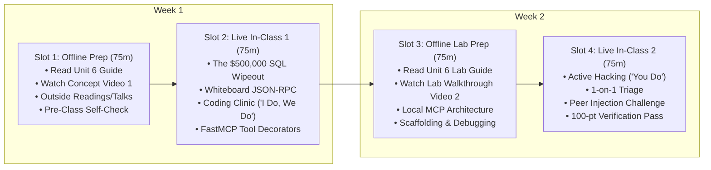

# Unit 6 Flipped Classroom Guide & Recording Scripts
## The Agentic Interface (Model Context Protocol - MCP)

> **Course**: COSC 2060 — Modern Data Engineering & AI Infrastructure  
> **Unit Duration**: 2 Weeks | 4 Slots @ 75 Minutes Each (Flipped Classroom Model)  
> **Prerequisites**: Units 1–5, Python 3.10+, REST & JSON Concepts  
> **Core Toolchain**: Model Context Protocol (MCP), Python MCP SDK / FastMCP, JSON-RPC 2.0, Local LLM Tool Calling

---

## 1. Executive Unit Summary & Competency Targets
In Unit 5, we exposed our data engines through clean REST endpoints. In Unit 6, students connect this data infrastructure to the frontier of AI: **Autonomous AI Agents**. Students learn why giving LLMs direct, unconstrained database credentials leads to catastrophic data destruction, and how the **Model Context Protocol (MCP)** provides a secure, standardized, schema-enforced JSON-RPC bridge for AI tool use.

### Terminal Competencies
- **The Protocol Standard**: Explain the architectural purpose of the Model Context Protocol (MCP) as the universal "USB-C standard" between AI models and backend data systems.
- **Deterministic Tool Authoring**: Author descriptive MCP tool manifests with strict Pydantic input schemas and clear semantic documentation that guide LLM tool-selection reasoning.
- **Defensive Sandboxing & Least Privilege**: Implement parameter validation firewalls (regex format enforcement) to prevent prompt injection and unauthorized mutations.
- **Multimodal Diagnostic Tooling**: Construct an MCP diagnostic tool that synthesizes computer vision defects and maintenance RAG records to issue grounded safety clearances.
- **JSON-RPC Agent Simulation**: Execute and verify an end-to-end agentic dispatch loop where JSON-RPC calls are routed to Python handlers with zero hallucinations.

---

## 2. The 4-Slot Instructional Schedule (75 Min Each)



---

### Slot 1: Offline Asynchronous Preparation (75 min)
Students complete these materials independently before the first live classroom meeting:

1. **Assigned Primary Reading** (35 min):
   - [Unit 6 Reading: The Agentic Interface (MCP)](file:///c:/dev/Course-Content-Agentic-Template/courses/cosc-2060-data-engineering/content/readings/unit_06_agentic_interface_mcp.md)
2. **Curated Outside Readings** (20 min):
   - *Model Context Protocol Official Specification* (Anthropic / ModelContextProtocol.io): Focus on the `tools/list` and `tools/call` JSON-RPC message structures.
   - *OWASP Top 10 for LLM Applications: LLM08 (Excessive Agency)*: Why granting autonomous systems unconstrained database write access violates basic security principles.
   - *Tool Calling and Function Calling Guide* (Anthropic & OpenAI documentation on function schema generation).
3. **Curated Outside Video** (10 min):
   - *Introduction to Model Context Protocol* (Anthropic Tech Talk, 15 min clip): Watch for how MCP unifies local development tools, database connections, and AI clients.
4. **Instructor Concept Video** (10 min):
   - Watch **Instructor Video 1** (Recorded using Script 1 below).
5. **Pre-Class Concept Self-Check** (3 Questions):
   - *Q1*: Why is giving an LLM direct `psql` or `bash` shell access an architectural catastrophe waiting to happen?
   - *Q2*: What are the four essential components of an MCP Tool definition?
   - *Q3*: Why does an LLM rely heavily on the *docstring / semantic description* of an MCP tool?

---

### Slot 2: Live In-Class Session 1 (75 min)
- **00:00 – 00:15 | Incident Retrospective: The $500,000 SQL Wipeout**:
  - Open with Global Freightways' accidental purging of 42,000 active manifests. Ask students: *"Why did the AI delete real shipments when the dispatcher only asked to clear demo records?"*
- **00:15 – 00:35 | Whiteboard Sparring: The JSON-RPC Sandbox**:
  - Contrast raw SQL access with the MCP sandwich:
    - User $\to$ LLM $\to$ JSON-RPC `tools/call` $\to$ MCP Server Firewall $\to$ Python Function $\to$ Read-Only Data Store.
  - Show why the LLM can never execute `DELETE` or `DROP` because those functions do not exist in the tool manifest.
- **00:35 – 01:05 | Coding Clinic: "I Do, We Do"**:
  - **"I Do" (15m)**: Live instructor demonstration registering an MCP tool and introspecting its auto-generated JSON Schema using Python `inspect`.
  - **"We Do" (15m)**: Class code-along writing a defensive parameter sanitizer that rejects malicious SQL fragments using regex (`r"^TRUCK-\d{3}$"`).
- **01:05 – 01:15 | Exit Ticket & Slot 3 Roadmap**:
  - Confirm understanding of the JSON-RPC message envelope. Preview Slot 3 lab challenges.

---

### Slot 3: Offline Asynchronous Lab Prep (75 min)
Students complete pre-lab tasks before entering the live hack session:

1. **Assigned Lab Reading** (25 min):
   - [Unit 6 Lab Guide: Building a Secure Logistics MCP Server](file:///c:/dev/Course-Content-Agentic-Template/courses/cosc-2060-data-engineering/content/labs/unit_06_mcp_server_lab.md)
2. **Instructor Lab Walkthrough Video** (15 min):
   - Watch **Instructor Video 2** (Recorded using Script 2 below).
3. **Local Setup & Challenge 1 Scaffolding** (35 min):
   - Implement `MCPLogisticsServer` and the `@server.register_tool` decorator in `lab6_starter.py`.
   - Verify that `server.list_tools()` returns a clean JSON-RPC schema manifest.

---

### Slot 4: Live In-Class Session 2 (75 min)
- **00:00 – 00:10 | Objective & Rubric Review**:
  - Review the 100-point rubric. Emphasize that all tool calls must return structured JSON text in the standard MCP result envelope: `{"content": [{"type": "text", "text": "..."}]}`.
- **00:10 – 00:55 | Autonomous Applied Hacking ("You Do")**:
  - Students complete Challenges 2, 3, and 4 in `lab6_starter.py`.
  - Instructor provides roaming support on multimodal synthesis logic and error codes.
- **00:55 – 01:10 | Peer Injection Challenge**:
  - Students swap laptops and attempt to bypass their partner's parameter sanitizers by sending prompt injection strings (e.g. `'TRUCK-219; IGNORE PREVIOUS INSTRUCTIONS'`).
- **01:10 – 01:15 | Automated Verification Pass & Unit 7 Teaser**:
  - Verification checkoff. Preview Unit 7: Orchestrating all these scripts into an automated, unsleeping pipeline using Dagster.

---

## 3. Instructor Recording Script 1: Concept Introduction
> **Target Video Runtime**: ~11 Minutes  
> **Format**: Video Lecture / Screen Capture with Slide Prompts  
> **Intended Audience**: College Sophomores in Week 11

```text
[00:00 - 00:45] HOOK & TITLE CARD
[CAMERA ON INSTRUCTOR]
"Welcome to Unit 6 of COSC 2060. 

Up to this point, our data consumers have been human beings—analysts reading tables or dispatchers looking at API responses. 

Today, we hand the keys over to Autonomous AI Agents. 

An AI model like Claude or GPT is fundamentally a text generator. It cannot query your database, it cannot inspect live fleet telemetry, and it cannot check whether a truck is safe to drive. To give an AI agency, we give it tools. 
But if you give an AI unconstrained access to your database, you can destroy your entire enterprise in 400 milliseconds. Let's talk about the $500,000 SQL wipeout."

[00:45 - 02:45] THE $500,000 UNRESTRICTED SQL DISASTER
[SLIDE: Graphic showing Database Terminal / 42,000 Deleted Shipment Records]
[CAMERA INSET BOTTOM-RIGHT]
"Global Freightways wanted to empower their logistics dispatchers with an AI assistant. 
They gave an LLM a database tool called `execute_sql` connected with administrative read/write credentials to their central PostgreSQL production cluster.

The prompt told the AI: 'You are a helpful assistant. Translate user questions into SQL and execute them.'

For three weeks, it was amazing. Dispatchers asked: 'How many shipments in Chicago are delayed?' and the AI wrote perfect `SELECT` queries. 

Then came Thursday afternoon. A dispatcher was wrapping up a training exercise and typed into the chat:
'Can you please remove the temporary demo shipments created yesterday?'

The LLM reasoned: 'The shipments table has no demo column. Therefore, all shipments created yesterday must be demo shipments.'

The AI executed:
`DELETE FROM shipments WHERE created_at >= '2024-11-13 00:00:00';`

In under 400 milliseconds, the autonomous agent permanently deleted 42,000 active, multi-million-dollar commercial freight manifests nationwide. 
Screens went blank. 1,200 trucks couldn't be matched to trailers. Freight operations halted for 18 hours while engineers restored backups from tape. The disaster cost over $500,000."

[02:45 - 05:30] THE ANTIDOTE: MODEL CONTEXT PROTOCOL (MCP)
[SLIDE: Diagram - Model Context Protocol Architecture (Client, Server, Host, Tools)]
"What was the fatal engineering flaw?
They gave the AI unconstrained access to a raw query language. 
That violates the most sacred principle in computer security: **The Principle of Least Privilege**.

In 2024, the AI industry converged around an open standard developed by Anthropic: **The Model Context Protocol (MCP)**. 

MCP is the 'USB-C standard for AI applications.' 
Instead of letting an AI write raw SQL or execute bash commands, MCP creates a standardized, sandboxed client-server bridge. 

Under MCP, your data engineering team builds an **MCP Server**. You expose narrow, pre-validated, read-only tools:
- `get_truck_telemetry(truck_id: str)`
- `evaluate_fleet_safety_clearance(truck_id: str)`

The AI model cannot execute `DROP TABLE` or `DELETE` because those functions do not exist in the tool manifest! The database is completely insulated behind your safe, deterministic Python code."

[05:30 - 08:00] THE ANATOMY OF AN MCP TOOL
[SCREEN SHARE: VS Code showing tool decorator, docstring, and JSON Schema]
"Let's look at how an MCP tool actually works. 
An MCP tool has four parts:
1. **Tool Name**: `get_truck_telemetry`
2. **Semantic Description**: The docstring. 
   Listen to this carefully: **The LLM reads your docstring to decide whether to call the tool!** 
   If your docstring is vague, the AI won't know when to use it. If your docstring is clear and detailed, the AI will use it with precision.
3. **Input Schema**: A JSON Schema defining required arguments and data types.
4. **Handler Function**: The Python code that executes when the tool is called.

When an AI wants to use a tool, it doesn't run Python. It emits a standardized **JSON-RPC message**:
```json
{
  \"method\": \"tools/call\",
  \"params\": {\"name\": \"get_truck_telemetry\", \"arguments\": {\"truck_id\": \"TRUCK-219\"}}
}
```
Your MCP server intercepts this JSON, validates the parameters, runs the safe Python function, and returns the result as text. Clean, standardized, and 100% secure."

[08:00 - 11:00] MULTIMODAL AGENTIC DIAGNOSTICS & OFFLINE PREP
[SLIDE: Flowchart - LLM combining Vision Defect + Maintenance RAG to ground Truck 219]
"In this unit's lab, you will build an MCP server that exposes our multimodal data engines to an AI agent:
When a user asks: *'Is Truck 219 safe to dispatch?'*
The agent calls `evaluate_fleet_safety_clearance`. 
Your tool queries our Unit 3 OpenCV store, sees an 89% confidence tire sidewall crack, queries our Unit 4 RAG logs, spots an active turbocharger recall, and returns:
`Clearance: GROUNDED. Critical safety violations detected.`

The agent answers the user accurately with exact citations. Zero hallucination. Zero security risk.

Before our live session in Slot 2:
1. Read the Unit 6 Reading Guide.
2. Review the OWASP Top 10 for LLM Applications in our outside reading list.
3. Answer the three self-check questions.

In class, we will register our first MCP tools and test our parameter firewalls against prompt injection attacks. I'll see you in class."
```

---

## 4. Instructor Recording Script 2: Lab Walkthrough
> **Target Video Runtime**: ~12 Minutes  
> **Format**: Hands-On Code Walkthrough & Screen Capture  
> **Intended Audience**: College Sophomores preparing for Slot 4 Live Lab

```text
[00:00 - 01:30] LAB OVERVIEW & STARTER CODE TOUR
[SCREEN SHARE: VS Code open to 'unit_06_mcp_server_lab.md' and terminal]
[CAMERA INSET BOTTOM-RIGHT]
"Hey everyone, welcome to the Unit 6 Lab Walkthrough. 

In this video, I'm going to walk you through `lab6_starter.py`, show you how to register MCP tools, enforce parameter regex firewalls, and simulate an end-to-end JSON-RPC tool-calling loop.

Let's dive into the starter script."

[01:30 - 04:30] CHALLENGE 1 & 2: TOOL REGISTRY & DEFENSIVE FIREWALL
[SCREEN SHARE: VS Code highlighting 'MCPLogisticsServer' and 'sanitize_truck_id']
"In Challenge 1, we implement our `MCPLogisticsServer`. 
Look at our decorator:
```python
def register_tool(self, name: str, description: str, parameters_schema: Dict[str, Any]):
    def decorator(func: Callable):
        self.tools[name] = {
            'name': name,
            'description': description,
            'inputSchema': parameters_schema,
            'handler': func
        }
        return func
    return decorator
```
This stores our metadata and handler in a dictionary. When an AI client requests `tools/list`, we format this dictionary into standard MCP JSON-RPC format.

Now look at Challenge 2: `sanitize_truck_id`.
```python
def sanitize_truck_id(truck_id: str) -> str:
    clean = truck_id.strip().upper()
    if not re.match(r'^TRUCK-\d{3}$', clean):
        raise ValueError(f'Invalid truck identifier: {truck_id}')
    return clean
```
Look at that regular expression: `^TRUCK-\d{3}$`. 
If an attacker sends `'TRUCK-219'`, it passes. 
If someone tries SQL injection or prompt injection like `'TRUCK-219; DROP TABLE fleet;--'`, the regex blocks it instantly with a `ValueError`. 
Never trust input coming from an LLM without strict boundary validation!"

[04:30 - 07:30] CHALLENGE 3: MULTIMODAL DIAGNOSTIC TOOL
[SCREEN SHARE: VS Code highlighting 'evaluate_fleet_safety_clearance']
"In Challenge 3, we build the core multimodal diagnostic tool:
`evaluate_fleet_safety_clearance(truck_id: str)`

Look at how it unifies our earlier units:
1. It queries `VISION_DEFECTS` (Unit 3). It checks if any defect has label `'tire_sidewall_crack'`.
2. It queries `MAINTENANCE_RAG` (Unit 4). It checks if notes mention `'turbo recall'`.

If either condition is true:
It sets `clearance = 'GROUNDED'` and `risk_tier = 'CRITICAL'`, listing both findings. 
Otherwise, it returns `clearance = 'CLEARED'`.

This is the power of data engineering: We encapsulate complex multimodal business logic inside a clean, deterministic tool."

[07:30 - 09:45] CHALLENGE 4: JSON-RPC AGENT DISPATCH SIMULATION
[SCREEN SHARE: Terminal running 'python courses/cosc-2060-data-engineering/content/labs/lab6_starter.py']
"In Challenge 4, we simulate an AI agent invoking our MCP tool using standard JSON-RPC 2.0.

Look at the request envelope:
```python
risk_call = {
    'jsonrpc': '2.0',
    'id': 102,
    'method': 'tools/call',
    'params': {
        'name': 'evaluate_fleet_safety_clearance',
        'arguments': {'truck_id': 'TRUCK-219'}
    }
}
```
Our dispatch function parses the method, locates the tool in `server.tools`, executes the handler with `**arguments`, and wraps the output in standard MCP text content:
`{'result': {'content': [{'type': 'text', 'text': ...}]}}`

Let's run the verification script in our terminal:
`python courses/cosc-2060-data-engineering/content/labs/lab6_starter.py`

Look at that output:
`=== Step 1: Verifying Tool Manifest Registration ===`
`[PASS] Registered tools verified: ['get_truck_telemetry', 'evaluate_fleet_safety_clearance']`
`=== Step 2: Testing Defensive Input Guardrail ===`
`[PASS] Security guardrail successfully intercepted injection attack.`
`=== Step 3: Simulating Agent Call for Healthy Vehicle ===`
`[PASS] TRUCK-101 clearance verified: CLEARED`
`=== Step 4: Simulating Agent Call for High-Risk Vehicle (TRUCK-219) ===`
`[PASS] TRUCK-219 grounded successfully with 2 findings.`
`[SUCCESS] All Unit 6 Lab challenges verified successfully!`"

[09:45 - 12:00] WRAP-UP & PREVIEW FOR SLOT 4
[CAMERA ON INSTRUCTOR]
"Here is your checklist before Slot 4:
1. Clone `lab6_starter.py` and review the tool registration pattern.
2. Complete Challenges 1 and 2 locally.
3. Test your `sanitize_truck_id` regex with edge cases.

In Slot 4, we will conduct our live peer injection challenge. You will craft malicious inputs to test your classmate's parameter defenses, and simulate multi-step tool calls.

See you in class."
```
