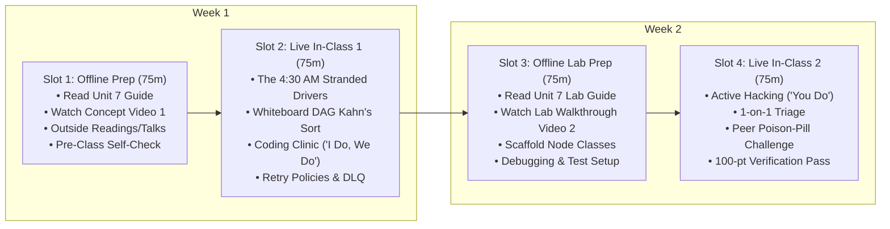

# Unit 7 Flipped Classroom Guide & Recording Scripts
## Orchestration & Automation (The Unsleeping Pipeline)

> **Course**: COSC 2060 — Modern Data Engineering & AI Infrastructure  
> **Unit Duration**: 2 Weeks | 4 Slots @ 75 Minutes Each (Flipped Classroom Model)  
> **Prerequisites**: Units 1–6, Python 3.10+, Graph Concepts (DAGs & Topological Sort)  
> **Core Toolchain**: Python Orchestration Engines (Dagster / Prefect Paradigms), Directed Acyclic Graphs (DAGs), Idempotency, Dead-Letter Queues (DLQ)

---

## 1. Executive Unit Summary & Competency Targets
In Units 1 through 6, students engineered all components of an enterprise AI infrastructure ecosystem. However, manual terminal execution (`python script.py`) is not deployable. In Unit 7, students confront unattended operations. They learn why blind time-based schedulers (Linux `cron`) cause catastrophic cascading failures, and build resilient, asset-based **Directed Acyclic Graph (DAG)** pipelines featuring **idempotent writes**, **exponential backoff retries**, and **Dead-Letter Queue (DLQ) poison-pill isolation**.

### Terminal Competencies
- **The Failure of Cron**: Explain why time-based triggering lacks dependency awareness and causes cascading corruption when upstream network glitches occur.
- **Topological Graph Sorting**: Construct DAG dependency graphs and resolve valid execution sequences using topological sorting while detecting circular dependencies.
- **Fault-Tolerant Exponential Retries**: Configure automated retry policies with exponential backoff ($2^{\text{attempt}-1} \times \text{base}$) to recover from transient outages.
- **Poison-Pill Quarantine (DLQ)**: Implement Dead-Letter Queue patterns that isolate corrupted or out-of-bounds records with error traces while allowing valid transactional batches to process.
- **Idempotent Partitioning**: Design idempotent state commits that allow pipelines to be re-run indefinitely on the same partition without creating duplicate records.

---

## 2. The 4-Slot Instructional Schedule (75 Min Each)



---

### Slot 1: Offline Asynchronous Preparation (75 min)
Students complete these materials independently before the first live classroom meeting:

1. **Assigned Primary Reading** (35 min):
   - [Unit 7 Reading: Orchestration & Automation](file:///c:/dev/Course-Content-Agentic-Template/courses/cosc-2060-data-engineering/content/readings/unit_07_orchestration_automation.md)
2. **Curated Outside Readings** (20 min):
   - *Software-Defined Assets: A Declarative Approach to Data Orchestration* by Nick Schrock (Founder of Dagster Labs): Explaining why asset dependencies beat task-based crons.
   - *Idempotency in Data Pipelines* by Maxime Beauchemin (Creator of Apache Airflow): Architectural patterns for idempotent writes and safe backfills.
   - *Designing Resilient Microservices: Retries, Backoff, and Dead-Letter Queues* (AWS Architecture Center).
3. **Curated Outside Video** (10 min):
   - *Nick Schrock: The Future of Data Orchestration* (PyData Global, 15 min clip): Watch for how declarative asset lineage replaces rigid scheduling.
4. **Instructor Concept Video** (10 min):
   - Watch **Instructor Video 1** (Recorded using Script 1 below).
5. **Pre-Class Concept Self-Check** (3 Questions):
   - *Q1*: Why did scheduling scripts 30 minutes apart in Linux `cron` cause 412 commercial truck drivers to have their fuel cards frozen?
   - *Q2*: What is the definition of an *Idempotent* pipeline operation, and why is `INSERT INTO ...` non-idempotent?
   - *Q3*: What is the difference between a *transient error* (which should be retried) and a *deterministic poison-pill error* (which should be routed to a DLQ)?

---

### Slot 2: Live In-Class Session 1 (75 min)
- **00:00 – 00:15 | Incident Retrospective: The 4:30 AM Stranded Drivers**:
  - Open with the Apex Freight disaster. Ask students: *"Why did Script #4 calculate anomalies on zero rows, and why did Script #5 deactivate valid cards at 5:00 AM?"*
- **00:15 – 00:35 | Whiteboard Sparring: Topological Sorting & Cycles**:
  - Draw a 5-node DAG on the board with two parallel branches.
  - Walk through Kahn's algorithm step-by-step: tracking `in_degree` counts and queueing zero-degree nodes.
  - Introduce a circular dependency (Node A $\to$ Node B $\to$ Node A) and demonstrate how Kahn's algorithm detects the cycle when `len(order) != len(nodes)`.
- **00:35 – 01:05 | Coding Clinic: "I Do, We Do"**:
  - **"I Do" (15m)**: Live instructor demonstration implementing exponential backoff with jitter in Python (`base_delay * (2 ** (attempt - 1))`).
  - **"We Do" (15m)**: Class code-along building a Dead-Letter Queue interceptor that separates clean transactions from negative gallon poison pills.
- **01:05 – 01:15 | Exit Ticket & Slot 3 Roadmap**:
  - Verify students understand DAG node status transitions (`PENDING`, `RUNNING`, `SUCCESS`, `SKIPPED`, `FAILED`). Preview Slot 3 lab challenges.

---

### Slot 3: Offline Asynchronous Lab Prep (75 min)
Students complete pre-lab tasks before entering the live hack session:

1. **Assigned Lab Reading** (25 min):
   - [Unit 7 Lab Guide: The Unsleeping Pipeline Lab](file:///c:/dev/Course-Content-Agentic-Template/courses/cosc-2060-data-engineering/content/labs/unit_07_unsleeping_pipeline_lab.md)
2. **Instructor Lab Walkthrough Video** (15 min):
   - Watch **Instructor Video 2** (Recorded using Script 2 below).
3. **Local Setup & Challenge 1 Scaffolding** (35 min):
   - Implement `PipelineNode` and `DAGOrchestrator` in `lab7_starter.py`.
   - Write a unit test verifying that linear dependencies resolve in order and circular dependencies throw a `ValueError`.

---

### Slot 4: Live In-Class Session 2 (75 min)
- **00:00 – 00:10 | Objective & Rubric Review**:
  - Review the 100-point rubric. Highlight the Idempotency benchmark: Re-running the pipeline on the same date partition must result in **zero duplicate records**.
- **00:10 – 00:55 | Autonomous Applied Hacking ("You Do")**:
  - Students implement Challenges 2, 3, and 4 in `lab7_starter.py`.
  - Instructor provides roaming triage on exception bubbling and partition overwrites.
- **00:55 – 01:10 | Peer Poison-Pill Challenge**:
  - Students inject a custom malformed record (e.g. `gallons = "CORRUPTED_STRING"`) into their partner's pipeline to verify that it routes to the DLQ without crashing the run.
- **01:10 – 01:15 | Automated Verification Pass & Unit 8 Teaser**:
  - Verification checkoff. Preview Unit 8: The Capstone Defense—packaging everything into Docker containers and ingesting a blind evaluation batch.

---

## 3. Instructor Recording Script 1: Concept Introduction
> **Target Video Runtime**: ~11 Minutes  
> **Format**: Video Lecture / Screen Capture with Slide Prompts  
> **Intended Audience**: College Sophomores in Week 13

```text
[00:00 - 00:45] HOOK & TITLE CARD
[CAMERA ON INSTRUCTOR]
"Welcome to Unit 7 of COSC 2060. 

Up to this point, you have run your code by typing `python main.py` in your terminal. 

Now, ask yourself: In the real world, who sits at a terminal at 3:15 AM every single morning to press 'Enter'? 
Nobody. 

Real data systems must run unattended, 24 hours a day, 365 days a year. 
But if you take your Python scripts and schedule them with simple Linux `cron` jobs, you are building a fragile house of cards. When a single network hiccup occurs in the middle of the night, your pipeline will corrupt your database and cause an operational catastrophe. Let's talk about the 4:30 AM stranded drivers."

[00:45 - 02:45] THE 4:30 AM STRANDED DRIVERS DISASTER
[SLIDE: Graphic showing 412 Commercial Drivers Stranded at Winter Truck Stops]
[CAMERA INSET BOTTOM-RIGHT]
"Apex Freight operated 800 semi-trucks. 
The data team set up five nightly Python scripts using standard Linux cron jobs scheduled 30 minutes apart:
- 3:00 AM: Download fuel records.
- 3:30 AM: Clean and deduplicate.
- 4:00 AM: Calculate mileage features.
- 4:30 AM: Run anomaly detection.
- 5:00 AM: Freeze fraudulent cards.

Notice the fatal assumption: They assumed that every script would always finish in under 30 minutes, and that every script would always succeed.

On Tuesday at 3:12 AM, the fuel vendor's FTP server experienced high load. 
Script 1 hung waiting for a network socket. It didn't fail; it just froze in memory. 

At 3:30 AM, cron blindly fired Script 2. 
Script 2 found an empty incoming directory! Instead of failing, it wiped the staging table in preparation for incoming rows and exited with code 0. 

At 4:00 AM, Script 3 generated an empty feature table. 
At 4:30 AM, Script 4 ran. Seeing that all active trucks had zero gallons logged due to the wiped staging table, the model evaluated EVERY truck as an extreme anomaly! 

At 5:00 AM, Script 5 executed automatically and **deactivated the corporate fuel cards of 412 active truck drivers**. 

Across the Midwest, 412 drivers pulled into truck stops at 5:15 AM in 12-degree winter weather. Every card was declined. 
Drivers couldn't buy fuel or stay warm in idling trucks. Operations halted nationwide for seven hours while engineers manually restored database snapshots. The disaster cost $240,000."

[02:45 - 05:30] WHY CRON FAILS & WHY DAGS RULE
[SLIDE: Visual Comparison - Blind Chronological Cron vs. Dependency-Aware DAG]
"Why did this disaster happen?
Because cron has **zero dependency awareness**. 
Cron only knows what time it is on the clock. It has no idea whether Script 1 succeeded, failed, or was still running.

In modern data engineering, we replace cron with **Data Orchestrators** like **Dagster**, **Prefect**, or **Airflow**. 

We model our pipeline as a **Directed Acyclic Graph (DAG)**:
- Node 1: Ingest Fuel Logs
- Node 2: Clean & Validate
- Node 3: Run Anomaly Detection
- Node 4: Publish to API

In a DAG, **Node 2 NEVER runs until Node 1 emits a verified SUCCESS state**. 
If Node 1 hangs or fails, the orchestrator immediately halts the downstream pipeline, sends an alert to the on-call engineer, and marks downstream tasks as SKIPPED. 
The cascade of corruption is stopped dead in its tracks."

[05:30 - 08:00] RESILIENCE: EXPONENTIAL BACKOFF & DEAD-LETTER QUEUES
[SLIDE: Diagram - Exponential Backoff Timeline & Dead-Letter Queue Quarantine Bucket]
"Now, how do we make our DAG resilient? Two core patterns:

Pattern 1: **Exponential Backoff Retries**.
External APIs and networks glitch all the time. If an ingestion script fails because of a temporary 2-second timeout, you don't crash the pipeline! 
You retry:
- Attempt 1: wait 1 second.
- Attempt 2: wait 2 seconds.
- Attempt 3: wait 4 seconds.
Most transient blips resolve themselves within seconds.

Pattern 2: **The Dead-Letter Queue (DLQ)**.
What happens if out of 1,000,000 transactions, row #42,109 contains corrupted data—like negative 50 gallons? 
Should the entire pipeline crash and block 999,999 valid transactions?
**No.** 
We isolate that corrupted record into a **Dead-Letter Queue (DLQ)** with the exact error trace. The valid transactions continue flowing into production, while the poison pill is quarantined for engineer review."

[08:00 - 11:00] IDEMPOTENCY & OFFLINE PREP
[SLIDE: Formula for Idempotent Execution: f(f(x)) = f(x)]
"Finally: **Idempotency**.
A pipeline is idempotent if running it once, twice, or 100 times on the same date partition produces the exact same output without duplicate records. 

Never use blind `INSERT INTO`! Always use partition overwrites or UPSERTs. 
If your pipeline crashes halfway through, you must be able to re-run it with zero fear of corrupting your data.

Before our live session in Slot 2:
1. Read the Unit 7 Reading Guide.
2. Review the Dagster Software-Defined Assets paper in our outside reading list.
3. Answer the three self-check questions.

In class, we will derive Kahn's topological sort on the whiteboard and build our first resilient DAG orchestrator. Let's build unsleeping pipelines."
```

---

## 4. Instructor Recording Script 2: Lab Walkthrough
> **Target Video Runtime**: ~12 Minutes  
> **Format**: Hands-On Code Walkthrough & Screen Capture  
> **Intended Audience**: College Sophomores preparing for Slot 4 Live Lab

```text
[00:00 - 01:30] LAB OVERVIEW & STARTER CODE TOUR
[SCREEN SHARE: VS Code open to 'unit_07_unsleeping_pipeline_lab.md' and terminal]
[CAMERA INSET BOTTOM-RIGHT]
"Hey everyone, welcome to the Unit 7 Lab Walkthrough. 

In this video, I'm going to walk you through `lab7_starter.py`, show you how to implement topological sorting using Kahn's algorithm, build an automated exponential backoff retry policy, and route poison pills into a Dead-Letter Queue.

Let's dive into the code."

[01:30 - 04:30] CHALLENGE 1: TOPOLOGICAL SORT & CYCLE DETECTION
[SCREEN SHARE: VS Code highlighting 'get_execution_order' in 'DAGOrchestrator']
"Let's look at Challenge 1: `get_execution_order()`. 
How does an orchestrator know which node to run first? 
We use **Kahn's Algorithm for Topological Sorting**:

```python
in_degree = {name: 0 for name in self.nodes}
adj = {name: [] for name in self.nodes}
for name, node in self.nodes.items():
    for dep in node.dependencies:
        adj[dep].append(name)
        in_degree[name] += 1
```
First, we count the incoming edges: if Node B depends on Node A, Node B has `in_degree = 1`. 
We put all nodes with `in_degree = 0` into a queue. Those are our starting nodes!

As each node completes, we decrement the in-degree of its neighbors. When a neighbor reaches 0, it gets added to the queue.

Now look at line 55:
```python
if len(order) != len(self.nodes):
    raise ValueError('Cycle detected in DAG! Pipeline execution blocked.')
```
If someone accidentally creates a circular dependency—Node A depends on B, and B depends on A—Kahn's algorithm will terminate before all nodes are processed. 
We immediately raise a `ValueError` and halt execution. Safety first!"

[04:30 - 07:30] CHALLENGE 2 & 3: RETRIES & DEAD-LETTER QUEUE
[SCREEN SHARE: VS Code highlighting retry loop and DLQ task]
"In Challenge 2, look at `execute_node_with_retry()`:
```python
for attempt in range(1, node.max_retries + 2):
    try:
        node.result = node.func(self.context)
        node.status = 'SUCCESS'
        return True
    except Exception as e:
        delay = base_delay * (2 ** (attempt - 1))
        time.sleep(delay)
```
Notice `2 ** (attempt - 1)`. 
Attempt 1 waits 0.05s. Attempt 2 waits 0.10s. Attempt 3 waits 0.20s. 
This exponential delay prevents thundering herds from overwhelming an already struggling database.

Now look at Challenge 3: `task_clean_and_dlq()`:
```python
for row in raw_data:
    if row['gallons'] <= 0.0 or row['status'] == 'POISON_PILL':
        orchestrator.dlq.append({
            'record': row,
            'reason': 'Invalid gallon measurement: negative or zero quantity.',
            'quarantined_at': time.time()
        })
    else:
        clean_batch.append(row)
```
Row TX-03 has `-50.0 gallons`. That's a poison pill! 
Instead of crashing the entire script, we append it to `orchestrator.dlq`. 
Clean records continue flowing to downstream feature tables unimpeded."

[07:30 - 09:45] CHALLENGE 4: IDEMPOTENCY & VERIFICATION
[SCREEN SHARE: Terminal running 'python courses/cosc-2060-data-engineering/content/labs/lab7_starter.py']
"In Challenge 4, look at how we enforce idempotency:
```python
# Clear or overwrite the specific date partition before inserting:
FINAL_FEATURE_STORE[date_partition] = {}
```
If we run this pipeline once: Truck 219 has 420.0 gallons. 
If we re-run the pipeline a second time: Truck 219 STILL has 420.0 gallons! 
Not 840 gallons! Zero duplicate records.

Let's run our test script in the terminal:
`python courses/cosc-2060-data-engineering/content/labs/lab7_starter.py`

Look at that output:
`=== Step 1: Building DAG & Checking Topological Order ===`
`Topological Execution Order: ['ingest_fuel', 'clean_fuel', 'write_features']`
`=== Step 2: Testing Cycle Detection ===`
`[PASS] Cycle detected successfully: Cycle detected in DAG! Pipeline execution blocked.`
`=== Step 3: Executing Resilient Pipeline ===`
`[PASS] All pipeline nodes completed with SUCCESS.`
`=== Step 4: Verifying Dead-Letter Queue (DLQ) Quarantine ===`
`DLQ contains 1 quarantined records. [PASS] Poison pill TX-03 correctly isolated in DLQ.`
`=== Step 5: Verifying Idempotent Execution ===`
`Aggregated Totals: {'TRUCK-101': 120.0, 'TRUCK-219': 420.0}`
`[PASS] Idempotency confirmed: Re-run produced zero duplicate gallons.`
`[SUCCESS] All Unit 7 Lab challenges verified successfully!`"

[09:45 - 12:00] WRAP-UP & PREVIEW FOR SLOT 4
[CAMERA ON INSTRUCTOR]
"Here is your checklist before Slot 4:
1. Complete Challenges 1 and 2 in `lab7_starter.py`.
2. Test your topological sorter on different graph shapes.
3. Test cycle detection.

In Slot 4, we will conduct our live peer fault injection challenge. You will inject poison pills into your partner's DAG and watch their DLQ catch it.

Let's make our pipelines bulletproof. See you in class."
```
