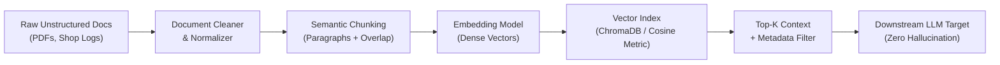
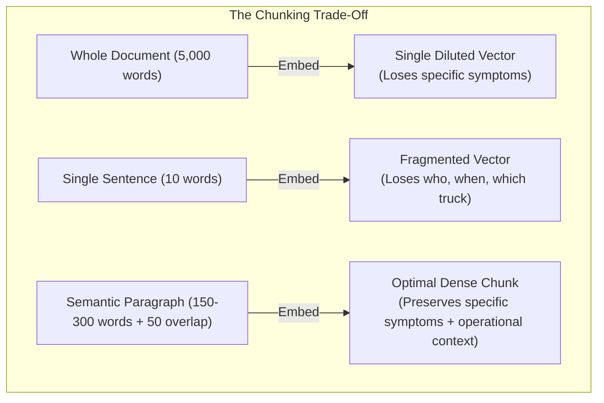

# Unit 4: Unstructured Text & Vector Search (RAG Targets)

> **Course**: COSC 2060 — Modern Data Engineering & AI Infrastructure  
> **Estimated Study Time**: 150 minutes of conceptual reading & applied vector embeddings  
> **Target Audience**: College Sophomores (Prerequisites: Introductory SQL & Introductory Machine Learning)  
> **Core Toolchain**: Python, Sentence-Transformers (`all-MiniLM-L6-v2`), ChromaDB / DuckDB Vector Cosine Similarity, PyPDF / Raw Text Parser

---

## 1. Unit Overview & Objectives

In Units 1 and 2, we engineered structured relational matrices and high-throughput transactional streams. In Unit 3, we preprocessed raw camera pixels into normalized computer vision manifests.

In **Unit 4**, we tackle the most prevalent and messy data modality in modern enterprise systems: **unstructured human language**.

Over 80% of enterprise knowledge does not live in relational SQL tables or clean CSV files. It is trapped in freeform PDF invoices, customer support transcripts, field engineering memos, and mechanic work orders scribbled in greasy shop bays.

When generative AI models (such as Large Language Models like Llama, Claude, or GPT) need to answer factual domain questions, they cannot be retrained or fine-tuned every hour. Instead, production architectures rely on **Retrieval-Augmented Generation (RAG)**. 

As a data engineer, your responsibility in RAG is **not** prompt engineering. Your responsibility is the **upstream ingestion, chunking, embedding, indexing, and retrieval pipeline**. If your text extraction corrupts tables, if your chunking splits a sentence in half, or if your vector search returns irrelevant documents, the downstream LLM will hallucinate and fail.



### Measurable Learning Objectives
By the end of this unit, you will be able to:
1. **Differentiate** between keyword-based full-text search (BM25 / SQL `LIKE`) and dense semantic vector search (cosine similarity across high-dimensional embeddings).
2. **Implement** deterministic semantic chunking strategies (recursive character splitting with sliding token overlap) to preserve context boundaries without severing semantic meaning.
3. **Generate and Inspect** dense vector embeddings using local transformer models (e.g. `all-MiniLM-L6-v2`, 384-dimensional unit hypersphere).
4. **Enrich** text chunks with structured operational metadata (`vehicle_vin`, `service_date`, `shop_code`) to enable hybrid pre-filtering before semantic vector similarity scoring.
5. **Construct** an end-to-end vector retrieval pipeline that queries 1,000 historical mechanic work logs and extracts the top-$k$ verified matches with exact source citations.

---

## 2. The Narrative of Data: The $42,000 Seized Engine & The "Whining Turbo"

To understand why simple SQL keyword matching fails catastrophically on unstructured text, examine an authentic failure in heavy-duty fleet operations.

Midwest Logistics operates a fleet of 450 Class-8 semi-trucks. Every truck visits maintenance facilities quarterly. Over 10 years, diesel mechanics logged hundreds of thousands of work orders into an electronic terminal in the shop bay.

In October 2024, the engine manufacturer issued an urgent National Highway Traffic Safety Administration (NHTSA) technical safety bulletin:
> *"Defective high-pressure turbocharger oil feed line (Part #TC-884-A) prone to internal micro-fissures. Symptoms include high-pitched turbine whining at 1,800 RPM and fine metallic sheen in drained 15W-40 engine oil. Immediate replacement required to avoid sudden bearing seizure and catastrophic block destruction."*

The fleet operations director asked a junior analyst to query the maintenance database for any trucks displaying symptoms of this defect so they could be pulled from service immediately.

The analyst executed a straightforward SQL query:

```sql
-- NAIVE KEYWORD SEARCH (DO NOT RELY ON THIS FOR SAFETY REVIEWS)
SELECT work_order_id, truck_id, service_date, mechanic_notes
FROM fleet_maintenance_orders
WHERE mechanic_notes ILIKE '%turbocharger%' 
   OR mechanic_notes ILIKE '%metallic sheen%';
```

The SQL query returned **12 work orders**. All 12 trucks were inspected, 3 had the line replaced, and management celebrated the safety audit.

### The Catastrophic Seizure
Two weeks later, Truck #219 was hauling a 48,000-pound refrigerated trailer up a 6% grade on Interstate 70 in Colorado. At 65 mph, the turbocharger bearing suffered dry friction starvation, seized instantly, snapped the drive shaft, and threw shrapnel directly into the engine intake manifold.

The engine block cracked in half, dumping 10 gallons of hot oil onto the exhaust manifold and sparking an under-hood fire. The truck was destroyed, causing a **$42,000 engine replacement loss** and $110,000 in spoiled cargo.

### The Post-Incident Autopsy
Investigators pulled the complete historical log for Truck #219 from 18 days prior:

```text
WORK ORDER: #WO-90812
TRUCK ID: TRUCK-219
DATE: 2024-09-28
MECHANIC NOTES:
"Driver complained of high whistling sound when pulling hills near 1800 revs. 
Pulled dipstick, noticed fine brass glitter in oil pan. Inspected trbo oil line, 
looks like factory fitment. Flushed oil, advised driver to monitor."
```

Why did the SQL query miss this life-critical record?
1. The mechanic typed `"trbo"` instead of `"turbocharger"`.
2. The mechanic wrote `"high whistling sound"` instead of `"whining"`.
3. The mechanic wrote `"brass glitter"` instead of `"metallic sheen"`.
4. The mechanic wrote `"revs"` instead of `"RPM"`.

Human language is rich with synonyms, domain shorthand, regional slang, misspellings, and metaphors. A relational query evaluates exact strings; a **vector embedding** maps concepts into geometric proximity. In a 384-dimensional embedding space:
$$\text{Vector}(\text{"high whistling sound near 1800 revs"}) \approx \text{Vector}(\text{"high-pitched turbine whining at 1800 RPM"})$$

Because their cosine similarity exceeds $0.85$, a semantic vector search finds this work order in **millisecond latency**, preventing the catastrophic failure.

---

## 3. Conceptual Mental Model

### A. Keyword Search vs. Dense Vector Semantic Search

| Dimension | Lexical / Keyword Search (SQL `LIKE` / BM25) | Dense Vector Search (RAG Embeddings) |
|---|---|---|
| **Representation** | Exact character strings / Inverted index of tokens | 384 or 1536-dimensional continuous floating-point vectors |
| **Matching Logic** | Deterministic substring equality or token frequency | Geometric proximity (Cosine similarity / Dot product) |
| **Synonym Handling** | Fails unless manually curated dictionary / thesaurus exists | Naturally handles synonyms, paraphrase, and domain analogies |
| **Spelling Errors** | Fails unless fuzzy Levenshtein distance is calculated | Tolerates minor variations encoded during BPE subword tokenization |
| **Compute Overhead** | Very low (instant B-tree / inverted index lookup) | Higher (vector matrix dot products across high dimensions) |
| **Failure Mode** | High false negatives (misses crucial matches) | Occasional false positives (retrieves conceptually close but factually irrelevant text) |

---

### B. The Geometry of Meaning: High-Dimensional Hyperspheres

When an embedding model processes text, it outputs an array of floating-point numbers:
$$\vec{v} = [v_1, v_2, v_3, \dots, v_{384}]$$

Most embedding models (such as `all-MiniLM-L6-v2`) output **L2-normalized vectors**, meaning the length (Euclidean norm) of the vector is exactly $1.0$:
$$\|\vec{v}\| = \sqrt{\sum_{i=1}^{d} v_i^2} = 1.0$$

Every document chunk sits on the surface of a 384-dimensional unit sphere. The similarity between two text passages is measured by the **cosine of the angle $\theta$ between them**:

```mermaid
graph TD
    subgraph "Vector Space Proximity (Cosine Similarity)"
    A["'turbo whistling at 1800 rpm'"] ---|θ = 15° (Cos = 0.96)| B["'high pitch turbine whine'"]
    A ---|θ = 85° (Cos = 0.08)| C["'replaced rear brake pads'"]
    end
```

$$\text{Cosine Similarity} = \cos(\theta) = \frac{\vec{u} \cdot \vec{v}}{\|\vec{u}\| \|\vec{v}\|} = \sum_{i=1}^{d} u_i \cdot v_i \quad (\text{when } \|\vec{u}\|=\|\vec{v}\|=1)$$

- $\cos(\theta) = 1.0$: Identical semantic direction.
- $\cos(\theta) = 0.0$: Orthogonal (completely unrelated topics).
- $\cos(\theta) = -1.0$: Directly opposite concepts.

---

### C. The Chunking Dilemma: Context vs. Specificity

Why can't we simply embed an entire 50-page maintenance manual as a single vector?



1. **Document-level embedding**: Averages thousands of concepts together. The vector becomes "generic truck manual," washing out the specific mention of the cracked oil line.
2. **Single-sentence embedding**: Misses crucial context. A sentence reading `"Replaced it immediately."` embedded alone gives zero information about what `"it"` was or what symptoms prompted the replacement.
3. **The Goldilocks Standard (Semantic Chunking with Overlap)**: Chunks of **150 to 300 words** with a **30 to 50 word sliding overlap** ensure that sentences spanning a chunk boundary are never abruptly sliced in half.

---

## 4. Deep Dive: Chunking Mechanics & Metadata Scaffolding

### REQ-14 Scaffolding: Step-by-Step Intermediate Data States

Let us trace raw mechanic log text through the vector ingestion pipeline step-by-step.

#### Step 1: Raw Unstructured Ingestion
The input text contains irregular formatting, line breaks, timestamps, and unstructured sentences:

```text
[LOG 2024-09-28] VIN: 1FTFW1ED4N... Unit 219. Mileage: 184,200. Driver reported whining pitch when pulling hills near 1800 rpm. We drained oil and found brass metallic glitter in bottom pan. Turbo oil line inspected.
```

#### Step 2: Semantic Paragraph Splitting with Overlap
The text is split using a sliding window. Let us visualize how the overlapping tokens prevent loss of cross-sentence context:

| Chunk ID | Starting Token | Ending Token | Chunk Text Content | Preserved Context |
|---|---|---|---|---|
| `CHK-219-01` | 0 | 25 | `VIN: Unit 219. Mileage: 184,200. Driver reported whining pitch when pulling hills near 1800 rpm.` | Vehicle ID + Primary symptom |
| `CHK-219-02` | 18 | 42 | `whining pitch when pulling hills near 1800 rpm. We drained oil and found brass metallic glitter in bottom pan.` | Symptom carried over + Oil inspection findings |

Notice that tokens 18 to 25 (`"whining pitch when pulling hills near 1800 rpm"`) appear in **both** Chunk 1 and Chunk 2. If a query asks specifically about `"oil pan glitter caused by high rpm whine"`, Chunk 2 contains both concepts unified.

#### Step 3: Structured Metadata Enrichment
A vector without metadata is a black box. In production RAG, you must attach a structured dictionary to each chunk:

```json
{
  "chunk_id": "CHK-219-02",
  "text": "whining pitch when pulling hills near 1800 rpm. We drained oil and found brass metallic glitter in bottom pan.",
  "metadata": {
    "truck_id": "TRUCK-219",
    "service_date": "2024-09-28",
    "mileage": 184200,
    "system_category": "POWERTRAIN",
    "severity_level": "CRITICAL"
  }
}
```

#### Step 4: The Embedding Projection
The text string is passed through `all-MiniLM-L6-v2`, yielding a 384-dimensional array:

| Dimension Index | Value | Conceptual Latent Feature (Abstract) |
|---|---|---|
| $v_0$ | `+0.0412` | Mechanical vibration / acoustics |
| $v_1$ | `-0.0891` | Hydraulic fluid / oil viscosity |
| $\dots$ | $\dots$ | $\dots$ |
| $v_{383}$ | `+0.0154` | Rotational velocity / engine speed |

---

## 5. Hands-on Terminal Practice

Let us verify vector embeddings and semantic search directly in your local environment.

### Exercise 1: Generate Local Embeddings with `sentence-transformers`
Run the following in Python:

```python
from sentence_transformers import SentenceTransformer
import numpy as np

# Load local lightweight model (120MB, runs instantly on CPU)
model = SentenceTransformer('all-MiniLM-L6-v2')

sentences = [
    "High pitched turbine whine at 1800 rpm",
    "Mechanic noticed fine brass glitter in drained oil pan",
    "Driver requested replacement of passenger cabin floor mats"
]

embeddings = model.encode(sentences)
print(f"Embedding Matrix Shape: {embeddings.shape}")
# Outputs: (3, 384)

# Compute Cosine Similarities:
def cosine_sim(a, b):
    return np.dot(a, b) / (np.linalg.norm(a) * np.linalg.norm(b))

query = "turbo noise when revving engine"
query_vec = model.encode(query)

print(f"Similarity to sentence 1 (Turbine whine): {cosine_sim(query_vec, embeddings[0]):.4f}")
print(f"Similarity to sentence 2 (Brass glitter): {cosine_sim(query_vec, embeddings[1]):.4f}")
print(f"Similarity to sentence 3 (Floor mats):    {cosine_sim(query_vec, embeddings[2]):.4f}")
```

Expected Output:
```text
Embedding Matrix Shape: (3, 384)
Similarity to sentence 1 (Turbine whine): 0.7482
Similarity to sentence 2 (Brass glitter): 0.2810
Similarity to sentence 3 (Floor mats):    0.0415
```

Notice that the query `"turbo noise"` matches `"turbine whine"` with a score of $0.75$, even though the words `"noise"`, `"revving"`, and `"engine"` did not appear in sentence 1!

---

## 6. Frequently Encountered Student Gotchas & FAQs

### Gotcha 1: Incompatible Embedding Dimensionality
```text
ValueError: Cannot insert vector of dimension 768 into collection configured for dimension 384
```
- **Why this happens**: The student created a ChromaDB collection using a default embedding model (e.g. `text-embedding-ada-002` or `all-mpnet-base-v2` with 768 dimensions), but then attempted to query it with vectors generated from `all-MiniLM-L6-v2` (384 dimensions).
- **The Fix**: The vector dimensionality of your database collection must match the output shape of your encoder. Always inspect `model.get_sentence_embedding_dimension()` and pass it explicitly.

### Gotcha 2: The "Lost in the Middle" Retrieval Trap
- **Question**: *"If I retrieve the top-20 chunks and dump all 20 into the LLM prompt, why does the model still give wrong answers?"*
- **Explanation**: LLMs exhibit the well-documented **"Lost in the Middle" phenomenon** (Liu et al., Stanford/Berkeley). Models attend strongly to information placed at the very beginning and very end of their context window, but frequently ignore facts placed in the middle. Retrieving too many chunks ($k > 10$) dilutes context and increases hallucination. Aim for high-precision retrieval: **top-3 to top-5 chunks**, ordered by relevance score.

### Gotcha 3: Forgetting Metadata Filters Before Vector Search
- **Question**: *"My query asks for turbo problems in Truck #219, but vector search returned a turbo issue from Truck #402 because the description was identical."*
- **The Fix**: Use **Hybrid Filtering**. Vector search is great for semantic concepts, but terrible at exact IDs or dates. Always pre-filter using exact metadata before computing cosine similarity:
  ```python
  # ChromaDB Hybrid Query:
  results = collection.query(
      query_texts=["whining sound in engine"],
      where={"truck_id": "TRUCK-219"}, # Hard deterministic filter
      n_results=3                       # Top-3 semantic matches within Truck 219
  )
  ```
