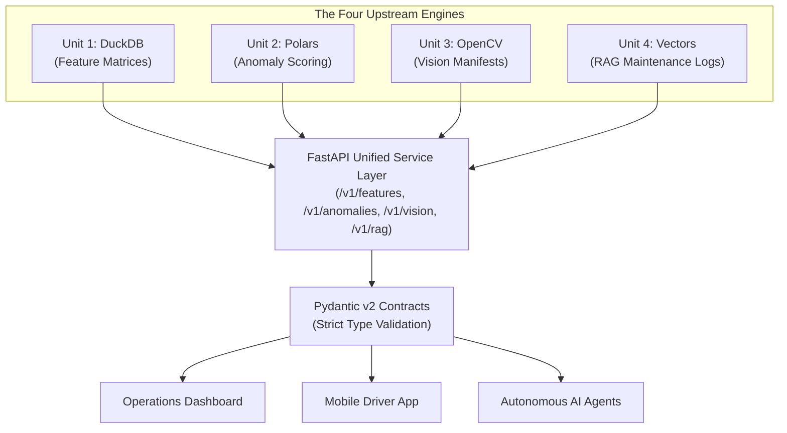
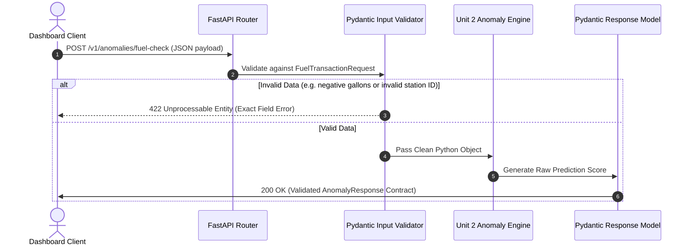

# Unit 5: Data as a Service (DaaS) & The API Layer

> **Course**: COSC 2060 — Modern Data Engineering & AI Infrastructure  
> **Estimated Study Time**: 150 minutes of conceptual reading & applied API engineering  
> **Target Audience**: College Sophomores (Prerequisites: Introductory SQL & Introductory Machine Learning)  
> **Core Toolchain**: FastAPI, Pydantic v2, Uvicorn, HTTP REST Architecture

---

## 1. Unit Overview & Objectives

In Units 1 through 4, we built specialized engines for every modern data modality:
- **Unit 1**: Relational feature matrices in DuckDB.
- **Unit 2**: Real-time anomaly detection in Polars.
- **Unit 3**: Computer vision preprocessing manifests in OpenCV.
- **Unit 4**: Semantic vector search and RAG indexing in Sentence-Transformers.

Each of these systems generated data artifacts: a `.parquet` file, a `.csv` dump, a `.json` manifest, or an in-memory vector array.

In **Unit 5**, we confront a fundamental engineering reality: **Data trapped in files on a hard drive is useless to the enterprise.**

A frontend web application cannot run DuckDB queries directly on your laptop's Parquet files. An iOS mobile app in a driver's hands cannot import your Polars script. An autonomous AI agent cannot read raw Python dictionaries from memory.

To make data accessible, secure, and resilient, we must treat **Data as a Service (DaaS)**. We wrap our data engines behind modern, high-performance **REST APIs** built with **FastAPI** and protected by strict **Pydantic v2 Data Contracts**.



### Measurable Learning Objectives
By the end of this unit, you will be able to:
1. **Explain** the architectural risks of file-based data sharing (the "Death of the CSV") versus decoupled, contract-enforced REST APIs.
2. **Design and Implement** RESTful endpoints utilizing standard HTTP verbs (`GET`, `POST`), status codes (`200 OK`, `400 Bad Request`, `404 Not Found`, `422 Unprocessable Entity`), and path/query parameters.
3. **Construct** defensive Pydantic v2 models that validate input payloads and guarantee output schemas, rejecting malformed or out-of-bounds data before processing.
4. **Unify** multimodal data sources (relational Parquet, tabular anomaly models, visual manifests, and vector retrieval) into a cohesive microservice.
5. **Test and Verify** API endpoints using automated Python client testing (`TestClient` / `httpx`) and interactive OpenAPI documentation (`/docs`).

---

## 2. The Narrative of Data: The $380,000 Monday Morning Outage

To appreciate why production data engineering abandoned CSV handoffs, consider an authentic incident at a national freight logistics firm.

Midwest Logistics operated a real-time dispatch dashboard used by 120 dispatchers to monitor delivery delays across 1,200 trucks. Every morning at 6:00 AM, an automated script exported an updated machine learning prediction table from the data science repository to a shared network drive:

`\\corp-shares\analytics\delivery_delay_predictions.csv`

At 7:45 AM, the dispatch dashboard backend ingested this file and loaded the delay probability scores into the user interface.

### The Silent Change
On Friday afternoon, a well-meaning junior data engineer cleaned up the feature engineering pipeline. They made three seemingly harmless improvements:
1. Renamed `truck_id` to `vehicle_vin` to match the company's new ERP standard.
2. Encoded missing weather delay values as the text string `"N/A"` instead of leaving them empty or null.
3. Added a new column containing unencrypted driver phone numbers for convenience.

Because CSV files contain **no schema enforcement, no type declarations, and no contracts**, the script generated the file without error.

### The Catastrophic Failure
On Monday morning at 8:00 AM, the dispatch dashboard backend crashed with an unhandled exception:
```text
KeyError: 'truck_id' not found in DataFrame columns
```

The application restarted, attempted to re-read the CSV, failed, and entered a crash loop. Dispatchers across four terminals were unable to view route assignments, delivery deadlines, or high-risk delays.

For four hours, 1,200 freight trucks sat idle or departed with unoptimized, outdated manifests. The company incurred **$380,000 in contractual late-delivery penalties** and expedited freight compensation.

### The Architectural Root Cause
Why did this disaster occur?
- **No Schema Contract**: A CSV accepts any column name, any data type, and any format change without warning.
- **No Boundary Validation**: The consuming application had no mechanism to validate the structure before ingesting.
- **Point-to-Point Coupling**: The dashboard depended directly on file system paths and internal column naming rather than an abstract API contract.

If the pipeline had used an API with Pydantic contracts, the pipeline would have failed at compile/test time with a clear descriptive validation error before reaching production.

---

## 3. Conceptual Mental Model

### A. Static File Sharing vs. Data as a Service (DaaS)

| Architectural Dimension | Static File Sharing (CSV / Parquet Dumps) | Data as a Service (FastAPI REST Layer) |
|---|---|---|
| **Data Freshness** | Stale batch snapshot; only as fresh as the last scheduled dump | Real-time or micro-batched; queries live in-memory state or database |
| **Schema Enforcement** | Weak or non-existent; breaking column changes break consumers | **Strict**: Pydantic validates input and output; returns `422` on violation |
| **Security & Privacy** | Coarse; user has access to the whole file or nothing | **Fine-grained**: Endpoint-level authentication (API keys, JWT, RBAC) |
| **Access Pattern** | Inefficient: consumer must download 500MB to inspect 1 row | **Granular**: Consumer requests `/v1/shipments/TRK-219` (1KB payload) |
| **Documentation** | Outdated Word documents or README files | **Living**: Self-documenting OpenAPI / Swagger UI at `/docs` |

---

### B. The Anatomy of an HTTP REST Request

When a client queries your data API, the interaction follows standard HTTP protocol:

```text
GET /v1/features/delay-matrix/TRK-219?include_history=true HTTP/1.1
Host: api.logistics.internal
Authorization: Bearer eyJhbGciOi...
Accept: application/json
```

- **HTTP Verb**: `GET` (read data), `POST` (submit data / trigger inference), `PUT` (update data), `DELETE` (remove).
- **Path Parameter**: `/v1/features/delay-matrix/{shipment_id}` — uniquely identifies the entity.
- **Query Parameter**: `?include_history=true` — filters or modifies response shape.
- **HTTP Status Codes**:
  - `200 OK`: Request succeeded, response body contains data.
  - `400 Bad Request`: Client sent invalid query logic.
  - `404 Not Found`: The requested entity does not exist.
  - `422 Unprocessable Entity`: Data contract failed (Pydantic rejected data type).
  - `500 Internal Server Error`: Server code crashed (the cardinal sin of API design).

---

## 4. Deep Dive: Pydantic v2 Data Contracts

### REQ-14 Scaffolding: Input Validation to Output Guarantee

Let us trace how Pydantic v2 enforces safety at the API boundary:



#### Step 1: Defining the Input Data Contract
```python
from pydantic import BaseModel, Field, field_validator

class FuelTransactionRequest(BaseModel):
    transaction_id: str = Field(..., description="Unique transaction UUID")
    truck_id: str = Field(..., min_length=3, max_length=20)
    gallons: float = Field(..., gt=0.0, le=350.0, description="Gallons pumped (Max truck tank capacity 350 gal)")
    price_per_gal: float = Field(..., gt=1.0, lt=10.0)
    latitude: float = Field(..., ge=24.0, le=50.0, description="Continental US Latitude")
    longitude: float = Field(..., ge=-125.0, le=-65.0, description="Continental US Longitude")

    @field_validator("truck_id")
    @classmethod
    def must_start_with_truck(cls, v: str) -> str:
        if not v.startswith("TRUCK-"):
            raise ValueError("truck_id must follow convention 'TRUCK-XXX'")
        return v
```

#### Step 2: Defining the Guaranteed Output Contract
```python
class AnomalyEvaluationResponse(BaseModel):
    transaction_id: str
    truck_id: str
    anomaly_score: float = Field(..., ge=0.0, le=1.0)
    is_outlier: bool
    risk_tier: str = Field(..., pattern="^(LOW|MEDIUM|CRITICAL)$")
    evaluated_at: str
```

If an internal calculation outputs `anomaly_score = 1.45`, Pydantic intercepts the response and flags an internal error rather than leaking corrupted data to the client!

---

## 5. Hands-on Terminal Practice

Let us build and test a minimal FastAPI service with interactive Swagger docs.

### Exercise 1: Minimal Self-Validating API
Create a scratch script `scratch/mini_api.py`:

```python
from fastapi import FastAPI, HTTPException
from pydantic import BaseModel, Field

app = FastAPI(title="Logistics Data Service", version="1.0.0")

class FeatureRecord(BaseModel):
    truck_id: str
    distance_miles: float = Field(..., gt=0)
    weather_severity: float = Field(..., ge=0.0, le=1.0)

DB = {
    "TRUCK-101": FeatureRecord(truck_id="TRUCK-101", distance_miles=412.5, weather_severity=0.15),
    "TRUCK-219": FeatureRecord(truck_id="TRUCK-219", distance_miles=890.0, weather_severity=0.82)
}

@app.get("/v1/features/{truck_id}", response_model=FeatureRecord)
def get_truck_features(truck_id: str):
    if truck_id not in DB:
        raise HTTPException(status_code=404, detail=f"Truck '{truck_id}' not found.")
    return DB[truck_id]
```

Test it in Python using `TestClient`:
```python
from fastapi.testclient import TestClient

client = TestClient(app)

# Test 1: Successful retrieval (200 OK)
res = client.get("/v1/features/TRUCK-219")
print(f"Status: {res.status_code}, Body: {res.json()}")
assert res.status_code == 200

# Test 2: Missing record (404 Not Found)
res404 = client.get("/v1/features/TRUCK-999")
print(f"Status: {res404.status_code}, Detail: {res404.json()['detail']}")
assert res404.status_code == 404
```

---

## 6. Frequently Encountered Student Gotchas & FAQs

### Gotcha 1: The Accidental Blocking I/O Bottleneck
- **Problem**: *"I used `async def` on my endpoint, but when two users query it simultaneously, the entire API freezes."*
- **Why this happens**: In FastAPI, if you declare an endpoint with `async def`, FastAPI runs it directly on the single-threaded asynchronous event loop. If inside that function you run a heavy, blocking synchronous computation (like training an Isolation Forest, reading a 500MB Parquet file, or computing PyTorch embeddings), you block the entire event loop for all users!
- **The Rule**:
  - If your code uses standard synchronous libraries (DuckDB, Polars, OpenCV, NumPy, Scikit-learn): Use standard `def endpoint(...)`. FastAPI will automatically offload it to a background thread pool!
  - Only use `async def` if you are using true asynchronous I/O libraries (like `httpx.AsyncClient` or `asyncpg`).

### Gotcha 2: Returning Raw Dictionaries Instead of Pydantic Models
- **Problem**: *"Why bother declaring `response_model=MyResponse` if FastAPI lets me just `return {'status': 'ok'}`?"*
- **Why this matters**:
  1. Without `response_model`, FastAPI cannot generate your automatic OpenAPI/Swagger documentation.
  2. Without `response_model`, FastAPI does not filter out internal fields (you might accidentally leak internal database passwords or driver SSNs to the client).
  3. With `response_model`, you provide a mathematically guaranteed contract to downstream data consumers.
