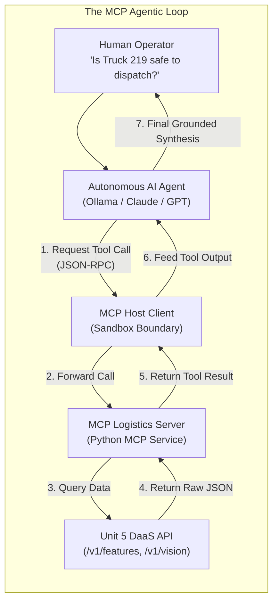
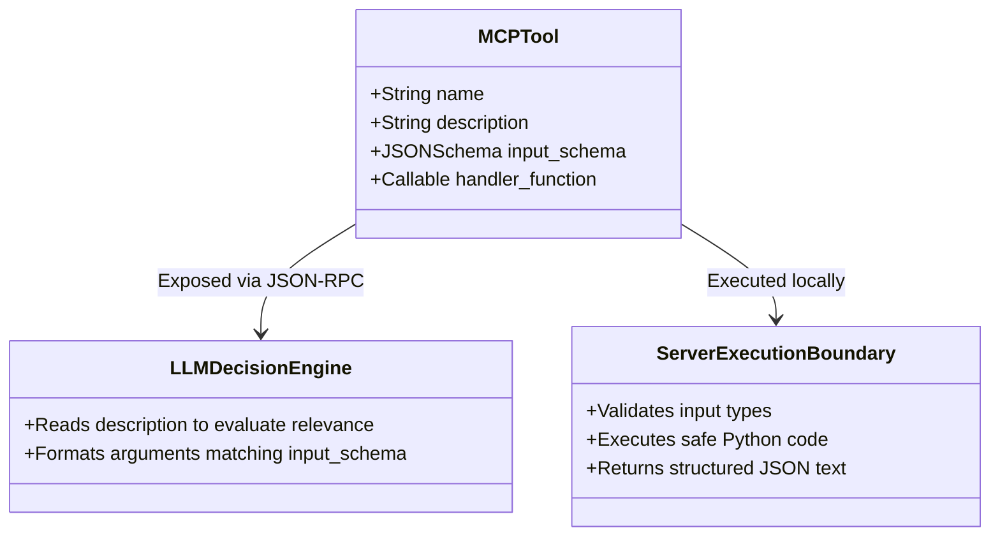

# Unit 6: The Agentic Interface (Model Context Protocol - MCP)

> **Course**: COSC 2060 — Modern Data Engineering & AI Infrastructure  
> **Estimated Study Time**: 150 minutes of conceptual reading & applied tool building  
> **Target Audience**: College Sophomores (Prerequisites: Introductory SQL & Introductory Machine Learning)  
> **Core Toolchain**: Model Context Protocol (MCP), Python MCP SDK / FastMCP, JSON-RPC, Local LLM Tool Calling (Ollama)

---

## 1. Unit Overview & Objectives

In Unit 5, we engineered a unified REST API layer serving multimodal data products (relational matrices, anomaly engines, computer vision manifests, and vector RAG indices).

In **Unit 6**, we connect this data infrastructure to the frontier of modern software engineering: **Autonomous AI Agents**.

An AI model by itself is simply a next-token predictor. It cannot check current warehouse inventory, it cannot query your database, and it cannot inspect live fleet telemetry. To make an AI model capable of taking action, we give it **tools** (function calling).

Historically, every company invented its own ad-hoc, proprietary framework to connect LLMs to databases. This led to dangerous security vulnerabilities, brittle integrations, and massive code duplication.

In 2024, the industry converged around an open standard: the **Model Context Protocol (MCP)**. Developed by Anthropic and adopted across the AI ecosystem, MCP is the **"USB-C standard for AI applications"**. It establishes an open, standardized, secure client-server protocol where AI models discover and invoke backend data tools through structured JSON-RPC messages.



### Measurable Learning Objectives
By the end of this unit, you will be able to:
1. **Explain** the architectural role of the Model Context Protocol (MCP) as a standardized, secure JSON-RPC bridge between LLMs and enterprise data stores.
2. **Design** descriptive, deterministic MCP Tool definitions (including function signatures, Pydantic argument schemas, and semantic prompt descriptions).
3. **Enforce** defensive security boundaries (the Principle of Least Privilege, read-only sandboxes, and parameter bounds) to prevent prompt injection and unauthorized execution.
4. **Implement** an MCP Server in Python exposing the logistics data engines developed in Units 1 through 5.
5. **Simulate and Verify** an agentic tool-calling loop where an LLM dynamically discovers tools, executes multi-step queries, and generates a factual, hallucination-free executive fleet report.

---

## 2. The Narrative of Data: The $500,000 "Unrestricted SQL" Disaster

To understand why data engineers must never give raw, unconstrained database credentials to an autonomous AI agent, consider an authentic corporate failure.

Global Freightways deployed an experimental "AI Logistics Assistant" powered by an LLM to help terminal dispatchers answer questions about shipments. The system prompt instructed the model:
> *"You are a helpful logistics assistant. When users ask questions, translate their intent into a SQL query and execute it using the attached `execute_sql` database connection tool."*

The database connection tool was connected with read/write administrative credentials to the central PostgreSQL production cluster.

For three weeks, the system was a sensation. Dispatchers asked: *"How many shipments in Chicago are running late?"* and the AI generated:
```sql
SELECT count(*) FROM shipments WHERE city = 'Chicago' AND status = 'DELAYED';
```

### The Fatal Ambiguity
On a busy Thursday afternoon, a dispatcher was clearing out test shipments from a training exercise. The dispatcher typed into the AI chat window:
> *"Hey, can you please remove all the temporary demo shipments created yesterday?"*

The LLM attempted to construct a SQL delete command. However, the `shipments` table did not have a column called `is_demo`. The model reasoned:
> *"Since there is no demo flag, all shipments created yesterday must have been part of the demo."*

The LLM generated and executed:
```sql
DELETE FROM shipments WHERE created_at >= '2024-11-13 00:00:00';
```

In under 400 milliseconds, the autonomous agent permanently purged **42,000 active, multi-million-dollar commercial freight manifests** across the United States.

Dispatch screens went blank nationwide. Drivers arriving at terminals could not be matched to their trailers. The company was forced to halt interstate operations for 18 hours while database administrators performed a point-in-time point recovery from off-site tape backups. The operational paralysis, driver detention fees, and missed SLA penalties totaled over **$500,000**.

### The Engineering Autopsy
What was the fatal flaw?
- **Unconstrained Tool Surface**: The agent was given arbitrary SQL execution privileges.
- **Violation of Least Privilege**: A dispatcher assistant should never have permission to run `DELETE` or `DROP`.
- **Lack of Guardrails**: There was no schema validation, no parameter boundaries, and no sandboxing.

### The MCP Defense: Deterministic Tool Contracts
Under MCP, an AI agent is **never given direct SQL or shell access**. Instead, the data engineer exposes narrow, purpose-built, pre-validated tools:

```python
@mcp.tool()
def get_truck_status(truck_id: str) -> dict:
    """Retrieves read-only status for a specific truck. Cannot modify database records."""
    ...
```

The AI can only request parameters that conform to a strict schema. The database remains completely insulated behind the data engineer's safe, deterministic code.

---

## 3. Conceptual Mental Model

### A. The Anatomy of an MCP Tool

An MCP tool consists of four distinct components:



1. **Tool Name**: A clean, snake_case identifier (e.g. `get_fleet_features`).
2. **Semantic Description**: A clear English paragraph. **The LLM reads this description to decide whether to call the tool!** If your description is vague, the LLM will hallucinate or fail to use the tool when needed.
3. **Input Schema**: A JSON Schema (generated automatically by Pydantic) detailing expected arguments, types, required fields, and constraints.
4. **Handler Function**: The Python code that executes when the tool is called.

---

### B. Standardized JSON-RPC Protocol

MCP communicates across standard input/output (`stdio`) or HTTP/SSE using **JSON-RPC 2.0**:

#### Step 1: The Client Lists Available Tools (`tools/list`)
```json
// Request from AI Host Client
{
  "jsonrpc": "2.0",
  "id": 1,
  "method": "tools/list"
}
```

```json
// Response from your MCP Server
{
  "jsonrpc": "2.0",
  "id": 1,
  "result": {
    "tools": [
      {
        "name": "check_truck_safety",
        "description": "Evaluates whether a truck is safe for dispatch by combining vision inspection and maintenance logs.",
        "inputSchema": {
          "type": "object",
          "properties": {
            "truck_id": {"type": "string", "pattern": "^TRUCK-\\d{3}$"}
          },
          "required": ["truck_id"]
        }
      }
    ]
  }
}
```

#### Step 2: The AI Invokes the Tool (`tools/call`)
```json
// Request from AI Host Client
{
  "jsonrpc": "2.0",
  "id": 2,
  "method": "tools/call",
  "params": {
    "name": "check_truck_safety",
    "arguments": {
      "truck_id": "TRUCK-219"
    }
  }
}
```

```json
// Response from your MCP Server
{
  "jsonrpc": "2.0",
  "id": 2,
  "result": {
    "content": [
      {
        "type": "text",
        "text": "{\"truck_id\": \"TRUCK-219\", \"status\": \"GROUNDED\", \"defect\": \"Sidewall crack detected in steer tire\", \"rag_warning\": \"Turbo whine and metallic glitter in oil\"}"
      }
    ]
  }
}
```

---

## 4. Deep Dive: Scaffolding the Multi-Tool Agentic Decision Loop

### REQ-14 Scaffolding: Step-by-Step Data Flow

Let us trace how an agent answers a complex operational question: *"Is Truck #219 cleared for a 500-mile highway dispatch?"*

| Step | Component | Action | Intermediate Data State |
|---|---|---|---|
| **1. User Prompt** | Human | Types question into agent chat | `"Is Truck 219 cleared for dispatch?"` |
| **2. Reasoning** | LLM | Inspects tool list; realizes it needs telemetry and vision data | Decides to call `get_truck_telemetry` |
| **3. Tool Execution** | MCP Server | Executes Python function; returns features | `{"avg_speed": 52.1, "status": "REQUIRES_INSPECTION"}` |
| **4. Second Reasoning** | LLM | Sees status is suspicious; decides to inspect computer vision manifest | Decides to call `get_vision_manifest` |
| **5. Tool Execution** | MCP Server | Queries Unit 3 vision manifest | `[{"label": "sidewall_crack", "confidence": 0.89}]` |
| **6. Synthesis** | LLM | Integrates tool outputs; formulates grounded response | *"Truck #219 must NOT be dispatched. Computer vision detected an 89% confidence sidewall crack on the steer tire."* |

Notice that the LLM **did not hallucinate**. Every claim made in the final response is grounded in factual JSON returned by your MCP tools.

---

## 5. Hands-on Terminal Practice

Let us build and test an MCP tool server using the Python MCP framework.

### Exercise 1: Minimal MCP Server with FastMCP
Create a scratch script `scratch/mini_mcp.py`:

```python
from mcp.server.fastmcp import FastMCP

# Initialize FastMCP Server
mcp = FastMCP("Logistics-Agent-Tools")

@mcp.tool()
def get_truck_health_score(truck_id: str) -> str:
    """
    Returns the comprehensive health score for a freight truck.
    Args:
        truck_id: The identifier of the truck (e.g. 'TRUCK-219')
    """
    if truck_id == "TRUCK-219":
        return "TRUCK-219: CRITICAL ALERT. Sidewall crack in tire. Turbocharger oil line recall."
    elif truck_id == "TRUCK-101":
        return "TRUCK-101: OPERATIONAL. All safety systems green."
    else:
        return f"Truck {truck_id} not found in database."

if __name__ == "__main__":
    mcp.run()
```

---

## 6. Frequently Encountered Student Gotchas & FAQs

### Gotcha 1: Tool Descriptions that Confuse the LLM
- **Bad Description**: `def query(id: str)` with docstring: `"Runs a query."`
  - *Why it fails*: The LLM has no idea what data the tool returns, what format `id` requires, or when it should be used.
- **Good Description**: `def get_truck_telemetry(truck_id: str)` with docstring:
  > *"Retrieves current operational metrics (fuel efficiency, average speed, maintenance status) for a commercial truck. Use this when evaluating whether a vehicle is fit for departure."*

### Gotcha 2: Returning Unparsed Binary Data to an MCP Tool
- **Problem**: *"Can my MCP tool return a raw OpenCV image array or a 100,000-row Polars DataFrame?"*
- **Why this fails**: MCP tool outputs are passed directly into the LLM's text context window. If you dump a 100,000-row table or raw binary pixels, you will immediately blow past the LLM's context limit (e.g. 8k or 32k tokens) and crash the session.
- **The Rule**: Always summarize and aggregate data on the server side. Return structured, concise JSON or markdown summaries (e.g. top-5 outliers, bounding box labels, or aggregated averages).
