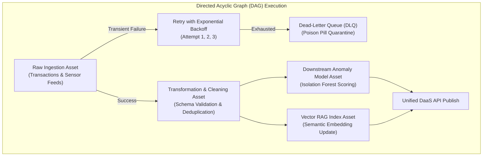
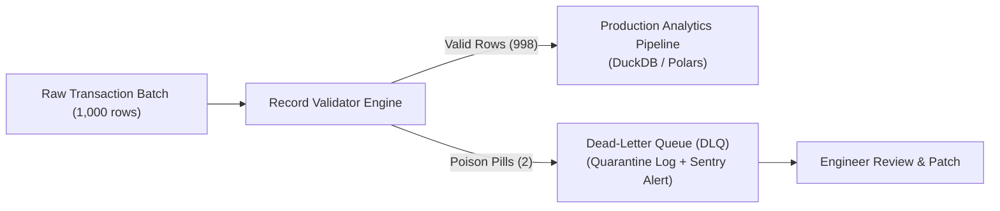
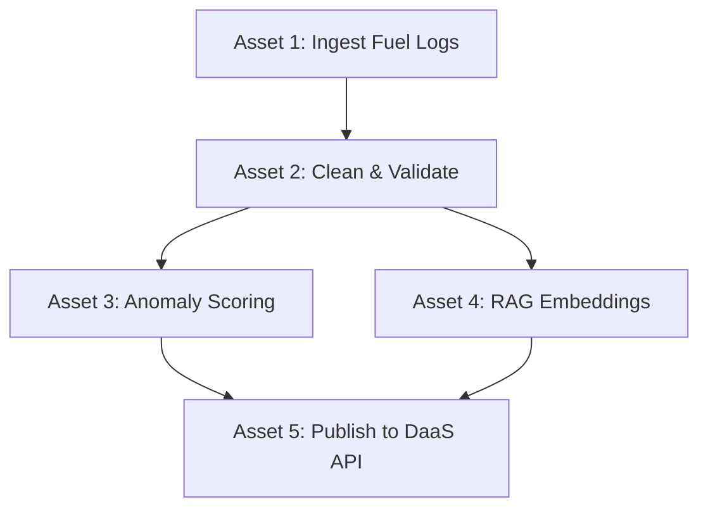

# Unit 7: Orchestration & Automation (The Unsleeping Pipeline)

> **Course**: COSC 2060 — Modern Data Engineering & AI Infrastructure  
> **Estimated Study Time**: 150 minutes of conceptual reading & applied DAG orchestration  
> **Target Audience**: College Sophomores (Prerequisites: Introductory SQL & Introductory Machine Learning)  
> **Core Toolchain**: Python Orchestration Engines (Dagster / Prefect Paradigms), Directed Acyclic Graphs (DAGs), Idempotency, Dead-Letter Queues (DLQ)

---

## 1. Unit Overview & Objectives

In Units 1 through 6, you built each component of an end-to-end AI infrastructure ecosystem:
- Relational feature matrices (Unit 1)
- High-throughput anomaly detection (Unit 2)
- Visual sensor manifests (Unit 3)
- Vector embeddings and RAG (Unit 4)
- Contract-guaranteed REST APIs (Unit 5)
- Sandboxed MCP agentic tools (Unit 6)

Up to this point, you have executed your Python scripts manually in your terminal: `python lab1.py`, `python lab2.py`.

In **Unit 7**, we confront the realities of production engineering: **No human sits in a terminal at 3:15 AM every morning to press "Enter".**

Real enterprise data systems must operate unattended, 24 hours a day, 365 days a year. However, simply scheduling raw Python scripts with basic Linux `cron` or Windows Task Scheduler leads to catastrophic failures. If script #1 fails or hangs due to a network glitch, script #2 runs blind on stale data, poisoning downstream databases and triggering false operational emergencies.

To build reliable data pipelines, data engineers use **Data Orchestrators** (such as **Dagster**, **Prefect**, or **Apache Airflow**). We model data workflows as **Directed Acyclic Graphs (DAGs)**, enforce **idempotency**, configure **exponential backoff retries**, and isolate corrupted records into **Dead-Letter Queues (DLQs)**.



### Measurable Learning Objectives
By the end of this unit, you will be able to:
1. **Explain** why time-based schedulers (Linux `cron`) fail in enterprise environments compared to dependency-aware Directed Acyclic Graph (DAG) orchestrators.
2. **Design and Implement** idempotent data transformations that can be safely re-executed multiple times without producing duplicate records or state corruption.
3. **Configure** automated fault-tolerance mechanisms, including exponential backoff retry policies and alert notifications.
4. **Implement** a Dead-Letter Queue (DLQ) pattern that quarantines malformed "poison pill" records while allowing valid transactional batches to complete.
5. **Construct** an end-to-end Python orchestration engine that executes upstream data ingestion, transforms, and downstream model updates in strict topological dependency order.

---

## 2. The Narrative of Data: The 4:30 AM Stranded Drivers Disaster

To understand why production data engineering abandoned unmanaged cron jobs, examine an authentic failure in nationwide fleet operations.

Apex Freight operated a fleet of 800 trucks. To monitor fuel card fraud and driver compliance, the engineering team set up six nightly Python scripts using standard Linux cron jobs scheduled 30 minutes apart:

```text
# CRON SCHEDULE (THE "HOUSE OF CARDS" ANTI-PATTERN)
0 3 * * * /usr/bin/python3 /etl/01_download_fuel_records.py
30 3 * * * /usr/bin/python3 /etl/02_clean_and_deduplicate.py
0 4 * * * /usr/bin/python3 /etl/03_calculate_mileage_features.py
30 4 * * * /usr/bin/python3 /etl/04_run_anomaly_detection.py
0 5 * * * /usr/bin/python3 /etl/05_freeze_fraudulent_cards.py
```

Notice the fatal assumption: The team assumed that each script would finish within exactly 30 minutes, and that each script would always succeed.

### The Midnight Glitch
On Tuesday at 3:12 AM, the national fuel vendor's FTP server experienced high load. Script #1 (`01_download_fuel_records.py`) hung waiting for an open network socket. It did not download any new files, but because it had no timeout configured, it remained frozen in memory.

At 3:30 AM, cron blindly fired Script #2 (`02_clean_and_deduplicate.py`). Script #2 found an empty incoming directory. Instead of failing with an alert, the script exited with code 0, wiping the intermediate staging table in preparation for incoming rows.

At 4:00 AM, Script #3 executed. Finding zero rows for today, it generated an empty feature table.

### The Catastrophic Cascade
At 4:30 AM, Script #4 (`04_run_anomaly_detection.py`) executed. Finding all current fuel totals recorded as `0.00 gallons` due to the wiped staging table, the model evaluated every active truck as an extreme statistical outlier.

At 5:00 AM, Script #5 (`05_freeze_fraudulent_cards.py`) executed automatically. It read the corrupted anomaly output and **automatically deactivated the corporate fuel cards of 412 active truck drivers**.

Across the Midwest and Great Plains, 412 truck drivers pulled into diesel truck stops at 5:15 AM in 12°F winter temperatures. Every card was declined. Drivers could not purchase fuel or stay warm in idling trucks. Dispatch switchboards were overwhelmed with panic calls. Operations halted nationwide for 7 hours while engineers manually restored database snapshots and unblocked cards one by one. The incident cost the company **$240,000 in emergency towing, driver compensation, and lost shipper trust**.

### The Engineering Autopsy
What was the root cause?
1. **Blind Time-Based Triggering**: Cron has no awareness of dependencies. Script #2 ran even though Script #1 never finished.
2. **Silent Partial Failures**: Scripts returned code 0 when encountering empty data rather than raising an unhandled asset error.
3. **Lack of Idempotency**: Running scripts out of order corrupted existing staging tables.

An orchestrator solves this fundamentally: In a DAG, **Node B never executes until Node A emits a verified completion state**.

---

## 3. Conceptual Mental Model

### A. Linux Cron vs. Modern DAG Orchestrator

| Dimension | Crontab / Task Scheduler | Asset-Based DAG Orchestrator (Dagster / Prefect) |
|---|---|---|
| **Trigger Mechanism** | Fixed clock time (`3:00 AM`) | **Topological dependency** (runs when upstream assets succeed) |
| **Failure Behavior** | Blindly continues running downstream scripts | **Cascading halt**: Downstream tasks are skipped or held |
| **Retry Strategy** | None; script fails and stays dead until next day | **Automated retries** with exponential backoff and jitter |
| **Observability** | Fragmented text files dumped into `/var/log` | **Unified UI**: Visual graph of runs, asset lineage, and execution time |
| **Backfills & Reruns** | Risky; often causes duplicate rows or corrupted state | **Idempotent partitions**: Rerunning any historical date is 100% safe |

---

### B. The Principle of Idempotency

> **Idempotency Definition**: A pipeline operation is **idempotent** if running it multiple times with the exact same input produces the exact same output without side effects or duplicate records.

#### Non-Idempotent (Dangerous) SQL:
```sql
-- DANGEROUS: Running this twice doubles your revenue rows!
INSERT INTO monthly_metrics (month, total_fuel_spend)
SELECT '2024-10', SUM(amount) FROM raw_fuel_transactions;
```

#### Idempotent (Production Safe) SQL / Code:
```sql
-- IDEMPOTENT: Safe to run 100 times without side effects
DELETE FROM monthly_metrics WHERE month = '2024-10';
INSERT INTO monthly_metrics (month, total_fuel_spend)
SELECT '2024-10', SUM(amount) FROM raw_fuel_transactions;
```
Or utilizing an `UPSERT` / `ON CONFLICT (transaction_id) DO UPDATE`.

---

### C. The Dead-Letter Queue (DLQ) Pattern

In data engineering, a **poison pill** is a malformed record (e.g. corrupt UTF-8 bytes, negative fuel prices, or malformed JSON) that causes your pipeline parser to crash.

If one record out of 1,000,000 is corrupted, should the entire pipeline crash and block 999,999 valid transactions? **No.**



The pipeline routes corrupted rows into a **Dead-Letter Queue (DLQ)** with the exact error traceback, while valid records continue flowing unimpeded to downstream consumers.

---

## 4. Deep Dive: DAG Topological Sorting & Retry Mechanics

### REQ-14 Scaffolding: Step-by-Step DAG Execution Sequence

Let us trace how an orchestrator schedules and executes a DAG:



1. **Topological Sort**: The orchestrator inspects dependencies and determines execution tiers:
   - Tier 0: `[Asset 1]`
   - Tier 1: `[Asset 2]`
   - Tier 2: `[Asset 3, Asset 4]` (can execute in parallel!)
   - Tier 3: `[Asset 5]`
2. **Execution State Transition**:
   - `Asset 1` enters state `RUNNING` $\to$ `SUCCESS`.
   - `Asset 2` starts. If a transient error occurs (e.g. file lock), it enters `RETRYING` with an exponential delay:
     $$\text{Wait Time} = 2^{\text{attempt}} \times \text{base\_delay}$$
   - When `Asset 2` succeeds, both `Asset 3` and `Asset 4` are unlocked simultaneously.
   - `Asset 5` waits until **both** upstream parents complete before publishing to the API gateway.

---

## 5. Hands-on Terminal Practice

Let us build an orchestration workflow with dependencies, retries, and a dead-letter queue.

### Exercise 1: Building a Micro-Orchestrator in Python
Create a scratch script `scratch/mini_dag.py`:

```python
import time

class Task:
    def __init__(self, name, action, dependencies=None, max_retries=2):
        self.name = name
        self.action = action
        self.dependencies = dependencies or []
        self.max_retries = max_retries
        self.state = "PENDING"

    def run(self, context):
        for dep in self.dependencies:
            if context[dep].state != "SUCCESS":
                self.state = "SKIPPED"
                print(f"Task '{self.name}' SKIPPED because dependency '{dep}' was not successful.")
                return

        for attempt in range(1, self.max_retries + 2):
            try:
                print(f"Running '{self.name}' (Attempt {attempt})...")
                self.action()
                self.state = "SUCCESS"
                print(f"Task '{self.name}' completed with SUCCESS.")
                return
            except Exception as e:
                print(f"Attempt {attempt} failed: {e}")
                if attempt <= self.max_retries:
                    time.sleep(0.5 * (2 ** attempt))
                else:
                    self.state = "FAILED"
                    print(f"Task '{self.name}' FAILED permanently.")
```

---

## 6. Frequently Encountered Student Gotchas & FAQs

### Gotcha 1: The Infinite Retry Loop
- **Problem**: *"My pipeline has been retrying the same record for 4 hours."*
- **Why this happens**: Retrying only helps **transient errors** (network blips, database connection timeouts). It will **never** fix a **deterministic error** (such as a malformed schema or invalid SQL syntax).
- **The Rule**: Always cap retries (`max_retries=3`). If all retries are exhausted, raise an alert and route the payload to the Dead-Letter Queue.

### Gotcha 2: Building Circular Dependencies (Cycles in a DAG)
- **Problem**: *"Why did my pipeline crash with `CycleDetectedError`?"*
- **Explanation**: A pipeline is a **Directed Acyclic Graph**. If Task A depends on Task B, and Task B depends on Task A, neither can ever start. Always verify that data flows strictly in one direction from sources to destinations.
