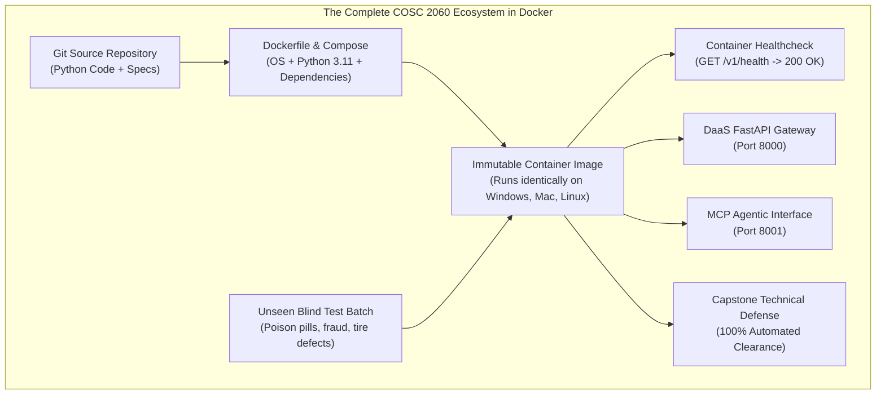
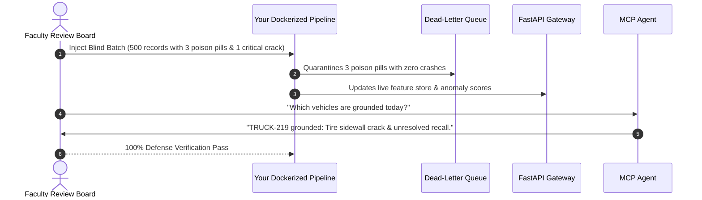

# Unit 8: Capstone Defense & Production Handoff

> **Course**: COSC 2060 — Modern Data Engineering & AI Infrastructure  
> **Estimated Study Time**: 150 minutes of conceptual reading & applied container deployment  
> **Target Audience**: College Sophomores (Prerequisites: Introductory SQL & Introductory Machine Learning)  
> **Core Toolchain**: Docker, `Dockerfile`, `docker-compose.yml`, Healthchecks, Live Defense Protocol

---

## 1. Unit Overview & Objectives

Over the past 14 weeks, you have constructed every layer of an enterprise AI infrastructure ecosystem:
- **Relational Core**: Feature engineering with point-in-time joins in DuckDB (Unit 1)
- **High-Throughput Analytics**: Unsupervised anomaly detection in Polars (Unit 2)
- **Visual Intelligence**: Standardized computer vision manifests in OpenCV (Unit 3)
- **Unstructured Knowledge**: Dense vector search and semantic RAG (Unit 4)
- **Data as a Service**: Contract-guaranteed REST APIs in FastAPI (Unit 5)
- **Agentic Bridges**: Model Context Protocol (MCP) tool integration (Unit 6)
- **Resilient Automation**: Asset-based DAG orchestration and DLQs (Unit 7)

In **Unit 8**, you face the final and most critical milestone of a software and data engineer: **Production Handoff and Live Capstone Defense.**

Building software that only runs on your local laptop is an incomplete engineering achievement. In the enterprise, your pipeline must run reliably in reproducible cloud environments, survive unseen messy data inputs, and be defended before executive stakeholders and technical review boards.

You will package your entire ecosystem into a production **Docker container**, write automated healthchecks, and defend your architecture against an **unseen blind test batch** during a live technical presentation.



### Measurable Learning Objectives
By the end of this unit, you will be able to:
1. **Explain** the principles of containerization (Virtual Machines vs. Linux Containers) and eliminate the "Works on My Machine" failure mode.
2. **Author** a hardened, multi-stage `Dockerfile` and `docker-compose.yml` that pins dependencies, enforces non-root execution, and exposes healthcheck endpoints.
3. **Execute** an end-to-end integration test where an unseen "Blind Test Batch" of multimodal data is ingested, cleansed, evaluated, and served without human intervention.
4. **Articulate** architectural trade-offs, latency SLAs, memory constraints, and defensive failure recoveries in an executive technical presentation.
5. **Defend** your ecosystem against real-time operational stress-tests in a live 15-minute capstone evaluation.

---

## 2. The Narrative of Data: The "Works on My Machine" Tragedy

To appreciate why containerization and reproducible handoffs are mandatory in data engineering, examine an authentic corporate tragedy.

A team of talented junior engineers developed a cutting-edge real-time logistics routing and delay-prediction system for a regional freight carrier. They spent four months refining their algorithms on their high-end local development laptops.

The client scheduled a high-stakes final evaluation with the Chief Technology Officer, VP of Supply Chain, and lead enterprise architects. If the demonstration succeeded, the system would receive a $1.2 million production rollout contract.

### The Disaster in the Boardroom
The team arrived at corporate headquarters. The client provided a fresh, clean cloud staging server running Ubuntu 22.04 LTS and instructed the team to deploy their system:

```bash
git clone https://github.com/client-org/logistics-pipeline.git
python3 main.py
```

Within 12 seconds, the terminal exploded in red text:

```text
Traceback (most recent call last):
  File "main.py", line 4, in <module>
    import cv2
ModuleNotFoundError: No module named 'cv2'
```

The lead engineer stammered: *"Oh, we just need to install OpenCV. Let me run `pip install`..."*

When they ran `pip install opencv-python`, the staging server failed with a missing system library:
```text
ImportError: libGL.so.1: cannot open shared object file: No such file or directory
```

The team attempted to install Linux system packages, but they did not have `sudo` administrator access on the corporate staging server. 

Next, the script tried to read training weights from a hardcoded Mac path:
```text
FileNotFoundError: [Errno 2] No such file or directory: '/Users/alex/Desktop/models/weights.pt'
```

Forty-five minutes elapsed in awkward silence as executives checked their watches. The demo never ran. The CTO closed his notebook and concluded:
> *"Your algorithms may be clever, but your software is not deployable. In our enterprise, if software cannot be deployed reliably in a container with a single command, it is a liability, not an asset."*

The contract was cancelled.

### The Antidote: Containerization
Had the team written a `Dockerfile` and a `docker-compose.yml`, the entire stack would have booted cleanly in 30 seconds with a single command:
```bash
docker compose up --build
```
Every system library (`libgl1-mesa-glx`), every Python dependency, every environment variable, and every file path would have been frozen in an immutable container image that runs identically on a MacBook, a Windows PC, or an enterprise Linux cluster.

---

## 3. Conceptual Mental Model

### A. Virtual Machines (VMs) vs. Docker Containers

| Architectural Dimension | Virtual Machine (VM) | Docker Container |
|---|---|---|
| **Architecture** | Emulates entire physical hardware + Guest OS kernel | Shares host OS kernel; isolates user-space processes |
| **Startup Time** | Minutes (boots full operating system) | **Milliseconds to seconds** (starts isolated process) |
| **Resource Overhead** | Heavy: 4GB+ RAM per VM; gigabytes of disk per OS | **Lightweight**: Minimal memory footprint; shared base layers |
| **Portability** | Heavy VM disk images (.vmdk, .iso) | **Universal**: Standard container images from Docker Hub / OCI |
| **Engineering Role** | Server infrastructure virtualization | **Application packaging, microservices, and reproducible data pipelines** |

---

### B. Anatomy of a Production `Dockerfile`

A `Dockerfile` is an explicit, step-by-step recipe for building an application environment:

```dockerfile
# 1. Base Image: Explicit version (never use 'latest' in production!)
FROM python:3.11-slim

# 2. Install essential OS libraries (e.g. OpenCV headless dependencies)
RUN apt-get update && apt-get install -y --no-install-recommends \
    curl \
    && rm -rf /var/lib/apt/lists/*

# 3. Set Working Directory
WORKDIR /app

# 4. Copy Dependency Manifests First (Optimizes Docker Layer Caching)
COPY requirements.txt .
RUN pip install --no-cache-dir -r requirements.txt

# 5. Copy Application Source Code
COPY . .

# 6. Create Non-Root User for Security
RUN useradd -m appuser && chown -R appuser /app
USER appuser

# 7. Expose Port & Define Healthcheck
EXPOSE 8000
HEALTHCHECK --interval=30s --timeout=5s --retries=3 \
  CMD curl -f http://localhost:8000/v1/health || exit 1

# 8. Start Service
CMD ["python", "main.py"]
```

---

## 4. Deep Dive: The Live Capstone Defense Protocol

### The Blind Test Batch Challenge
During your 15-minute Capstone Defense, your instructor will inject a **Blind Test Batch** into your pipeline:



Your pipeline must successfully:
1. **Ingest** the batch without unhandled exceptions.
2. **Quarantine** poison pill records into the DLQ.
3. **Score** the fuel transactions and identify anomalies.
4. **Update** the DaaS API and MCP tools with fresh state.
5. **Answer** stakeholder questions through the MCP agent interface with verified citations.

---

## 5. Hands-on Terminal Practice

Let us verify container configuration syntax and validate a local multi-service build.

### Exercise 1: Docker Compose Multi-Service Declaration
Examine how `docker-compose.yml` orchestrates the data pipeline and the API service:

```yaml
version: '3.8'

services:
  logistics-api:
    build: .
    container_name: midwest-logistics-daas
    ports:
      - "8000:8000"
    environment:
      - ENVIRONMENT=production
      - LOG_LEVEL=INFO
    healthcheck:
      test: ["CMD", "curl", "-f", "http://localhost:8000/v1/health"]
      interval: 15s
      timeout: 5s
      retries: 3
    restart: unless-stopped
```

---

## 6. Frequently Encountered Student Gotchas & FAQs

### Gotcha 1: Hardcoding `localhost` or Local File Paths
- **Problem**: *"My container can't find `/Users/student/data/shipments.parquet`."*
- **Why this happens**: A container has its own isolated filesystem. It has no access to your personal desktop folders unless explicitly mounted via a Docker volume (`volumes: - ./data:/app/data`).
- **The Rule**: Always use relative paths resolved from the project root (`Path(__file__).parent / "data"`).

### Gotcha 2: The "Works on Windows, Fails in Linux" Line-Ending Trap
- **Problem**: *"Why does my bash entrypoint script throw `exec: /app/entrypoint.sh: no such file or directory` inside Docker?"*
- **Why this happens**: Windows text editors save line breaks with `\r\n` (CRLF), whereas Linux requires `\n` (LF). When Linux encounters `\r`, it interprets it as part of the command name!
- **The Fix**: Configure your Git repository with `.gitattributes` to force `eol=lf` for shell scripts and Dockerfiles.
