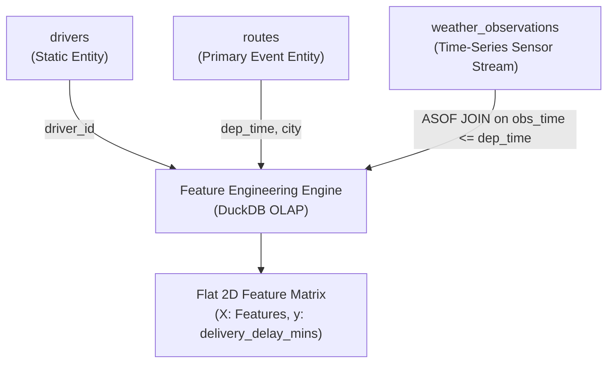

# Technical & Architectural Plan: Unit 1 Foundation Bundle

- **Spec Reference**: [spec.md](file:///c:/dev/Course-Content-Agentic-Template/courses/cosc-2060-data-engineering/specs/001-unit1-foundation-bundle/spec.md)
- **Course**: `cosc-2060-data-engineering`
- **Status**: In Review
- **Target Audience**: College Sophomores (Intro SQL + Intro ML prerequisites)

---

## 1. Technical Architecture & Data Schemas

The data pipeline models an enterprise freight logistics system. Students engineer a flat feature matrix predicting `delivery_delay_mins` (target $y$) from three unjoined, normalized relational tables.



### Table Schemas (Realistic & Messy)
1. **`drivers`** (Dimension Table):
   - `driver_id` (INTEGER, Primary Key)
   - `driver_name` (VARCHAR)
   - `hire_date` (DATE)
   - `safety_score` (DECIMAL(3,2), e.g., 0.85 to 1.00)
   - `vehicle_type` (VARCHAR: `'Semi-Trailer'`, `'Box Truck'`, `'Flatbed'`)

2. **`routes`** (Transactional Fact Table):
   - `route_id` (INTEGER, Primary Key)
   - `driver_id` (INTEGER, Foreign Key)
   - `origin_city` (VARCHAR)
   - `dest_city` (VARCHAR)
   - `dep_time` (TIMESTAMP, e.g. `'2026-10-12 06:15:00'`)
   - `sched_arrival` (TIMESTAMP)
   - `act_arrival` (TIMESTAMP)
   - `distance_miles` (DECIMAL(6,1))
   - `delivery_delay_mins` (INTEGER, Target Label: `act_arrival - sched_arrival` in minutes)

3. **`weather_observations`** (Asynchronous Time-Series Stream):
   - `station_id` (VARCHAR)
   - `city` (VARCHAR)
   - `obs_time` (TIMESTAMP, erratic intervals, e.g. hourly or 30 mins)
   - `precipitation_in` (DECIMAL(4,2))
   - `visibility_miles` (DECIMAL(4,1))
   - `wind_speed_mph` (INTEGER)
   - `road_condition` (VARCHAR: `'Dry'`, `'Wet'`, `'Snow/Ice'`, `'Flooded'`)

---

## 2. Core Transformation Pipeline (DuckDB Mechanics)

### A. The Leak-Free As-Of Join
Standard equality joins (`ON routes.origin_city = weather.city AND routes.dep_date = weather.obs_date`) introduce **look-ahead bias** because a rainstorm at 4:00 PM gets joined to a truck that departed at 8:00 AM. 

DuckDB solves this via its vectorized **`ASOF JOIN`**:
```sql
SELECT 
    r.route_id,
    r.driver_id,
    r.dep_time,
    r.origin_city,
    r.dest_city,
    r.distance_miles,
    w.obs_time AS weather_recorded_at,
    w.precipitation_in,
    w.visibility_miles,
    w.road_condition,
    r.delivery_delay_mins AS target_delay
FROM routes r
ASOF JOIN weather_observations w
  ON r.origin_city = w.city
 AND r.dep_time >= w.obs_time;
```
*Mathematical Condition*: For each route, DuckDB finds the weather record where `origin_city = city` and `obs_time <= dep_time`, selecting the maximum `obs_time` that satisfies the inequality.

### B. Defensive Rolling Window Lags
To predict delay for an upcoming trip, students must compute a driver's recent track record without contaminating the calculation with the current trip's result:
```sql
AVG(r.delivery_delay_mins) OVER (
    PARTITION BY r.driver_id 
    ORDER BY r.dep_time 
    ROWS BETWEEN 5 PRECEDING AND 1 PRECEDING
) AS driver_prior_5trip_avg_delay
```
*Scaffolding Rule*: Explicitly teach why `1 PRECEDING` is mandatory. `CURRENT ROW` causes instant label leakage!

---

## 3. Pure PostgreSQL Alternative Implementation

In the reference guide, we contrast DuckDB's native syntax with the standard PostgreSQL 16 implementation using **`LEFT JOIN LATERAL`**:
```sql
SELECT 
    r.route_id,
    r.dep_time,
    w.obs_time AS weather_recorded_at,
    w.precipitation_in,
    w.visibility_miles
FROM routes r
LEFT JOIN LATERAL (
    SELECT w.obs_time, w.precipitation_in, w.visibility_miles
    FROM weather_observations w
    WHERE w.city = r.origin_city
      AND w.obs_time <= r.dep_time
    ORDER BY w.obs_time DESC
    LIMIT 1
) w ON true;
```
*Performance Contrast*:
- **PostgreSQL**: Implements a nested loop over the subquery, requiring a composite B-Tree index on `(city, obs_time DESC)` to avoid quadratic scan penalties.
- **DuckDB**: Columnar sort-merge / binary search As-Of execution running in vectorized SIMD memory.

---

## 4. Scaffolded Deliverables Layout

```
courses/cosc-2060-data-engineering/
├── content/
│   ├── readings/
│   │   └── unit_01_relational_foundation.md
│   │       ├── 1. Unit Overview & Bloom's Objectives
│   │       ├── 2. The Narrative: Why the $10M Model Failed (Look-Ahead Bias)
│   │       ├── 3. The Mental Model: OLTP Row Filing vs. OLAP Columnar Straws
│   │       ├── 4. Technical Deep Dive: Evolving SQL to Feature Engineering
│   │       │   ├── Step-by-Step Intermediate Schema Progression (REQ-14)
│   │       │   ├── DuckDB ASOF JOIN in Depth
│   │       │   └── Window Function Lag Scaffolding (1 PRECEDING)
│   │       ├── 5. Guided Terminal & CLI Practice
│   │       └── 6. FAQs & Quoted DuckDB Error Messages
│   │
│   ├── labs/
│   │   └── unit_01_feature_matrix_lab.md
│   │       ├── Section 1: Coding Clinic Walkthrough (Gradual Release: "I Do, We Do, You Do")
│   │       ├── Section 2: Applied Lab Challenges (100 Pts) + lab1_starter.py
│   │       └── Section 3: 100-Point Grading Rubric Table
│   │
│   └── reference/
│       └── postgres_temporal_joins_reference.md
│           ├── LATERAL Subquery Syntax & Mechanics
│           ├── Window Function Fallback Pattern (ROW_NUMBER)
│           ├── Index Optimization for Temporal Joins
│           └── EXPLAIN ANALYZE Plan Comparison (DuckDB vs Postgres)
```

---

## 5. ADR & Accessibility Conformance
- **ADR-001 (Accessibility)**: All markdown tables use standard headers (`| Header |`), all code blocks specify language identifiers (`sql`, `python`), and color contrast notes adhere to WCAG 2.2 AA.
- **ADR-002 (Spec Traceability)**: Every requirement (`REQ-01` through `REQ-14`) maps directly to dedicated sections in the content files.
