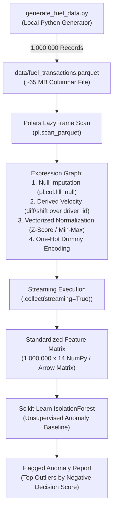
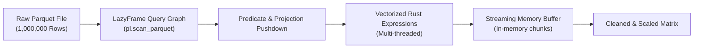

# Technical & Architectural Plan: Unit 2 Anomaly Engine

- **Spec Reference**: [spec.md](file:///c:/dev/Course-Content-Agentic-Template/courses/cosc-2060-data-engineering/specs/002-unit2-anomaly-engine/spec.md)
- **Course**: `cosc-2060-data-engineering`
- **Status**: In Review
- **Target Audience**: College Sophomores (Intro SQL + Intro ML prerequisites)

---

## 1. Technical Architecture & Data Schemas

The data pipeline processes **1,000,000 raw fuel transaction records** generated locally. Students engineer a normalized, scaled feature matrix that feeds an unsupervised **Isolation Forest** anomaly detector to identify fraudulent fuel card activity and fuel theft.



### Dataset Schema: `fuel_transactions.parquet` (1,000,000 Rows)
| Column Name | Data Type | Description | Normal Range / Values |
|---|---|---|---|
| `transaction_id` | `Int64` | Primary Key | 1 to 1,000,000 |
| `timestamp` | `Datetime` | Transaction Timestamp | 2026-09-01 to 2026-09-30 |
| `driver_id` | `Int32` | Fleet Driver Identifier | 101 to 500 |
| `truck_id` | `Int32` | Vehicle Assigned | 1001 to 1400 |
| `station_id` | `Utf8` | Travel Center Station Code | e.g. `'ST-WY-01'`, `'ST-CO-14'` |
| `station_city` | `Utf8` | City Location | Cheyenne, Denver, Salt Lake, Dallas, Omaha |
| `station_state` | `Utf8` | State Abbreviation | WY, CO, UT, TX, NE |
| `station_lat` | `Float32` | Latitude coordinate | 29.0 to 43.0 |
| `station_lon` | `Float32` | Longitude coordinate | -111.0 to -95.0 |
| `fuel_type` | `Utf8` | Fuel Grade Dispensed | `'Diesel'`, `'DEF'`, `'Regular_Gas'` |
| `gallons_pumped` | `Float32` | Volume pumped in gallons | Normal: 40.0 to 240.0 (Capacity = 300 gal) |
| `unit_price` | `Float32` | Price per gallon | $3.45 to $4.30 |
| `transaction_amount`| `Float32` | Total cost (`gallons * unit_price`) | $140.00 to $1,050.00 |
| `odometer_reading` | `Int64` | Truck odometer reading | 150,000 to 750,000 |
| `is_fraud_ground_truth` | `Int8` | Injected ground truth (for verification) | `0` (Normal, 99%), `1` (Fraud, 1%) |

---

## 2. The Three Embedded Fraud Patterns

Students will not use `is_fraud_ground_truth` during training (this is an **unsupervised** learning task). Instead, their feature engineering pipeline must expose physical anomalies that allow the Isolation Forest to isolate outliers:

1. **Tank Capacity Violations (Siphoning / Illegal Container Pumping)**:
   - *Physical Constraint*: Standard Class 8 commercial semi-trucks hold dual 120-150 gallon tanks (maximum fuel capacity $\le 300$ gallons).
   - *Fraud Injected*: Transactions logging $350.0$ to $600.0$ gallons pumped in a single fuel stop.
2. **Impossible Velocity (Cloned Fuel Cards / Teleportation)**:
   - *Physical Constraint*: Commercial trucks cannot exceed realistic highway speeds ($< 75 \text{ mph}$).
   - *Fraud Injected*: The same `driver_id` card is swiped at Station A (e.g. Cheyenne, WY) and then swiped 45 minutes later at Station B (e.g. Denver, CO, 102 miles away), yielding an implied travel speed $> 135 \text{ mph}$.
3. **Dormant Card Swipes (Ghost Drivers / Stolen Cards)**:
   - *Physical Constraint*: Long-haul carriers lock inactive or retired driver cards.
   - *Fraud Injected*: Swipes occurring between 1:00 AM and 4:00 AM on driver accounts flagged as dormant or retired.

---

## 3. The Polars Transformation Pipeline & Scaffolding

### A. Polars Lazy Execution Graph (The Mental Model)
In Pandas, calling `df['x'] = df['x'] * 2` creates an immediate new memory allocation (**Eager Execution**). Doing 10 operations creates 10 intermediate in-memory copies, crashing RAM on 1M rows.

In Polars, calling `.lazy()` constructs a **Directed Acyclic Graph (DAG)** of mathematical expressions. Polars optimizes the query plan (combining column projections, predicate pushdown, and SIMD vector operations) before executing anything when `.collect()` is called.



### B. Scaffolded Intermediate Transformations (REQ-14)

```
STATE 1: Raw Unscaled Input
+----------------+----------------+-------------------+----------------+
| gallons_pumped | odometer       | implied_speed_mph | fuel_type      |
+----------------+----------------+-------------------+----------------+
| 120.5          | 452,100        | 58.2              | Diesel         |
| 520.0 (FRAUD!) | 452,110        | 210.4 (FRAUD!)    | Diesel         |
+----------------+----------------+-------------------+----------------+
Problem: Odometer is in hundreds of thousands, while gallons is in hundreds!
Unscaled distance algorithms (Euclidean) will ignore gallons and focus 99% on odometer.

STATE 2: Vectorized Polars Normalization (Min-Max Scaling)
Formula: (x - x_min) / (x_max - x_min)
+------------------+------------------+----------------------+----------------+
| norm_gallons     | norm_odometer    | norm_implied_speed   | fuel_type      |
+------------------+------------------+----------------------+----------------+
| 0.16             | 0.50             | 0.23                 | Diesel         |
| 1.00 (Outlier!)  | 0.50             | 1.00 (Outlier!)      | Diesel         |
+------------------+------------------+----------------------+----------------+
Both features are now mapped strictly between [0.0, 1.0], giving equal mathematical weight.

STATE 3: Final Feature Matrix (Post One-Hot Encoding)
+--------------+---------------+--------------------+----------------+--------------+
| norm_gallons | norm_odometer | norm_implied_speed | is_diesel      | is_def       |
+--------------+---------------+--------------------+----------------+--------------+
| 0.16         | 0.50          | 0.23               | 1.0            | 0.0          |
| 1.00         | 0.50          | 1.00               | 1.0            | 0.0          |
+--------------+---------------+--------------------+----------------+--------------+
```

---

## 4. Deliverables File Mapping

```
courses/cosc-2060-data-engineering/
├── content/
│   ├── readings/
│   │   └── unit_02_anomaly_engine.md
│   │       ├── 1. Unit Overview & Bloom's Objectives
│   │       ├── 2. The Narrative: The Ghost Fuel Card Ring ($2.4M Theft)
│   │       ├── 3. The Mental Model: The Ruler Distortion (Why Scaling Matters)
│   │       ├── 4. Technical Deep Dive: Polars Architecture vs. Pandas OOM
│   │       │   ├── Arrow Memory & GIL Bypass
│   │       │   ├── Expressions Context (select, with_columns, filter)
│   │       │   ├── REQ-14 Scaffolded Intermediate Schemas
│   │       │   └── Lazy vs. Eager Execution Graphs
│   │       ├── 5. Guided Student Practice (Polars CLI / Python)
│   │       └── 6. FAQs & Quoted Polars Error Messages (ComputeError, SchemaError)
│   │
│   ├── labs/
│   │   ├── generate_fuel_data.py          # Synthetic 1M generator script
│   │   └── unit_02_anomaly_pipeline_lab.md # 3-section lab guide + lab2_starter.py
│   │
│   └── reference/
│       └── pandas_vs_polars_memory_benchmark.md # Memory profiling (RSS) & GIL benchmarks
```

---

## 5. ADR & Accessibility Conformance
- **ADR-001 (Accessibility)**: All markdown tables adhere to WCAG 2.2 AA formatting; code blocks specify language tags (`python`, `sql`); high-contrast code themes.
- **ADR-002 (Spec Traceability)**: Full alignment with `REQ-01` through `REQ-15`.
