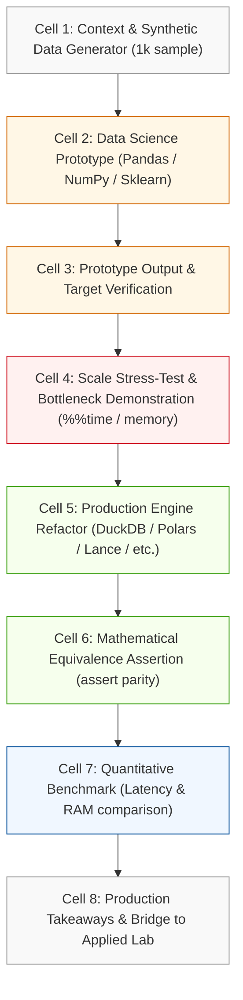

# Implementation Plan 005: Traditional Data Science Prototype to Modern Data Engineering Pipeline Notebooks

## Status
- **Course**: `cosc-2060-data-engineering` (COSC 2060: Modern Data Engineering & AI Infrastructure)
- **Active Stage**: Stage 2 — Plan
- **Preceding Spec**: [spec.md](file:///c:/dev/Course-Content-Agentic-Template/courses/cosc-2060-data-engineering/specs/005-ds-prototype-to-de-engine-notebooks/spec.md)

---

## 1. Technical Architecture & Pedagogical Strategy

### 1.1 The "Re-Platforming" Persona Model
Each notebook introduces an authentic workplace scenario:
> *"Your data science colleague, Dr. Elena Rostova, prototyped a feature transformation in a Jupyter Notebook using Pandas and Scikit-Learn. It worked on her 1,000-row test sample, but when scheduled against the live 1M-row sensor stream, the job ran out of memory and failed. Your task as the AI Data Engineer is to re-platform this logic into our production engine without altering the mathematical output."*

This framing lowers cognitive barrier, respects what sophomores already know, and instills professional pride in engineering rigor.

---

### 1.2 The Standard 8-Cell Notebook Anatomy
Every notebook will follow this strict 8-cell structural template to ensure pedagogical consistency:



---

## 2. Unit-by-Unit Technical Architecture & Notebook Layout

```
courses/cosc-2060-data-engineering/
├── content/
│   └── notebooks/
│       ├── unit_01_ds_to_engine.ipynb  # Pandas merge_asof -> DuckDB ASOF JOIN
│       ├── unit_02_ds_to_engine.ipynb  # Pandas .apply() -> Polars Lazy Streaming
│       ├── unit_03_ds_to_engine.ipynb  # PIL / Matplotlib -> OpenCV Batch Normalization
│       ├── unit_04_ds_to_engine.ipynb  # TF-IDF / Cosine -> Sentence-Transformers & ChromaDB
│       ├── unit_05_ds_to_engine.ipynb  # Pickle/CSV Script -> FastAPI + Pydantic v2 DaaS
│       ├── unit_06_ds_to_engine.ipynb  # Ad-hoc Prompt Script -> FastMCP Stdio Agent Tool
│       ├── unit_07_ds_to_engine.ipynb  # Linear Cell Sequence -> Dagster Asset DAG
│       └── unit_08_ds_to_engine.ipynb  # Local Fragile Script -> Docker + Pytest Suite
```

### Detailed Unit Design Specifications

#### Unit 01: Temporal Joins & Feature Stores (`unit_01_ds_to_engine.ipynb`)
- **Prototype (DS)**: `pd.merge_asof(trips, weather, on='timestamp', by='route_id', direction='backward')`.
- **Failure Mode**: Multi-pass sorting in RAM; massive memory footprint when handling 500,000 records; silent look-ahead bias if timestamps are misaligned or direction is set improperly.
- **Engine Refactor (DE)**: In-process **DuckDB** reading directly from Parquet with `ASOF JOIN weather ON trips.route_id = weather.route_id AND trips.timestamp >= weather.timestamp`.
- **Verification Assertion**: `pandas.testing.assert_frame_equal(duckdb_df, pandas_df)`.

#### Unit 02: High-Throughput Transformation & Anomaly Engine (`unit_02_ds_to_engine.ipynb`)
- **Prototype (DS)**: Pandas row-by-row iteration or `.apply(lambda row: (row['fuel'] - mean) / std)` and rolling window loops across a simulated telemetry stream.
- **Failure Mode**: Global Interpreter Lock (GIL) locks single CPU core; 1,000,000 rows takes 15–30 seconds and consumes ~1.2 GB RAM.
- **Engine Refactor (DE)**: **Polars** multi-threaded lazy execution: `df.lazy().with_columns(((pl.col('fuel') - pl.col('fuel').rolling_mean(window_size=20)) / pl.col('fuel').rolling_std(window_size=20)).alias('z_score')).collect()`.
- **Verification Assertion**: `np.allclose(polars_df['z_score'].to_numpy(), pandas_df['z_score'].to_numpy(), equal_nan=True)`.

#### Unit 03: Multimodal Vision Tensors & Manifests (`unit_03_ds_to_engine.ipynb`)
- **Prototype (DS)**: Loading individual images via PIL `Image.open()`, iterating sequentially in a Python `for` loop, manual aspect ratio calculation, Matplotlib figure saving.
- **Failure Mode**: Single-threaded bottleneck (I/O and CPU bound); incompatible with downstream batch tensor inputs for PyTorch/ONNX YOLO models.
- **Engine Refactor (DE)**: High-throughput **OpenCV (`cv2.resize`, `cv2.copyMakeBorder`)** vector letterboxing, vectorized bounding box re-scaling `[x_center, y_center, width, height]`, and batch Parquet manifest generation.
- **Verification Assertion**: Exact bounding box coordinate parity ($< 10^{-4}$ tolerance) and tensor shape $(B, 3, 640, 640)$ verification.

#### Unit 04: Unstructured Text & Vector Search (`unit_04_ds_to_engine.ipynb`)
- **Prototype (DS)**: Storing unstructured work order logs in Pandas; computing Scikit-Learn `TfidfVectorizer` and computing pairwise cosine distance across all documents in memory.
- **Failure Mode**: Lexical vocabulary mismatch (fails on synonyms like "blown head gasket" vs. "coolant engine leak"); $O(N)$ brute-force memory scan collapses when document counts scale.
- **Engine Refactor (DE)**: **Sentence-Transformers** (`all-MiniLM-L6-v2`) dense vectorization loaded into a persistent local **ChromaDB** collection with HNSW indexing and metadata filtering.
- **Verification Assertion**: Semantic match recall test demonstrating semantic retrieval of synonyms where TF-IDF returned score 0.0.

#### Unit 05: Data as a Service (DaaS) REST APIs (`unit_05_ds_to_engine.ipynb`)
- **Prototype (DS)**: Python script loading a pickled DataFrame and exposing a synchronous function `get_prediction(vin, date)` with no schema or type validation.
- **Failure Mode**: Accepts invalid types (string instead of float), throws unhandled 500 exceptions, cannot handle concurrent requests, no documentation for frontend/agent clients.
- **Engine Refactor (DE)**: Asynchronous **FastAPI** application with **Pydantic v2** `BaseModel` schema validation, automatic HTTP 422 error handlers, and auto-generated Swagger UI (`/docs`).
- **Verification Assertion**: `TestClient(app).post()` testing valid payloads, boundary invalid payloads (type mismatch, range error), and async response latency.

#### Unit 06: Agentic Interfaces via MCP (`unit_06_ds_to_engine.ipynb`)
- **Prototype (DS)**: Manual copy-paste prompt engineering where a data scientist extracts DataFrame rows, converts them to markdown strings, and pastes them into a static LLM prompt template.
- **Failure Mode**: Cannot be invoked dynamically by an autonomous AI agent; prone to prompt injection and hallucinated schemas; static snapshot quickly becomes stale.
- **Engine Refactor (DE)**: Standardized **Model Context Protocol (FastMCP)** server exposing `@mcp.tool()` endpoints that query live DuckDB tables and return structured JSON-RPC messages.
- **Verification Assertion**: JSON-RPC schema compliance test simulating an agent tool discovery request and dynamic tool invocation with parameter validation.

#### Unit 07: Pipeline Orchestration & Asset Lineage (`unit_07_ds_to_engine.ipynb`)
- **Prototype (DS)**: A monolithic Jupyter Notebook with sequential cells: Ingest $\rightarrow$ Clean $\rightarrow$ Join $\rightarrow$ Export to CSV, run manually by pressing "Restart & Run All".
- **Failure Mode**: Silent partial failures (corrupted intermediate state); lack of caching (re-runs expensive extracts every time); zero automated alerting or lineage visualization.
- **Engine Refactor (DE)**: **Dagster Software-Defined Assets (`@asset`)** with explicit upstream dependencies, asset checks, metadata materialization, and local Dagit/Dagster UI visualization.
- **Verification Assertion**: Dagster in-memory materialization test verifying dependency graph order, asset hash caching, and failure boundary isolation.

#### Unit 08: Capstone Production Defense & Packaging (`unit_08_ds_to_engine.ipynb`)
- **Prototype (DS)**: A loose script with hardcoded local file paths (`C:\Users\username\Desktop\...`), unpinned dependencies, and no automated tests ("it works on my machine").
- **Failure Mode**: Immediate crash in foreign environment (Docker, CI/CD, or production server); missing system libraries.
- **Engine Refactor (DE)**: Production Python package layout (`pyproject.toml` / `requirements.txt`), deterministic environment configuration, companion **Dockerfile**, and automated **Pytest** data contract validation test suite.
- **Verification Assertion**: Execution of Pytest test suite inside a simulated isolated virtual environment verifying 100% test pass rate.

---

## 3. ADR Conformance & Constraints

### 3.1 Accessibility (ADR-001)
- Notebook markdown cells will use semantic heading structures (`#`, `##`, `###`).
- Code blocks will include inline explanatory comments and plain-text output alternatives.
- Color palettes in Matplotlib/Seaborn prototype cells will adhere to colorblind-safe standards (e.g., `viridis`, high-contrast lines).

### 3.2 Spec-Driven Development (ADR-002)
- All 8 notebooks map 1-to-1 to EARS requirements `EARS-001` through `EARS-028` in [spec.md](file:///c:/dev/Course-Content-Agentic-Template/courses/cosc-2060-data-engineering/specs/005-ds-prototype-to-de-engine-notebooks/spec.md).

### 3.3 Platform & Cost Constraints
- **100% Free & Open-Source**: Zero proprietary cloud APIs, zero credit card requirements.
- **Student Hardware Target**: Tested to run on a standard student laptop (minimum 8 GB RAM, 4 CPU cores, Windows/macOS/Linux).
- **Execution Self-Containment**: Each notebook dynamically generates its own deterministic mock dataset in Cell 1, eliminating external download failures or broken URLs.

---

## 4. Verification & Testing Strategy

A dedicated verification script will be created at:  
`scratch/verify_ds_to_engine_notebooks.py`

This script will programmatically:
1. Parse every `.ipynb` file in `content/notebooks/`.
2. Verify all 8 cells conform to the standard anatomy.
3. Execute the notebook top-to-bottom using `nbformat` and `nbconvert.preprocessors.ExecutePreprocessor`.
4. Capture and verify:
   - Zero unhandled exceptions or syntax errors.
   - All assertion cells (`assert`, `np.allclose`, `assert_frame_equal`) evaluate to `True`.
   - Benchmark outputs confirm the production engine achieved lower latency and memory footprint than the prototype.
