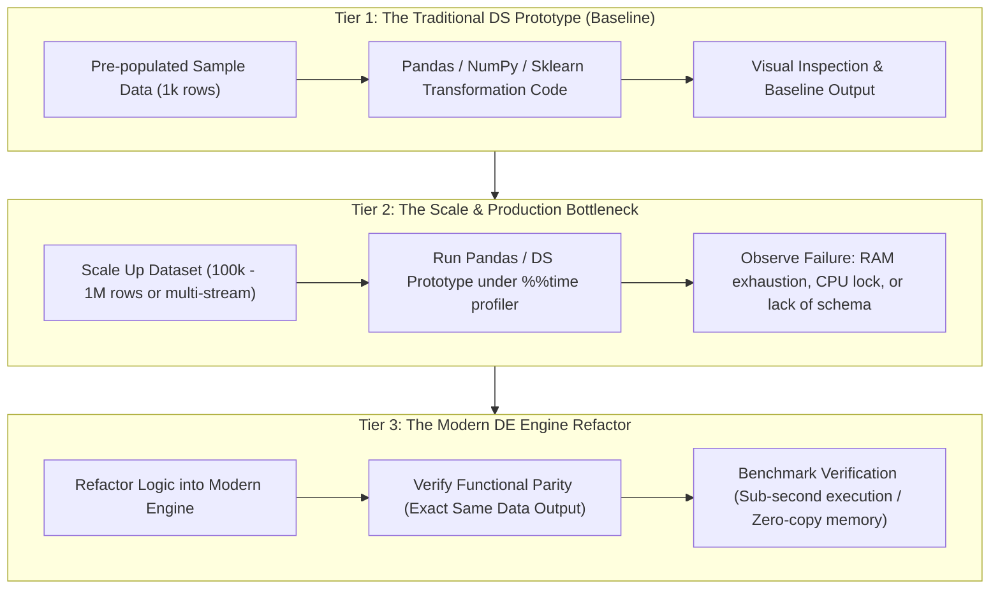

# Specification 005: Traditional Data Science Prototype to Modern Data Engineering Pipeline Notebooks

## Status
- **Course**: `cosc-2060-data-engineering` (COSC 2060: Modern Data Engineering & AI Infrastructure)
- **Active Stage**: Stage 1 — Specify
- **Author**: Antigravity Assistant & Faculty Lead
- **Target Deliverable**: 8 Interactive Transition Notebooks (`content/notebooks/unit_01_ds_to_engine.ipynb` through `unit_08_ds_to_engine.ipynb`)

---

## 1. Problem Statement & User Intent
In modern AI and data organizations, data scientists routinely prototype data preparation, feature engineering, and exploratory pipelines inside Jupyter Notebooks using the traditional Python Data Science stack (**Pandas, NumPy, Scikit-Learn**). 

However, these prototypes are not production-ready:
1. They are bound to single-threaded Python runtime execution.
2. They duplicate in-memory data representations (Pandas 2x–5x RAM bloat), hitting out-of-memory crashes on realistic datasets.
3. They lack schema enforcement, asynchronous streaming, asset-level orchestration, and deterministic agent interfaces.

The goal of this feature is to scaffold and provide a complete 8-unit suite of interactive **"DS Prototype $\rightarrow$ DE Production Engine"** Jupyter Notebooks. These notebooks will bridge what college sophomores already know (introductory Pandas/NumPy data science) to what industry data engineers actually build (DuckDB, Polars, OpenCV, ChromaDB, FastAPI, FastMCP, Dagster, Docker).

---

## 2. Target Audience & Pedagogical Context
- **Target Audience**: College Sophomores (2nd-year undergraduates, LCCC).
- **Prerequisites**: Introductory SQL and basic introductory Python Data Science (familiar with Pandas DataFrames, CSV loading, and train/test splits).
- **Cognitive Guardrails & Workload Control**:
  - Students must NOT be burdened with building two full end-to-end labs from scratch per unit.
  - The Traditional Data Science prototype (Pandas/NumPy) shall be pre-provided in Cells 1–3 on a micro-sample dataset (1,000 rows).
  - The scale failure/bottleneck cell shall be pre-built with live execution timers (`%%time` and memory profiling).
  - The student's primary active task is implementing the refactor into the production data engineering engine, validating the transformation correctness, and verifying the 10x–100x performance/memory improvement.

---

## 3. Structural Standard: The 3-Tier Transition Pattern

Every unit notebook shall adhere strictly to a standardized 3-tier architecture:

---

## 4. EARS Requirements Specification

### Global Requirements
- **EARS-001 (Ubiquitous)**: Every notebook shall be delivered as a fully executable, self-contained `.ipynb` Jupyter notebook compatible with standard Python 3.10+ environments and Google Colab.
- **EARS-002 (Ubiquitous)**: Every notebook shall include markdown narrative scaffolding explaining the business context, the colleague persona handing off the prototype, and the specific failure mode being resolved.
- **EARS-003 (Ubiquitous)**: Every notebook shall include an automated assertion test cell verifying that the output of the modern data engineering engine matches the mathematical output of the prototype within machine precision.
- **EARS-004 (Ubiquitous)**: Every notebook shall include an active benchmarking comparison cell contrasting execution time and peak memory consumption between the prototype and the production engine.

---

### Unit-by-Unit Technical Requirements

#### Unit 1: Temporal Joins & Feature Stores (DuckDB vs. Pandas)
- **EARS-005 (Ubiquitous)**: The Unit 1 notebook shall provide a Pandas prototype performing `pd.merge_asof()` and manual `.ffill()` across simulated IoT sensor and dispatch event logs.
- **EARS-006 (When - Scale Trigger)**: When executed against 500,000 historical records, the notebook shall demonstrate the high memory footprint and sorting overhead of Pandas.
- **EARS-007 (Ubiquitous)**: The refactor tier shall guide students to implement the exact same point-in-time lookup using native **DuckDB SQL (`ASOF JOIN`)** directly querying Parquet files, demonstrating zero-copy and sub-second execution.

#### Unit 2: High-Throughput Transformation & Outlier Detection (Polars vs. Pandas)
- **EARS-008 (Ubiquitous)**: The Unit 2 notebook shall provide a Pandas prototype using iterative row `.apply()` lambda functions and standard `.rolling()` to compute z-scores across a fuel telemetry stream.
- **EARS-009 (When - Scale Trigger)**: When scaled to 1,000,000 rows, the notebook shall demonstrate Python GIL (Global Interpreter Lock) constraints and multi-second single-threaded delays.
- **EARS-010 (Ubiquitous)**: The refactor tier shall guide students to implement the calculation using **Polars LazyFrame expressions** (`pl.col().rolling_mean()`, `pl.when().then()`), demonstrating Apache Arrow columnar parallelism and streaming execution.

#### Unit 3: Multimodal Vision Tensors & Manifests (OpenCV vs. PIL/Matplotlib)
- **EARS-011 (Ubiquitous)**: The Unit 3 notebook shall provide a traditional data science prototype using PIL (`Image.open`) and Matplotlib to manually load, crop, resize, and display vehicle surveillance images.
- **EARS-012 (When - Scale Trigger)**: When scaling to a batch of 500 images, the notebook shall illustrate memory bloat and sluggish single-threaded processing.
- **EARS-013 (Ubiquitous)**: The refactor tier shall implement high-throughput **OpenCV (`cv2`)** letterboxing, spatial coordinate normalization, and structured YOLO manifest generation into NumPy array batches ready for inference.

#### Unit 4: Unstructured Text & Vector Search (ChromaDB vs. Pandas/TF-IDF)
- **EARS-014 (Ubiquitous)**: The Unit 4 notebook shall provide a prototype using Pandas text filtering and Scikit-Learn `TfidfVectorizer` with pairwise cosine similarity over maintenance work orders.
- **EARS-015 (When - Semantic Query Trigger)**: When querying conceptual synonyms (e.g., "radiator overheating" vs. "coolant boiling over"), the notebook shall demonstrate the fatal lexical limitations of traditional TF-IDF keyword matching.
- **EARS-016 (Ubiquitous)**: The refactor tier shall implement dense embeddings via **Sentence-Transformers** stored in **ChromaDB**, executing indexed semantic top-$k$ nearest-neighbor retrieval with metadata filtering.

#### Unit 5: Data as a Service REST APIs (FastAPI vs. Pickled DataFrames)
- **EARS-017 (Ubiquitous)**: The Unit 5 notebook shall provide a prototype of a data scientist loading a static `pickle` file or CSV with `df.to_dict()` inside a basic script to answer queries.
- **EARS-018 (If - Invalid Input Condition)**: If corrupt types or malformed query parameters are passed to the prototype, then the prototype shall fail silently or raise unhandled runtime exceptions.
- **EARS-019 (Ubiquitous)**: The refactor tier shall implement an asynchronous **FastAPI** route backed by **Pydantic v2** models, demonstrating strict type validation, automated OpenAPI documentation, and high-concurrency throughput.

#### Unit 6: Agentic Bridges & Tool Execution (FastMCP vs. Manual Ad-Hoc Scripts)
- **EARS-020 (Ubiquitous)**: The Unit 6 notebook shall provide a prototype showing manual interactive prompt construction where a user pastes raw DataFrame query results into an LLM prompt.
- **EARS-021 (When - Autonomy Trigger)**: When an agent needs to dynamically pull fresh warehouse inventory on demand, the prototype shall prove incapable of autonomous two-way execution.
- **EARS-022 (Ubiquitous)**: The refactor tier shall implement a standardized **Model Context Protocol (FastMCP)** tool using `@mcp.tool()` to expose analytical DuckDB queries to autonomous agents via JSON-RPC.

#### Unit 7: Pipeline Orchestration & Lineage (Dagster vs. Linear Notebook Execution)
- **EARS-023 (Ubiquitous)**: The Unit 7 notebook shall provide a prototype of a multi-stage pipeline run as sequential notebook cells (Extract $\rightarrow$ Clean $\rightarrow$ Aggregate $\rightarrow$ Export).
- **EARS-024 (If - Upstream Failure Condition)**: If an intermediate step fails midway, the prototype shall demonstrate state corruption and lack of lineage tracking.
- **EARS-025 (Ubiquitous)**: The refactor tier shall re-architect the stages into **Dagster Software-Defined Assets (`@asset`)**, defining explicit dependencies, asset checks, and deterministic caching.

#### Unit 8: Capstone Production Defense & Packaging (Docker + Pytest vs. Local Script)
- **EARS-026 (Ubiquitous)**: The Unit 8 notebook shall provide a prototype script that works only under specific local Python path assumptions ("works on my machine").
- **EARS-027 (If - Drift Condition)**: If run in a blind test environment with missing dependencies or unexpected data drift, the prototype shall crash.
- **EARS-028 (Ubiquitous)**: The refactor tier shall structure the pipeline into a modular Python package with a companion **Dockerfile** and automated **Pytest** data contract validation suite.

---

## 5. Out of Scope Boundaries
- **Rewriting Existing Canvas WikiPages**: The completed Canvas HTML reading pages, flipped guides, and lab guides will remain intact. The notebooks will be added as high-value hands-on companions linked within the modules.
- **Replacing ChromaDB**: Per user decision, ChromaDB is locked as the primary vector store; LanceDB will not replace ChromaDB in Unit 4.
- **Cloud Infrastructure / AWS / GCP**: All notebooks and refactors shall run 100% locally on standard student hardware with zero cloud subscriptions or API keys required.

---

## 6. Verification & Quality Gates
- **Syntax & Execution Gate**: Every `.ipynb` notebook must successfully execute top-to-bottom without unhandled exceptions via automated test runners (`nbconvert --execute`).
- **Assertion Gate**: The comparison test cells in Tier 3 must assert `True` across all 8 notebooks.
- **Speedup Demonstration**: Each unit benchmark cell must empirically prove that the modern data engineering engine completes the operation significantly faster than the Pandas/DS prototype.
- **Clean Environment**: All dependencies must be installable via a single `pip install -r requirements.txt`.
