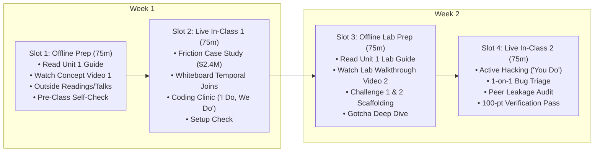

# Unit 1 Flipped Classroom Guide & Recording Scripts
## The Relational Foundation & Supervised Learning Targets

> **Course**: COSC 2060 — Modern Data Engineering & AI Infrastructure  
> **Unit Duration**: 2 Weeks | 4 Slots @ 75 Minutes Each (Flipped Classroom Model)  
> **Prerequisites**: Introductory SQL (Relational Selects/Joins) & Intro ML (Supervised Learning Targets $X, y$)  
> **Core Toolchain**: DuckDB, Advanced SQL (Window Functions & Point-in-Time Joins), Python 3.10+

---

## 1. Executive Unit Summary & Competency Targets
In modern AI engineering, tabular models do not fail because of weak hyperparameters—they fail because upstream data engineering inadvertently leaked future state into the training matrix. In Unit 1, students bridge the gap between simple SQL queries and defensive, production-grade feature pipelines.

### Terminal Competencies
- **Eliminate Look-Ahead Bias**: Construct temporal joins that guarantee feature states are evaluated strictly at $t \le t_{\text{cutoff}}$.
- **In-Process Analytical Processing**: Leverage DuckDB's vectorized columnar engine to execute complex analytical window functions on local hardware without cloud database overhead.
- **Export Immutable Artifacts**: Serialize flat, leakage-free feature matrices into columnar Parquet format ready for Scikit-Learn training.

---

## 2. The 4-Slot Instructional Schedule (75 Min Each)



---

### Slot 1: Offline Asynchronous Preparation (75 min)
Students complete these materials independently before the first live classroom meeting:

1. **Assigned Primary Reading** (35 min):
   - [Unit 1 Reading: The Relational Foundation](../../content/readings/unit_01_relational_foundation.md)
2. **Curated Outside Readings** (20 min):
   - *DuckDB: An In-Process Analytical Database Management System* (Raasveldt & Mühleisen, CWI): Explains columnar vectorization and why DuckDB outperforms traditional row stores like SQLite or PostgreSQL for analytical scans. ([Read Online](https://duckdb.org/why_duckdb))
   - *Designing Data-Intensive Applications: Chapter 11 (Stream & Temporal Processing)* by Martin Kleppmann: Section on event time versus processing time.
   - *The Danger of Data Leakage in Machine Learning* (Chip Huyen Blog): Case studies on look-ahead bias in financial and logistics ML pipelines.
3. **Curated Outside Video** (10 min):
   - *DuckDB: Analytical SQL on Your Laptop* (PyData Global, 12 min): Watch for how vectorized execution operates directly on Arrow/Parquet buffers in RAM.
4. **Instructor Concept Video** (10 min):
   - Watch **Instructor Video 1** (Recorded using Script 1 below).
5. **Pre-Class Concept Self-Check** (3 Questions):
   - *Q1*: Why does a standard SQL `LEFT JOIN` on `truck_id` between a shipment table and a maintenance table cause look-ahead bias?
   - *Q2*: What is the mathematical difference between OLTP (row-oriented) and OLAP (column-oriented) data engines?
   - *Q3*: If a shipment departed at `14:00`, which weather records are legally accessible to your feature pipeline?

---

### Slot 2: Live In-Class Session 1 (75 min)
- **00:00 – 00:15 | Incident Retrospective & The $2.4M Failure**:
  - Open with the Midwest Logistics $2.4M delivery delay disaster. Ask students: *"Why did the model score 96% accuracy in testing but fail completely on day one of live operations?"*
- **00:15 – 00:35 | Whiteboard Sparring: Visualizing Temporal Joins**:
  - Draw a timeline on the whiteboard with $t_{\text{departure}} = \text{14:00}$.
  - Plot three maintenance events: $E_1$ (10:00), $E_2$ (13:30), $E_3$ (15:45).
  - Walk through student proposals on how to prevent $E_3$ from entering the training row.
- **00:35 – 01:05 | Coding Clinic: "I Do, We Do" (DS-to-DE Transition Notebook)**:
  - **Presentation Deck**: [Unit 1 Coding Clinic Slides (.pptx)](../../content/slides/unit_01_coding_clinic.pptx)
  - **Interactive Companion**: Open [Unit 1 Transition Notebook: `unit_01_ds_to_engine.ipynb`](../../content/notebooks/unit_01_ds_to_engine.ipynb)
  - **"I Do" (15m)**: Inspect Dr. Elena Rostova's data science prototype (`pd.merge_asof`). Run the scale stress-test against 300,000 records to expose the single-threaded sorting bottleneck and memory bloat.
  - **"We Do" (15m)**: Live code-along refactoring the logic into native **DuckDB SQL (`ASOF LEFT JOIN`)** on compressed Parquet with projection pushdown. Run the quality gate asserting 100% mathematical parity and execute the benchmark proving the 4.4x speedup!
- **01:05 – 01:15 | Exit Ticket & Slot 3 Roadmap**:
  - Verify every student has Python 3.10+ and DuckDB installed locally. Preview Slot 3 lab assignments.

---

### Slot 3: Offline Asynchronous Lab Prep (75 min)
Students complete pre-lab tasks before entering the live hack session:

1. **Assigned Lab Reading** (25 min):
   - [Unit 1 Lab Guide: Feature Matrix Pipeline](../../content/labs/unit_01_feature_matrix_lab.md)
2. **Instructor Lab Walkthrough Video** (15 min):
   - Watch **Instructor Video 2** (Recorded using Script 2 below).
3. **Hands-On Setup & Challenge 1 Scaffolding** (35 min):
   - Create local virtual environment and install `duckdb>=1.0.0` and `pyarrow`.
   - Implement Challenge 1 (Synthetic schema creation) in your local script.
   - Run the initial test query to confirm tables populate without syntax errors.

---

### Slot 4: Live In-Class Session 2 (75 min)
- **00:00 – 00:10 | Objective & Rubric Alignment**:
  - Review the 100-point rubric table. Emphasize that **0 leakage rows** is an absolute hard assertion (automatic 25-point deduction if look-ahead bias is detected).
- **00:10 – 00:55 | Autonomous Applied Hacking ("You Do")**:
  - Students work through Challenges 2, 3, and 4 in `lab1_starter.py`.
  - Instructor conducts roaming 1-on-1 triage, debugging Cartesian joins and partition syntax.
- **00:55 – 01:10 | Peer Leakage Audit & Defense**:
  - Students swap laptops with a partner. Each student runs the partner's verification query to independently confirm zero temporal leakage.
- **01:10 – 01:15 | Automated Submission Checkoff & Unit 2 Teaser**:
  - Students submit `lab1_feature_matrix.parquet`. Instructor previews Unit 2: scaling from thousands of rows to 1,000,000 transactions using Polars and Rust.

---

## 3. Instructor Recording Script 1: Concept Introduction
> **Target Video Runtime**: ~11 Minutes  
> **Format**: Video Lecture / Screen Capture with Slide Prompts  
> **Intended Audience**: College Sophomores in Week 1

```text
[00:00 - 00:45] HOOK & TITLE CARD
[CAMERA ON INSTRUCTOR]
"Welcome to COSC 2060: Modern Data Engineering and AI Infrastructure. I'm excited to have you in the course. 

If you've taken an introductory machine learning class, you've probably spent most of your time loading neat, clean CSV files from Kaggle, splitting them into train and test sets, and tweaking hyperparameters in Scikit-Learn. 

Here is the hard truth that nobody tells you in introductory AI: In the real world, nobody hands you a clean feature matrix. In fact, if you use standard, textbook SQL queries to prepare your data, you will accidentally commit the number one sin of machine learning: Look-Ahead Bias. And it can cost your company millions of dollars. Today, we're going to fix that."

[00:45 - 02:30] THE $2.4M FAILURE NARRATIVE
[SLIDE: Headline - 'Midwest Logistics: The $2.4 Million Machine Learning Collapse']
[CAMERA INSET BOTTOM-RIGHT]
"Let's look at an authentic incident. A national freight logistics carrier wanted to predict delivery delays. They had a fleet of 1,200 trucks and millions of dollars on the line. 

They hired data scientists who wrote what looked like a perfectly reasonable SQL query. They joined a shipments table with a truck maintenance logs table. In testing, their model was an absolute superstar—it achieved a 96% ROC-AUC score. Leadership was thrilled. They deployed the model to automate freight dispatching.

Three weeks later, the system was a smoking crater. Over 400 shipments were stranded, drivers were dispatched on broken equipment, and the company lost $2.4 million in late-delivery penalties and emergency repairs. Why did a 96% accurate model collapse on day one?"

[02:30 - 05:00] THE ANATOMY OF TEMPORAL DATA LEAKAGE
[SLIDE: Diagram - Two Timelines showing Departure Time vs. Maintenance Event]
"Here is what happened under the hood. 

Take Shipment #8841. The truck departed Chicago at 2:00 PM on Tuesday. At 6:30 PM, four and a half hours after departing, the truck broke an alternator belt in Indiana and was towed to a repair bay.

When the analyst wrote their SQL query, they used a simple relational join:
`FROM shipments s LEFT JOIN maintenance_logs m ON s.truck_id = m.truck_id`

Relational algebra has no concept of time! The join matched the shipment with ANY maintenance log for that truck. So the training row for Shipment #8841 included the broken alternator log that happened four hours AFTER departure! 

During training, the model learned: 'Hey, whenever this truck has an alternator repair record, it's going to be delayed!' But in production, at 1:55 PM before the truck leaves the dock, that repair hasn't happened yet! The feature was empty. The model was effectively cheating on the test by reading the answers from the future. We call this Target Leakage, or Look-Ahead Bias."

[05:00 - 07:30] THE SOLUTION: POINT-IN-TIME JOINS
[SCREEN SHARE: VS Code or Whiteboard Diagram showing Window Function Cutoff]
"To fix this, we must adopt Target-Driven Architecture and enforce strict Point-in-Time Joins. 

Rule number one: A feature pipeline can only see data that existed at or before the exact moment the prediction is made. We call this the Cutoff Timestamp, or T-cutoff.

If a truck departs at 2:00 PM, any maintenance log timestamped at 2:01 PM is toxic waste. It must be mathematically excluded. Furthermore, we don't just want any log before 2:00 PM—we want the SINGLE MOST RECENT log before 2:00 PM.

In advanced SQL, we achieve this using Window Functions:
`ROW_NUMBER() OVER (PARTITION BY truck_id ORDER BY service_timestamp DESC)`
combined with an explicit filter:
`WHERE service_timestamp <= shipment.departure_timestamp`

This guarantees that our feature matrix reflects reality exactly as it was when the truck was sitting at the loading dock."

[07:30 - 09:30] WHY DUCKDB FOR LOCAL ANALYTICS?
[SLIDE: DuckDB Logo vs. SQLite vs. Postgres - Columnar vs Row Storage]
"Now, you might be asking: why are we using DuckDB in this unit instead of PostgreSQL or SQLite?

Postgres and SQLite are OLTP databases—Online Transaction Processing. They store data row by row. They are fantastic when you want to update a single customer's password. But when you want to scan 500,000 sensor rows and compute average speeds and temporal window functions, row stores are terribly slow.

DuckDB is an in-process OLAP database—Online Analytical Processing. It stores data in columnar chunks and uses vectorized execution algorithms written in modern C++. It runs directly inside your Python process, queries Parquet files faster than a multi-node database cluster, and requires zero servers to configure. It is the modern data engineer's secret weapon."

[09:30 - 11:00] SUMMARY & OFFLINE SELF-CHECK
[CAMERA ON INSTRUCTOR]
"Here is your mission for Slot 1:
Read through the Unit 1 Reading guide carefully. Pay special attention to the REQ-14 Scaffolding section where we trace intermediate data states through the window query step-by-step. 

Check the outside readings on DuckDB's internal architecture, and try answering the three self-check questions at the end of the guide. 

When you walk into our live session in Slot 2, be ready to defend your answers on the whiteboard. We're going to build this point-in-time engine together. I'll see you in class."
```

---

## 4. Instructor Recording Script 2: Lab Walkthrough
> **Target Video Runtime**: ~12 Minutes  
> **Format**: Hands-On Code Walkthrough & Screen Capture  
> **Intended Audience**: College Sophomores preparing for Slot 4 Live Lab

```text
[00:00 - 01:15] LAB OVERVIEW & STARTER CODE TOUR
[SCREEN SHARE: VS Code open to 'unit_01_feature_matrix_lab.md' and terminal]
[CAMERA INSET BOTTOM-RIGHT]
"Hey everyone, welcome to the Unit 1 Lab Walkthrough. 

In this video, I'm going to walk you through our starter script for Lab 1, orient you to the four graded challenges, and show you the exact SQL bug that trips up over 80% of students so you don't fall into the same trap.

By the end of this lab, you are going to generate a production-ready, leak-free Parquet feature matrix that merges three disparate tables: shipments, maintenance records, and regional weather logs."

[01:15 - 04:00] CHALLENGE 1 & 2: SCHEMA & TEMPORAL JOINS
[SCREEN SHARE: Scrolling through 'lab1_starter.py']
"Let's look at Challenge 1. We start by initializing an in-memory DuckDB connection:
`con = duckdb.connect(database=':memory:')`

We generate three tables: shipments, maintenance logs, and weather observations. Notice the timestamps: shipments depart between 8:00 AM and 6:00 PM. Weather observations are logged every hour. Maintenance events occur randomly.

Now look at Challenge 2. This is where the magic happens. We need to attach the most recent weather observation to each shipment. 

Watch what happens if you write a naive SQL join:
`SELECT s.shipment_id, w.precipitation_inches FROM shipments s JOIN weather_logs w ON s.origin_city = w.city`

If you have 100 weather records for Chicago and 50 shipments departing Chicago, DuckDB will generate a 5,000-row Cartesian product! That's bug number one.

Bug number two: without a timestamp filter, you will match 5:00 PM thunderstorm data to an 8:00 AM shipment. You just leaked the future."

[04:00 - 07:30] LIVE CODING: THE DEFENSIVE WINDOW QUERY
[SCREEN SHARE: DuckDB Interactive Terminal]
"Here is how you construct the query defensively. We use a Common Table Expression, or CTE:

```sql
WITH RankedWeather AS (
    SELECT 
        s.shipment_id,
        w.precipitation_inches,
        w.temperature_f,
        ROW_NUMBER() OVER (
            PARTITION BY s.shipment_id 
            ORDER BY w.observation_time DESC
        ) as recency_rank
    FROM shipments s
    JOIN weather_logs w 
      ON s.origin_city = w.city
     AND w.observation_time <= s.planned_departure_time
)
SELECT * FROM RankedWeather WHERE recency_rank = 1;
```

Let's dissect this:
First, `w.observation_time <= s.planned_departure_time`. That is our temporal firewall. If an observation happened at 8:01 AM and the truck left at 8:00 AM, it is discarded immediately.
Second, `ROW_NUMBER() OVER (PARTITION BY s.shipment_id ORDER BY w.observation_time DESC)`. This groups all valid past observations for that shipment and ranks the newest one as number 1.
Third, `WHERE recency_rank = 1`. This isolates the exact point-in-time state without duplicate rows. Clean, deterministic, and zero leakage."

[07:30 - 09:45] CHALLENGE 3 & 4: PARQUET EXPORT & VERIFICATION
[SCREEN SHARE: Running verification script in terminal]
"In Challenge 3, you combine the weather CTE and the maintenance CTE into a single unified matrix. 

Notice how we export to Parquet. DuckDB makes this trivial:
`con.execute(\"COPY (SELECT * FROM feature_matrix) TO 'lab1_matrix.parquet' (FORMAT PARQUET)\")`

Why Parquet? Because Parquet stores data column-by-column with Snappy compression and embedded schema metadata. A 100MB CSV file compresses down to about 15MB in Parquet, and Scikit-Learn can read it 10 times faster.

In Challenge 4, we run the automated verification suite. Notice the assertion:
`assert leakage_count == 0, 'FAIL: Look-ahead bias detected!'`
If this assertion throws an error, your lab score drops by 25 points. Make sure you run this script locally and see the green success banner before coming to class."

[09:45 - 12:00] PRO-TIPS FOR LIVE CLASSROOM HACKING
[CAMERA ON INSTRUCTOR]
"Before our live session in Slot 4, make sure you have:
1. Cloned the repository.
2. Verified that `python -c \"import duckdb; print(duckdb.__version__)\"` outputs version 1.0 or higher.
3. Attempted Challenge 1 and Challenge 2 on your own machine.

When you come into class for Slot 4, we're not lecturing. We are opening our laptops, coding the full pipeline, running peer audits, and verifying your 100-point rubric live. 

If you get stuck on the window functions, don't panic—bring your half-finished script and we'll squash the bugs together in our coding clinic. Let's build something awesome."
```
