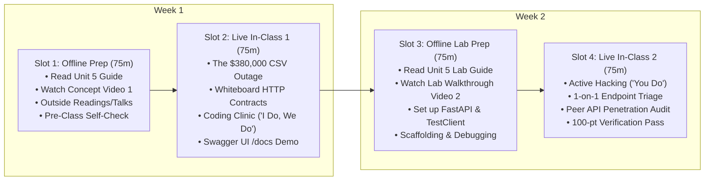

# Unit 5 Flipped Classroom Guide & Recording Scripts
## Data as a Service (DaaS) & The API Layer

> **Course**: COSC 2060 — Modern Data Engineering & AI Infrastructure  
> **Unit Duration**: 2 Weeks | 4 Slots @ 75 Minutes Each (Flipped Classroom Model)  
> **Prerequisites**: Units 1–4, Python 3.10+, Basic HTTP Concepts  
> **Core Toolchain**: FastAPI, Pydantic v2, Uvicorn, REST Architecture, TestClient

---

## 1. Executive Unit Summary & Competency Targets
In Units 1 through 4, we built specialized engines for relational tables, streaming anomalies, visual sensor images, and vector RAG text. But data trapped in `.parquet` or `.csv` files on a hard drive is useless to an enterprise. In Unit 5, students replace fragile file sharing with **Data as a Service (DaaS)**—unifying all four multimodal engines behind a high-performance, contract-guaranteed **FastAPI REST gateway**.

### Terminal Competencies
- **The Death of the CSV**: Explain the architectural liabilities of file-based data sharing versus contract-enforced, authenticated REST microservices.
- **RESTful Resource Modeling**: Design clean HTTP endpoints using standard verbs (`GET`, `POST`), path parameters, and query parameters.
- **Defensive Pydantic v2 Contracts**: Author strict input validation schemas (`gt`, `le`, regex patterns) that intercept malformed data and return HTTP `422 Unprocessable Entity` before code executes.
- **Multimodal Data Unification**: Combine tabular metrics, anomaly scores, vision bounding boxes, and vector search results into a single queryable microservice.
- **Automated API Testing**: Construct programmatic in-memory unit tests using FastAPI `TestClient` to verify HTTP `200`, `404`, and `422` behaviors.

---

## 2. The 4-Slot Instructional Schedule (75 Min Each)



---

### Slot 1: Offline Asynchronous Preparation (75 min)
Students complete these materials independently before the first live classroom meeting:

1. **Assigned Primary Reading** (35 min):
   - [Unit 5 Reading: Data as a Service (DaaS)](../../content/readings/unit_05_data_as_a_service.md)
2. **Curated Outside Readings** (20 min):
   - *Designing Robust Web APIs* by Stripe Engineering: Foundational principles of schema contracts, idempotency keys, and backward compatibility.
   - *FastAPI Documentation: Request Body & Field Validations* by Sebastián Ramírez ([fastapi.tiangolo.com](https://fastapi.tiangolo.com/tutorial/body-fields/)).
   - *Pydantic v2 Architecture: Rust-Powered Validation* by Samuel Colvin: How Pydantic v2 achieved a 10x speedup through Rust core serialization.
3. **Curated Outside Video** (10 min):
   - *Modern APIs with FastAPI and Python* (Sebastián Ramírez, PyCon, 15 min clip): Watch for how type hints generate automatic Swagger documentation.
4. **Instructor Concept Video** (10 min):
   - Watch **Instructor Video 1** (Recorded using Script 1 below).
5. **Pre-Class Concept Self-Check** (3 Questions):
   - *Q1*: Why did a simple column rename from `truck_id` to `vehicle_vin` in a CSV file cause a 4-hour production outage?
   - *Q2*: What is the HTTP status code difference between `404 Not Found` and `422 Unprocessable Entity`?
   - *Q3*: Why must heavy synchronous computations (like training an Isolation Forest) NOT be placed inside an `async def` FastAPI endpoint?

---

### Slot 2: Live In-Class Session 1 (75 min)
- **00:00 – 00:15 | Incident Retrospective: The $380,000 Monday Morning Outage**:
  - Open with the Midwest Logistics dashboard crash. Ask students: *"Why did sharing CSV files over a shared network drive fail the moment a data engineer cleaned up missing values?"*
- **00:15 – 00:35 | Whiteboard Sparring: The Pydantic Firewall**:
  - Draw the HTTP request boundary on the board:
    - Raw JSON Payload $\to$ Pydantic Input Validator $\to$ Internal Engine $\to$ Pydantic Output Model.
  - Demonstrate how Pydantic protects backend code from `KeyError` and `TypeError`.
- **00:35 – 01:05 | Coding Clinic: "I Do, We Do" (DS-to-DE Transition Notebook)**:
  - **Presentation Deck**: [Unit 5 Coding Clinic Slides (.pptx)](../../content/slides/unit_05_coding_clinic.pptx)
  - **Interactive Companion**: Open [Unit 5 Transition Notebook: `unit_05_ds_to_engine.ipynb`](../../content/notebooks/unit_05_ds_to_engine.ipynb)
  - **"I Do" (15m)**: Inspect Dr. Leo Chen's freight pricing prototype loading a static pickled DataFrame with an unvalidated Python function. Inject negative miles and string weights to observe silent corruptions and unhandled crashes.
  - **"We Do" (15m)**: Live code-along refactoring into an asynchronous **FastAPI** service with strict **Pydantic v2** `Field(gt=0)` validation. Use `TestClient` to verify sub-3ms responses on valid inputs and automatic HTTP 422 protection against bad data!
- **01:05 – 01:15 | Exit Ticket & Slot 3 Roadmap**:
  - Confirm students have `fastapi` and `httpx` installed in Python 3.11. Preview Slot 3 lab challenges.

---

### Slot 3: Offline Asynchronous Lab Prep (75 min)
Students complete pre-lab tasks before entering the live hack session:

1. **Assigned Lab Reading** (25 min):
   - [Unit 5 Lab Guide: Logistics Unified Data Service Lab](../../content/labs/unit_05_logistics_api_lab.md)
2. **Instructor Lab Walkthrough Video** (15 min):
   - Watch **Instructor Video 2** (Recorded using Script 2 below).
3. **Local Setup & Challenge 1 Scaffolding** (35 min):
   - Implement the Pydantic request and response models in `lab5_starter.py`.
   - Write a standalone test creating a valid `FuelEvaluationRequest` and an invalid request (e.g. negative gallons) to verify that Pydantic raises a `ValidationError`.

---

### Slot 4: Live In-Class Session 2 (75 min)
- **00:00 – 00:10 | Objective & Rubric Review**:
  - Review the 100-point rubric. Emphasize that zero unhandled `500 Internal Server Errors` are allowed—all client errors must be cleanly caught as `404` or `422`.
- **00:10 – 00:55 | Autonomous Applied Hacking ("You Do")**:
  - Students implement Challenges 2, 3, and 4 in `lab5_starter.py`.
  - Instructor provides roaming support on route parameters and `TestClient` assertions.
- **00:55 – 01:10 | Peer API Penetration Audit**:
  - Students swap laptops and attempt to crash each other's API endpoints using malicious or malformed JSON payloads. If the API returns `500`, the author loses 5 points!
- **01:10 – 01:15 | Automated Verification Pass & Unit 6 Teaser**:
  - Verification checkoff. Preview Unit 6: Connecting these REST endpoints to autonomous AI agents via the Model Context Protocol (MCP).

---

## 3. Instructor Recording Script 1: Concept Introduction
> **Target Video Runtime**: ~11 Minutes  
> **Format**: Video Lecture / Screen Capture with Slide Prompts  
> **Intended Audience**: College Sophomores in Week 9

```text
[00:00 - 00:45] HOOK & TITLE CARD
[CAMERA ON INSTRUCTOR]
"Welcome to Unit 5 of COSC 2060. 

Over the last eight weeks, you built four powerhouse data engines: DuckDB for relational matrices, Polars for 1M-row anomalies, OpenCV for tire inspection photos, and Sentence-Transformers for mechanic RAG logs. 

Now, ask yourself this: How does a dispatch manager in Chicago actually use any of this? 
Do you expect them to open a terminal and run your Python scripts? 
Do you email them a CSV file every morning? 

If your answer is 'Yes, I'll email a CSV,' you are walking directly into the single most expensive mistake in enterprise software. Let's talk about the $380,000 Monday morning outage."

[00:45 - 02:45] THE $380,000 CSV OUTAGE NARRATIVE
[SLIDE: Graphic showing 1,200 Idle Commercial Trucks / Dispatch Dashboard Crash]
[CAMERA INSET BOTTOM-RIGHT]
"Midwest Logistics ran a live dispatch dashboard used by 120 dispatchers to manage 1,200 commercial trucks. Every morning at 6:00 AM, an automated script exported delivery delay predictions to a shared drive:
`\\corp-shares\analytics\delay_predictions.csv`

At 7:45 AM, the frontend dashboard ingested this file. 

On Friday afternoon, a well-meaning junior engineer decided to clean up the code. They made three changes:
1. Renamed `truck_id` to `vehicle_vin`.
2. Encoded missing weather data as the string `'N/A'` instead of empty nulls.
3. Added un-hashed driver cell phone numbers for convenience.

Because CSV files have no contracts, no data types, and no schema enforcement, the export script succeeded with zero errors. 

On Monday morning at 8:00 AM, 120 dispatchers logged on. The dashboard backend crashed immediately:
`KeyError: 'truck_id' not found in DataFrame`

The backend restarted, crashed again, and entered a crash loop. Dispatchers couldn't see route assignments. 
For four hours, 1,200 trucks sat idle at loading docks across four states. The firm incurred $380,000 in contractual late-delivery penalties. 

Why? Because file-based data sharing is fundamentally broken."

[02:45 - 05:30] DATA AS A SERVICE (DaaS) & REST APIS
[SLIDE: Comparison Table - Static File Sharing vs. Data as a Service REST APIs]
"In modern data engineering, we replace file sharing with **Data as a Service (DaaS)**. 

Instead of dumping files on a hard drive, we wrap our data engines behind a REST API. 

What is an API? It is an explicit, programmatic contract between two systems:
1. A client sends an HTTP request:
   `GET /v1/features/TRUCK-219`
2. The server authenticates the client, checks permissions, retrieves the data from DuckDB or Polars, and returns a verified JSON payload:
   `200 OK: {"truck_id": "TRUCK-219", "avg_speed": 52.1}`

Why is this a million times better?
First, **Data Freshness**: It's live, not a stale daily dump.
Second, **Granular Access**: The client only downloads the 1KB record they need, not a 500MB file.
Third, **Security**: We can enforce API keys and encrypt data in transit.
And fourth, **Schema Contracts**: Breaking changes are intercepted before they ever reach production."

[05:30 - 08:00] THE PYDANTIC V2 FIREWALL
[SLIDE: Diagram - Pydantic Input and Output Validation Boundary]
"To enforce our contracts, we use **FastAPI** and **Pydantic v2**. 

Think of Pydantic as a strict security guard standing at the door of your API.
When a client sends data to our `/v1/anomalies/fuel-check` endpoint, we don't accept a raw dictionary. We define a Pydantic model:

```python
class FuelEvaluationRequest(BaseModel):
    truck_id: str = Field(..., pattern=r"^TRUCK-\d{3}$")
    gallons_pumped: float = Field(..., gt=0.0, le=350.0)
```

Look at those constraints:
- `pattern=r'^TRUCK-\d{3}$'`: If a client sends `'TRUCK-219'`, it passes. If someone sends an injection attack like `'TRUCK-219; DROP TABLE'`, Pydantic rejects it!
- `gt=0.0, le=350.0`: A truck cannot pump negative gallons, and commercial fuel tanks cannot hold more than 350 gallons.

If a client sends `-50 gallons`, FastAPI doesn't execute your code. It doesn't crash with a `500 Internal Server Error`. 
It instantly returns:
`422 Unprocessable Entity: 'gallons_pumped must be greater than 0.0'`
Your backend is mathematically insulated from corrupt data."

[08:00 - 11:00] THE MULTIMODAL UNIFIER & OFFLINE PREP
[SCREEN SHARE: Visualizing FastAPI Swagger UI at '/docs']
"In this unit, FastAPI acts as our **Great Unification Layer**:
- Endpoint 1 serves our Unit 1 DuckDB feature matrices.
- Endpoint 2 serves our Unit 2 Polars anomaly scores.
- Endpoint 3 serves our Unit 3 OpenCV vision bounding boxes.
- Endpoint 4 serves our Unit 4 Sentence-Transformer RAG search.

All four modalities unified into a single microservice with self-documenting Swagger UI at `/docs`.

Before our live session in Slot 2:
1. Read the Unit 5 Reading Guide.
2. Review the Stripe API design guide in our outside reading list.
3. Answer the three self-check questions.

In class, we will boot our first FastAPI server and test our endpoints live. Let's build production data services."
```

---

## 4. Instructor Recording Script 2: Lab Walkthrough
> **Target Video Runtime**: ~12 Minutes  
> **Format**: Hands-On Code Walkthrough & Screen Capture  
> **Intended Audience**: College Sophomores preparing for Slot 4 Live Lab

```text
[00:00 - 01:30] LAB OVERVIEW & STARTER CODE TOUR
[SCREEN SHARE: VS Code open to 'unit_05_logistics_api_lab.md' and terminal]
[CAMERA INSET BOTTOM-RIGHT]
"Hey everyone, welcome to the Unit 5 Lab Walkthrough. 

In this video, I'm going to walk you through `lab5_starter.py`, show you how we enforce Pydantic v2 data contracts, build our multimodal endpoints, and test our entire API in memory using `TestClient` without having to start an external server.

Let's look at the starter script."

[01:30 - 04:30] CHALLENGE 1 & 2: CONTRACTS & CORE ENDPOINTS
[SCREEN SHARE: VS Code highlighting Pydantic classes and routes]
"In Challenge 1, we define our Pydantic contracts:
`FuelEvaluationRequest`, `FuelEvaluationResponse`, and `FeatureMatrixResponse`.

Notice `response_model=FeatureMatrixResponse` on our route:
```python
@app.get('/v1/features/{truck_id}', response_model=FeatureMatrixResponse)
def get_truck_features(truck_id: str):
    if truck_id not in FEATURE_STORE:
        raise HTTPException(
            status_code=status.HTTP_404_NOT_FOUND,
            detail=f'Truck {truck_id} not found in feature store.'
        )
    return FEATURE_STORE[truck_id]
```

Why is `response_model` critical?
1. It guarantees that our output strictly matches the contract.
2. It filters out any internal dictionary keys you don't want the client to see.
3. If `truck_id` does not exist, we raise a proper `HTTPException(status_code=404)`. 
Never return a 200 with `{'error': 'not found'}`! That is a REST anti-pattern."

[04:30 - 07:30] CHALLENGE 3: MULTIMODAL VISION & RAG ENDPOINTS
[SCREEN SHARE: VS Code highlighting vision and RAG endpoints]
"In Challenge 3, we add our vision and RAG endpoints.

Look at `/v1/vision/manifest/{truck_id}`:
It queries our Unit 3 OpenCV store and returns the detected bounding boxes and labels:
`[{'label': 'sidewall_crack', 'confidence': 0.89}]`.

Now look at `/v1/maintenance/search`:
It takes a `RAGSearchRequest` containing a query string and an optional `truck_id_filter`. 
It executes our vector similarity search and returns a list of `RAGSearchResult` models.

Notice that our API is now a one-stop shop: any downstream client or AI agent can query tabular metrics, anomaly scores, vision defects, or maintenance notes from a single base URL."

[07:30 - 09:45] CHALLENGE 4: AUTOMATED TESTING WITH TESTCLIENT
[SCREEN SHARE: Terminal running 'python courses/cosc-2060-data-engineering/content/labs/lab5_starter.py']
"In Challenge 4, we write our automated verification suite using FastAPI's `TestClient`.

Watch how easy this is:
```python
client = TestClient(app)
res = client.get('/v1/features/TRUCK-219')
assert res.status_code == 200
```
`TestClient` uses `httpx` to simulate full HTTP requests directly in memory. You don't need to open port 8000 or deal with firewall permissions.

Now look at line 170:
```python
# Malformed Request (Negative gallons):
invalid_tx = {'transaction_id': 'TX-01', 'truck_id': 'TRUCK-219', 'gallons_pumped': -50.0, ...}
res_invalid = client.post('/v1/anomalies/fuel-check', json=invalid_tx)
assert res_invalid.status_code == 422
```
Look at that assertion: `assert res_invalid.status_code == 422`. 
We verify that our Pydantic guardrail stopped the bad payload dead in its tracks.

Let's run it in terminal:
`python courses/cosc-2060-data-engineering/content/labs/lab5_starter.py`
`[PASS] Test 1: Health check passed.`
`[PASS] Test 2: Feature retrieval and 404 handling passed.`
`[PASS] Test 3: Anomaly scoring and Pydantic 422 validation passed.`
`[PASS] Test 4: Multimodal vision and RAG endpoints passed.`
`[SUCCESS] All Unit 5 Lab challenges verified successfully!`"

[09:45 - 12:00] WRAP-UP & PREVIEW FOR SLOT 4
[CAMERA ON INSTRUCTOR]
"Here is your checklist before Slot 4:
1. Verify `fastapi` is installed in your Python environment.
2. Complete Challenges 1 and 2 in `lab5_starter.py`.
3. Try querying your endpoints using `TestClient`.

In Slot 4, we will run our live peer penetration test. You will try to crash your classmate's API, and they will try to crash yours. If your Pydantic contracts hold firm, you get full credit.

See you in class."
```
