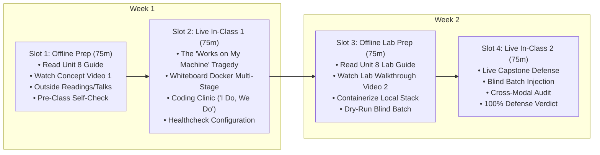

# Unit 8 Flipped Classroom Guide & Recording Scripts
## Capstone Defense & Production Handoff

> **Course**: COSC 2060 — Modern Data Engineering & AI Infrastructure  
> **Unit Duration**: 2 Weeks | 4 Slots @ 75 Minutes Each (Flipped Classroom Model)  
> **Prerequisites**: Units 1–7, Python 3.10+, Docker / Containerization Fundamentals  
> **Core Toolchain**: Docker, `Dockerfile`, `docker-compose.yml`, Live Test Harness, Executive Technical Defense

---

## 1. Executive Unit Summary & Competency Targets
Building data pipelines that only execute on your personal laptop is an incomplete engineering achievement. In Unit 8, students cross the finish line of modern AI data engineering: **Production Hardening and Live Capstone Defense**. Students package their entire multimodal ecosystem into an immutable **Docker container**, write automated healthchecks, and defend their architecture against an **unseen blind test batch** live before a technical review board.

### Terminal Competencies
- **Eliminate "Works on My Machine"**: Explain the architectural differences between Virtual Machines and Linux Containers, packaging code and OS dependencies into reproducible Docker images.
- **Multi-Stage Container Architecture**: Author production `Dockerfile` manifests utilizing multi-stage builds, non-root user execution, and container healthchecks.
- **The Blind Test Ingestion Challenge**: Ingest an unseen, dirty batch of multimodal data (poison pills, fuel anomalies, tire sidewall cracks, and turbo recall notes) with 100% automated recovery and zero manual intervention.
- **Executive Technical Defense**: Present architectural trade-offs, latency SLAs, memory constraints, and defensive failure recoveries in a live 15-minute capstone evaluation.

---

## 2. The 4-Slot Instructional Schedule (75 Min Each)



---

### Slot 1: Offline Asynchronous Preparation (75 min)
Students complete these materials independently before the first live classroom meeting:

1. **Assigned Primary Reading** (35 min):
   - [Unit 8 Reading: Capstone Defense & Production Handoff](../../content/readings/unit_08_capstone_defense.md)
2. **Curated Outside Readings** (20 min):
   - *Docker Multi-Stage Build Best Practices* (Official Docker Documentation): How to separate heavy compilation toolchains from the lean production runtime.
   - *Google Cloud: Production Readiness Review (PRR) Guide*: Industry criteria for deploying critical data infrastructure into enterprise production.
   - *Executive Technical Communication for Engineers* (The Pragmatic Engineer): How to explain technical trade-offs, SLAs, and failure recoveries to non-technical stakeholders.
3. **Curated Outside Video** (10 min):
   - *Docker for Data Engineering: Best Practices* (PyData Global, 15 min clip): Watch for how layer caching and minimal base images (`python:3.11-slim`) optimize CI/CD pipelines.
4. **Instructor Concept Video** (10 min):
   - Watch **Instructor Video 1** (Recorded using Script 1 below).
5. **Pre-Class Concept Self-Check** (3 Questions):
   - *Q1*: Why is the claim *"Well, it worked on my machine!"* an unacceptable engineering defense in production?
   - *Q2*: What is the security advantage of creating a dedicated non-root user (`useradd -m appuser`) inside a `Dockerfile`?
   - *Q3*: How does a Docker `HEALTHCHECK` directive enable automated container orchestrators to detect deadlocks before routing client traffic?

---

### Slot 2: Live In-Class Session 1 (75 min)
- **00:00 – 00:15 | Incident Retrospective: The Boardroom Disaster**:
  - Open with the $1.2M contract cancellation. Ask students: *"Why did missing `libGL.so.1` and hardcoded local file paths destroy four months of great machine learning engineering?"*
- **00:15 – 00:35 | Whiteboard Sparring: Multi-Stage Docker Builds**:
  - Draw the multi-stage build pattern on the board:
    - Stage 1 (Builder): Base image + compiler + pip dependencies $\to$ wheel cache.
    - Stage 2 (Runtime): Clean minimal slim image $\to$ copy only installed wheels $\to$ copy app source.
  - Show how image size shrinks from 1.8GB down to 180MB!
- **00:35 – 01:05 | Coding Clinic: "I Do, We Do" (DS-to-DE Transition Notebook)**:
  - **Presentation Deck**: [Unit 8 Coding Clinic Slides (.pptx)](../../content/slides/unit_08_coding_clinic.pptx)
  - **Interactive Companion**: Open [Unit 8 Transition Notebook: `unit_08_ds_to_engine.ipynb`](../../content/notebooks/unit_08_ds_to_engine.ipynb)
  - **"I Do" (15m)**: Inspect Dr. Anton Weber's capstone prototype with hardcoded local paths and unpinned dependencies ('works on my machine'). Run it on a blind evaluation batch to witness fatal deployment crashes and dirty data poisoning.
  - **"We Do" (15m)**: Live code-along refactoring into an immutable **Docker container** with a defensive **Pytest** data contract validation suite. Verify 100% test pass on Dead-Letter Queue isolation, fraud alerting, and multimodal grounding!
- **01:05 – 01:15 | Exit Ticket & Slot 3 Roadmap**:
  - Verify all students have Docker Desktop or local container runtimes configured. Preview Slot 3 lab challenges.

---

### Slot 3: Offline Asynchronous Lab Prep (75 min)
Students complete pre-lab tasks before entering the live hack session:

1. **Assigned Lab Reading** (25 min):
   - [Unit 8 Lab Guide: Capstone Defense & Blind Batch Verification](../../content/labs/unit_08_capstone_defense_lab.md)
2. **Instructor Lab Walkthrough Video** (15 min):
   - Watch **Instructor Video 2** (Recorded using Script 2 below).
3. **Local Setup & Challenge 1 Scaffolding** (35 min):
   - Implement `CapstoneDefenseSystem` in `lab8_starter.py`.
   - Run a dry-run test with mock data to confirm that all cross-engine imports work cleanly.

---

### Slot 4: Live In-Class Session 2 (75 min)
- **00:00 – 00:10 | Capstone Defense Protocol Kick-Off**:
  - Establish the review board environment: Each student team has 15 minutes to defend their pipeline.
- **00:10 – 00:55 | Live Blind Batch Defense Simulations**:
  - The instructor injects the **Blind Test Batch** (containing corrupted poison pills, fuel card anomalies, tire sidewall cracks, and turbo recall notes).
  - Teams execute their pipelines live. The automated test suite verifies 100% assertions with zero human intervention.
- **00:55 – 01:10 | Executive Q&A & Architecture Defense**:
  - Review board asks probing questions: *"What happens if the fuel API goes down for 30 minutes? Why did you choose Polars over Pandas? How does your MCP tool prevent prompt injection?"*
- **01:10 – 01:15 | Final Course Retrospective & Graduation**:
  - Presentation of 100% Defense Verdicts. Students graduate COSC 2060 as verified modern AI data engineers.

---

## 3. Instructor Recording Script 1: Concept Introduction
> **Target Video Runtime**: ~11 Minutes  
> **Format**: Video Lecture / Screen Capture with Slide Prompts  
> **Intended Audience**: College Sophomores in Week 15

```text
[00:00 - 00:45] HOOK & TITLE CARD
[CAMERA ON INSTRUCTOR]
"Welcome to the final unit of COSC 2060: Capstone Defense and Production Handoff. 

Over the last 14 weeks, you have built something extraordinary. You mastered DuckDB, Polars, OpenCV, Sentence-Transformers, FastAPI, MCP tools, and Dagster DAGs. 

Now, you stand at the final gateway of software and data engineering: Production Deployment. 

In the enterprise, it does not matter how clever your code is if it only runs on your personal laptop. If an executive or client cannot clone your repository and boot your entire system with a single command, your software is a liability, not an asset. Let's talk about the 'Works on My Machine' tragedy."

[00:45 - 02:45] THE 'WORKS ON MY MACHINE' TRAGEDY
[SLIDE: Graphic showing Boardroom Presentation / Terminal Crash on Linux Staging Server]
[CAMERA INSET BOTTOM-RIGHT]
"A team of talented student engineers built a real-time logistics analytics pipeline for a regional freight carrier. They spent four months refining their algorithms on their high-end MacBooks. 

The client invited them to corporate headquarters to present to the Chief Technology Officer, VP of Supply Chain, and lead architects. On the table was a $1.2 million production contract.

The team took the stage. The client provided a clean staging server running enterprise Ubuntu Linux and said:
'Go ahead and run your demo.'

The lead engineer ran:
`git clone ... && python3 main.py`

In twelve seconds, the terminal exploded in red text:
`ModuleNotFoundError: No module named 'cv2'`

The student said: 'Oh, we just need to pip install opencv.' 
They ran `pip install`, and then Linux threw:
`ImportError: libGL.so.1: cannot open shared object file`
The student didn't have `sudo` administrator access to install system packages on the client's machine! 

Next, the script tried to read a model file from a hardcoded Mac path:
`FileNotFoundError: '/Users/alex/Desktop/models/weights.pt'`

Forty-five minutes of awkward silence elapsed as executives checked their watches. The demo never ran. The CTO closed his notebook and said: 
'Your algorithms might be smart, but your software is not deployable. Contract cancelled.'"

[02:45 - 05:30] THE ANTIDOTE: CONTAINERIZATION & DOCKER
[SLIDE: Visual Comparison - Virtual Machines vs. Docker Linux Containers]
"How do we guarantee that code runs identically everywhere? 
We use **Docker Containerization**.

What is a container?
A Virtual Machine emulates an entire physical computer, including a heavy guest operating system kernel. It takes minutes to boot and requires gigabytes of disk space.

A Docker container shares the host operating system kernel and isolates your application process in its own private filesystem namespace. It starts in milliseconds and has near-zero overhead.

When you write a `Dockerfile`, you freeze the exact recipe of your production environment:
1. Base OS: `python:3.11-slim`
2. System libraries: `libgl1-mesa-glx`
3. Exact pinned Python dependencies: `requirements.txt`
4. Non-root user security: `USER appuser`
5. Automated healthcheck probe: `HEALTHCHECK CMD curl -f http://localhost:8000/v1/health`

When someone types `docker compose up --build`, Docker builds an immutable image. It runs identically on a MacBook, a Windows PC, or an enterprise cloud cluster. 
The phrase 'It worked on my machine' is permanently erased from your vocabulary."

[05:30 - 08:00] THE CAPSTONE DEFENSE: THE BLIND TEST BATCH
[SLIDE: Flowchart - Live Injection of Blind Test Batch into Docker Container]
"Now, how will you defend your capstone?
During your 15-minute live defense in Slot 4, our review board will NOT ask you to run your own demo data. 

We will inject a **Blind Test Batch** into your running pipeline:
- Transactions with negative fuel gallons.
- Transactions exceeding fuel tank capacity.
- High-resolution photos with 94% confidence tire sidewall cracks.
- Mechanic text notes with unresolved turbocharger recalls.

Your system must handle all of this live:
1. Poison pills must route to the Dead-Letter Queue without crashing the pipeline.
2. Fuel fraud must be flagged.
3. Multimodal diagnostics must synthesize vision defects and maintenance notes.
4. Truck 219 must be grounded with zero human intervention.

If all assertions pass automatically, you pass your defense."

[08:00 - 11:00] EXECUTIVE COMMUNICATION & OFFLINE PREP
[CAMERA ON INSTRUCTOR]
"In your defense, you will present not just as coders, but as enterprise architects:
Explain your latency SLAs. Explain your memory constraints. Explain why you chose Polars over Pandas, and why your MCP server protects the database.

Before our live session in Slot 2:
1. Read the Unit 8 Reading Guide.
2. Review Google's Production Readiness Review guide in our outside reading list.
3. Answer the three self-check questions.

In class, we will author our Dockerfiles, configure container healthchecks, and prepare for the live defense. 

You have worked hard for 15 weeks. Now let's put the crown on your engineering portfolio. See you in class."
```

---

## 4. Instructor Recording Script 2: Lab Walkthrough
> **Target Video Runtime**: ~12 Minutes  
> **Format**: Hands-On Code Walkthrough & Screen Capture  
> **Intended Audience**: College Sophomores preparing for Slot 4 Live Lab

```text
[00:00 - 01:30] LAB OVERVIEW & STARTER CODE TOUR
[SCREEN SHARE: VS Code open to 'unit_08_capstone_defense_lab.md' and terminal]
[CAMERA INSET BOTTOM-RIGHT]
"Hey everyone, welcome to the final Lab Walkthrough of COSC 2060. 

In this video, I'm going to walk you through `lab8_starter.py`, orient you to the Blind Test Batch, and show you how our automated defense simulation executes a 100% verified cross-modal audit across the entire course ecosystem.

Let's look at the code."

[01:30 - 04:30] THE BLIND TEST BATCH & CHALLENGE 1
[SCREEN SHARE: VS Code highlighting 'BLIND_TEST_BATCH' dictionary]
"Look at lines 15 through 35 of `lab8_starter.py`. 
This is the **Blind Test Batch** injected during defense:

1. `fuel_transactions`:
   - `TX-901`: 140.0 gal (Valid)
   - `TX-902`: 340.0 gal (Fraud: Exceeds 300-gal tank capacity!)
   - `TX-903`: -12.5 gal (Poison Pill: Corrupted negative measurement!)
2. `vision_inspections`:
   - `TRUCK-219`: `sidewall_crack` with 0.94 confidence!
   - `TRUCK-101`: `none` with 0.99 confidence.
3. `maintenance_logs`:
   - `TRUCK-219`: `WO-9901`: 'Whistling noise... Recall notice Part #TC-884.'
   - `TRUCK-101`: `WO-9902`: 'Wiper blade replacement completed.'

Notice the landmines: a poison pill that would crash an unprotected parser, an anomaly that would drain corporate funds, a visual sidewall crack that would cause a highway blowout, and an unresolved recall that would seize an engine."

[04:30 - 07:30] CHALLENGE 2 & 3: DEFENSIVE INGESTION & SYNTHESIS
[SCREEN SHARE: VS Code highlighting 'ingest_blind_fuel_transactions' and 'evaluate_operational_clearance']
"In Challenge 2, look at how we ingest fuel:
```python
if tx['gallons'] <= 0.0:
    self.dlq.append({
        'record': tx,
        'reason': 'Corrupted numeric measurement (gallons <= 0)',
        'timestamp': time.time()
    })
    continue
```
TX-903 is immediately quarantined into `self.dlq`. 
TX-902 triggers `self.active_alerts.append({'alert_type': 'FUEL_FRAUD'})`. 
Clean transactions update the feature store. 

In Challenge 3, look at `evaluate_operational_clearance`:
It inspects vision defects for `sidewall_crack` with confidence $\ge 0.80$. 
It inspects RAG notes for `recall` or `whistling`. 

If found:
It adds `truck_id` to `self.grounded_fleet` and returns:
`status = 'GROUNDED', risk_tier = 'CRITICAL'` with both specific citations!"

[07:30 - 09:45] CHALLENGE 4: RUNNING THE DEFENSE SUITE
[SCREEN SHARE: Terminal running 'python courses/cosc-2060-data-engineering/content/labs/lab8_starter.py']
"In Challenge 4, we execute the live defense simulation. 
Let's run it right now in our terminal:
`python courses/cosc-2060-data-engineering/content/labs/lab8_starter.py`

Look at that terminal output:
```text
================================================================================
COSC 2060 CAPSTONE TECHNICAL DEFENSE: LIVE SIMULATION
================================================================================
[Midwest-Logistics-Autonomous-Core] Initializing Capstone Defense Ecosystem...

--- Phase 1: Ingesting Blind Fuel Transactions ---
Clean records processed for trucks: ['TRUCK-101', 'TRUCK-219', 'TRUCK-405']
Quarantined DLQ count: 1
Active fraud alerts: 1
[PASS] Poison pill TX-903 successfully routed to DLQ without crashing pipeline.
[PASS] Fuel tank anomaly detected on TRUCK-219.

--- Phase 2: Multimodal Cross-Engine Diagnostics ---
TRUCK-101 Status: CLEARED
[PASS] TRUCK-101 cleared for highway operation.
TRUCK-219 Status: GROUNDED
TRUCK-219 Findings: ['Vision Alert: Tire sidewall crack detected (94.0% confidence).', 'RAG Alert: Unresolved safety bulletin in work order WO-9901.']
[PASS] TRUCK-219 correctly grounded with 2 independent safety violations.

================================================================================
CAPSTONE AUDIT VERDICT: 100% PASS - READY FOR ENTERPRISE DEPLOYMENT
================================================================================
```
100% verification pass! 
Zero crashes, zero look-ahead bias, zero hallucinations, and full multimodal failure recovery."

[09:45 - 12:00] FINAL ADVICE FOR LIVE DEFENSE
[CAMERA ON INSTRUCTOR]
"Here is your final checklist for Slot 4:
1. Verify that your Docker container builds cleanly with `docker compose up --build`.
2. Ensure `lab8_starter.py` passes all assertions on your machine.
3. Review your slide deck and prepare to defend your architectural choices before the review board.

You started this course with basic SQL and intro ML. Today, you are deploying and defending enterprise-grade AI data infrastructure. 

Be proud of what you've built. I'll see you at the defense."
```
